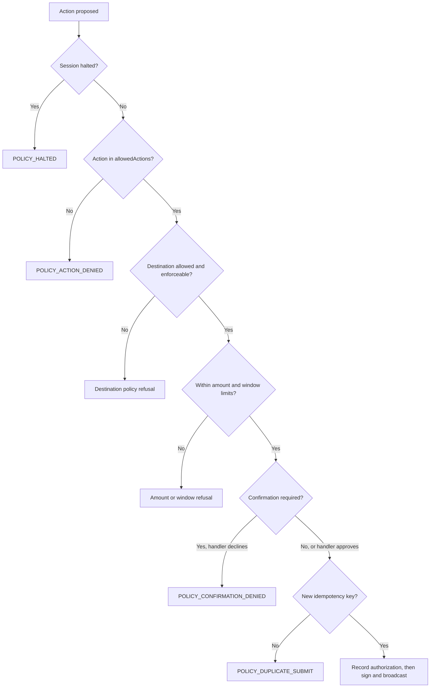
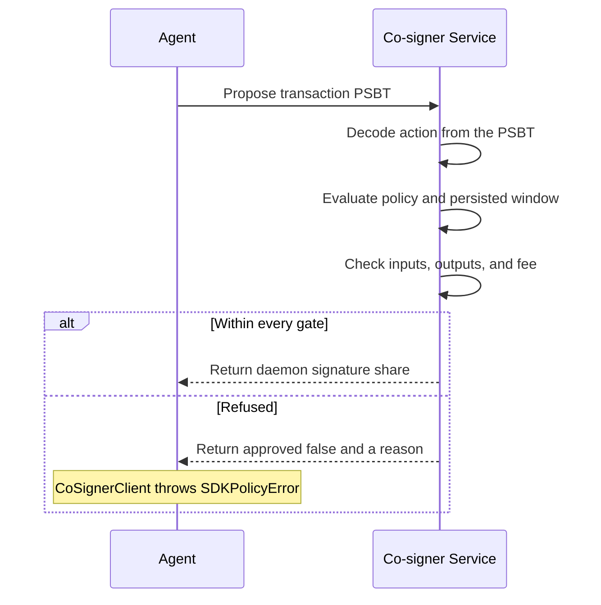

<!--
Copyright © 2025–2026 Dankest, LLC
SPDX-License-Identifier: AGPL-3.0-or-later
Licensed under the GNU Affero GPL v3.0 or later; see LICENSE.md.
A commercial license is available, contact legal@dankest.llc.
-->

# Giving an AI Agent a Wallet, Safely

If an AI agent is going to move real value, it should only be able to move the value you decided it can move: through the actions you chose, to the places you allow, and at a rate you set. The SDK's **agent session** provides those guardrails.

## The idea

A normal wallet session can do anything the key can do. An agent session wraps the same key with a policy that is checked before each submission is signed or broadcast:

```js
const sdk = new XChainSDK({ network: 'bitcoin-testnet' });

const agent = sdk.agentSession(wif, {
    // Nothing is allowed unless you list it.
    allowedActions: ['SEND'],

    // Where token SEND actions may go (optional; omit to allow any destination).
    allowedDestinations: ['tb1q...storefront', 'tb1q...treasury'],

    // The most a single action may move.
    maxPerAction: { SEND: { MYTOKEN: '100', '*': '10' } }, // '*' = any other token

    // The most the agent may move in total, per rolling window.
    maxPerWindow: { hours: 24, perTick: { MYTOKEN: '500' }, maxActions: 50 },

    // Above this, a human or supervising process must say yes.
    confirmAbove: {
        perTick: { '*': '50' },
        handler: async (ctx) => await askTheOperator(ctx),
        // ctx: action, tick, amount, destinations, address, windowUsage
    },

    // Observe policy denials raised through the session's denial path.
    onPolicyViolation: (v) => console.error('agent blocked:', v.code, v.message),

    // Override the default usage-state path (~/.xchain/agent-usage-<address>.json).
    // The file persists window and idempotency records across restarts.
    stateFile: '/var/lib/myapp/agent-usage.json',
});

await agent.send(
    { tick: 'MYTOKEN', amount: '5', destination: 'tb1q...storefront' },
    {},
    { idempotencyKey: 'store-order-1842' },
);
```

The idempotency key identifies one intended submission. Reuse the same key when retrying that submission. Use a new key only when you intend to make another payment. `AgentSession` refuses an unkeyed submission by default; `allowUnkeyedSubmits: true` is an explicit opt-out.

Every successful action's result carries `result.policy`, including what was checked and how much of the window is used. The agent can inspect its remaining budget instead of discovering limits by hitting them.

## What happens on a violation

The action is refused before signing or broadcast. Construction and submission failures use a typed `SDKPolicyError` whose `code` identifies the reason:

| Code | Meaning |
|------|---------|
| `POLICY_INVALID` | The policy is malformed, has no allowed actions, or has neither an enforceable hard cap nor `confirmAbove` without `allowUnbounded: true` |
| `POLICY_HALTED` | The session is paused, or its kill-switch file is present or unreadable |
| `POLICY_ACTION_DENIED` | Action type not in `allowedActions` |
| `POLICY_AMOUNT_INVALID` | Amount is not a canonical non-negative decimal |
| `POLICY_DESTINATION_DENIED` | Destination not in `allowedDestinations` |
| `POLICY_DESTINATION_UNENFORCEABLE` | The decoded action version has no destination field that `allowedDestinations` can constrain |
| `POLICY_UNRESOLVED_DESTINATION` | Destination is an address index reference (`^<id>`) that the allowlist cannot match |
| `POLICY_AMOUNT_EXCEEDED` | Single-action amount exceeds the per-action cap |
| `POLICY_WINDOW_AMOUNT_EXCEEDED` | Rolling-window token total would breach the cap |
| `POLICY_WINDOW_COUNT_EXCEEDED` | This action would exceed `maxActions` in the rolling window |
| `POLICY_CONFIRMATION_DENIED` | Amount is above the `confirmAbove` threshold and the handler returned false |
| `POLICY_UNBOUNDED_ACTION` | The action moves value that the configured amount cap cannot measure from the action alone |
| `POLICY_UNRESOLVED_TICK` | A token uses its `^<id>` wire form and the policy cannot bind its tick-scoped limits to a name |
| `POLICY_TICK_CASE_COLLISION` | A cap table names the same case-insensitive token more than once |
| `POLICY_IDEMPOTENCY_REQUIRED` | A stable `submitOpts.idempotencyKey` was not supplied |
| `POLICY_DUPLICATE_SUBMIT` | That idempotency key was already recorded; the error includes the earlier transaction id when known |
| `POLICY_STATE_CORRUPT` | The usage-state file is unreadable or structurally invalid |



Do not blindly retry a policy error. Change a denied request only when the operator's policy permits it. For `POLICY_DUPLICATE_SUBMIT`, resume tracking the original transaction instead of submitting again. Configuration, halt, and state-file errors require deliberate operator action.

## Designed to fail closed

- A missing or empty `allowedActions` list makes the session refuse to construct.
- A policy also needs at least one enforceable `maxPerAction` or `maxPerWindow.perTick` entry, or a `confirmAbove` object. Running with only an action allowlist requires the explicit `allowUnbounded: true` opt-in.
- Window usage and idempotency records persist to disk. Restarting or crash-looping the agent does not reset a spending window or immediately forget a submitted payment.
- The session records budget when it authorizes a submission, before the irreversible broadcast. A later failure can therefore consume budget even when no transaction id is returned. This conservative behavior prevents a lost acknowledgement from reopening the cap.
- If the usage file is corrupted, the session blocks instead of silently starting a fresh window. Inspect, repair, or remove it deliberately to recover.
- `pause()` stops the current session object. The default kill-switch file, `~/.xchain/agent-halt-<address>`, can halt a running session that the operator cannot call directly.
- Amount checks use exact decimal arithmetic. There is no floating-point edge to slip through.

## What this does: and does not: protect against

This is a guardrail around the **agent**, not around the **key**. It protects you from an agent that hallucinates an amount, gets prompt-injected into draining a wallet, or loops on a bad plan. It does not protect you from an attacker who steals the WIF itself; they can use the raw SDK without the policy.

Two practices close most of that gap:

1. **Fund the agent's address like a spending account, not a vault.** The window cap only has to be wrong by one top-up.
2. For hard enforcement on a SegWit network, use the **MuSig2 co-signer** described next. The agent holds one key, a policy service holds another, and neither can complete the ordinary spend path alone.

## Hard enforcement: the MuSig2 co-signer

The agent session is a guardrail inside the SDK; whoever holds the raw key can go around it. A MuSig2 account removes that path. In the plain 2-of-2 form, the spending address aggregates the agent key and a co-signer key. Before adding its signature share, the co-signer decodes the action from the PSBT, evaluates its own policy and persisted window, checks that the inputs belong to the configured account, restricts transaction outputs, and reconciles the miner fee. The agent combines both shares into one Taproot signature.

This path requires a network that supports SegWit and P2TR. The SDK refuses to derive it on networks, including Dogecoin networks, where a witness-v1 output would not be safe. The co-signer also fails closed on action formats it cannot decode. In particular, an action being present in `allowedActions` does not guarantee that every protocol version of that action is decodable or that an amount or destination cap can constrain it.



```js
const { coSigner } = require('@dankest-llc/xchain-sdk');

const transport = coSigner.httpTransport('http://127.0.0.1:8787/cosign', {
    token: coSignerToken,
});

const session = sdk.musig2AgentSession(agentWif, policy, {
    coSigner: {
        transport,
        publicKeys: [agentPublicKey, daemonPublicKey],
        // Optional: add a separately stored recovery public key.
        recovery: recoveryPublicKey,
    },
});
```

The co-signer service is built with `coSigner.CoSigner`. A Node daemon can expose it with `createCoSignerApp` from `@dankest-llc/xchain-sdk/src/cosigner/server.js`; that HTTP sidecar requires a bearer token unless the operator deliberately enables its development-only unauthenticated mode.

Co-signer refusals reach the agent as `SDKPolicyError`, but their codes are not limited to the `POLICY_*` values in the agent-session table. Decode failures, unauthorized outputs, fee checks, malformed requests, and a confirmation-required action at a headless daemon all withhold the signature and return their own refusal reasons. A standalone headless co-signer automatically signs requests that pass every configured gate. It denies `confirmAbove` requests by default because it cannot prompt a human.

One wrinkle to know about: the SDK can shrink on-chain payloads by writing an indexed token's tick as its numeric id (`^123` instead of `MYTOKEN`), and the co-signer judges the transaction exactly as it appears on chain. If your policy has tick-scoped limits, tell the co-signer which ids those tokens have with `tickIds: { MYTOKEN: 123 }`. An id the policy cannot resolve is refused rather than allowed to slip past a named cap.

`allowedDestinations` constrains destination fields in supported action formats. It is not an allowlist for arbitrary native-coin transaction outputs. The co-signer separately permits its OP_RETURN carrier, change back to the account, and outputs explicitly configured in its `allowedOutputs`; `maxFeeSats` can add an absolute miner-fee ceiling.

### Signing through XChain Wallet

XChain Wallet's dApp bridge is an interactive co-signer, not the unattended policy daemon described above. Every `coSign` request opens an approval prompt and requires the wallet password. The wallet decodes the PSBT and evaluates account policy as a safety check, but the human remains the final gate. An automated agent cannot use the wallet's `coSign` bridge method unattended.

The wallet's saved site permissions do not change that rule. For ordinary `signAction` requests, `never` is an immediate refusal, while both the default `ask` state and a saved `always` state still reach the signing approval flow. `canSignMessage: true` does not avoid the password prompt by itself. `signPsbt`, `signIn`, and `coSign` remain interactive.

The only shipped bridge prompt bypass is a separate developer feature for localhost. When Developer Mode and a positive localhost auto-sign timeout are both enabled, a successful real approval can cache the wallet password in the extension service worker's memory. Later `signMessage` and single `signAction` requests from localhost can reuse it until expiry without another prompt. The feature is off by default, applies only to loopback origins, does not survive a service-worker or browser restart, and still enforces site, chain, account, action-denial, and throttle checks. It does not apply to `coSign`.

### The 2-of-3 recovery account, and where that key must live

A 2-of-2 address has an obvious failure mode: lose either key or the co-signer host and the funds are stuck forever. `deriveMuSig2P2TR2of3` adds a third **recovery key** so any two of the three can move funds. Normal operation still runs agent plus co-signer through the policy-controlled key path. `buildRecoverySpend` is the operator escape hatch for when one party is lost.

That escape hatch is deliberate, and it comes with one hard operational rule:

**Never store the recovery key where the agent or the co-signer runs.** A recovery-path spend involves no policy check; that is its purpose. If the recovery key sits on the same machine as the agent key, a compromised agent holds two of the three keys and can drain the account without the policy service. Keep the recovery key cold, such as in a hardware wallet or on an offline machine, and treat any use of it as an incident to investigate, not a routine workflow.

## For MCP users

Without wallet configuration, `xchain-mcp` has no key material. Its query tools are read-only, and `compose_action` creates an unsigned PSBT for external signing.

The operator can add a WIF and policy outside the model conversation. That configuration adds `get_agent_wallet` and `submit_action`; every submission routes through an agent session. The MCP server rejects `confirmAbove` because there is no human in its loop, and it requires a binding `maxPerAction` or `maxPerWindow.perTick` amount cap. A request that passes the policy is signed and broadcast **without per-action user approval**. This is why the configured key should control only a deliberately funded spending account.

`submit_action` derives a stable idempotency key from the coin, action, and parameters unless the caller supplies one. An identical retry is refused as a duplicate and returns the earlier transaction id when available. There is no unpoliced MCP write path. See the [MCP Quickstart](mcp-quickstart.md).
