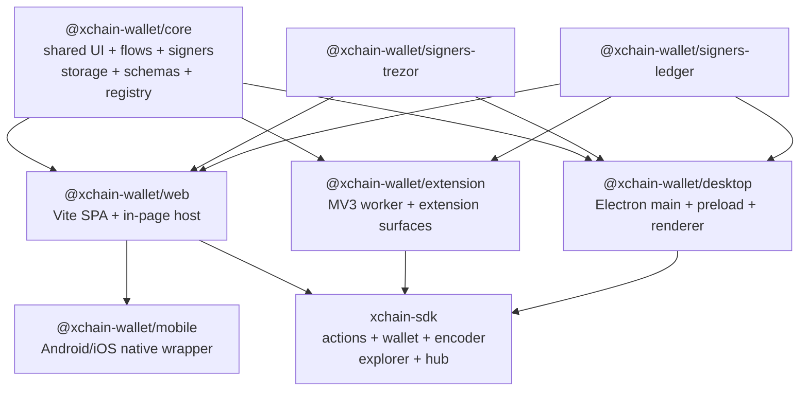
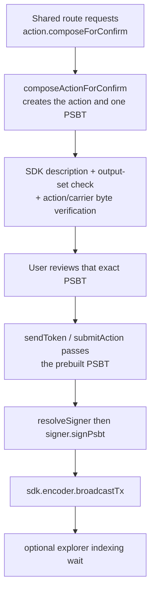

<!-- SPDX-License-Identifier: AGPL-3.0-or-later -->
<!-- Copyright © 2026 Dankest, LLC -->

# Wallet Architecture

This document describes how the wallet is organized at the package level, how the four shells relate to the shared core, and how state and messages flow through the system at runtime.

## Four shells, one core

The wallet is a pnpm workspace with four product targets and a shared `@xchain-wallet/core` package:

- `@xchain-wallet/web`: a Vite browser application
- `@xchain-wallet/extension`: a Chromium Manifest V3 extension
- `@xchain-wallet/desktop`: an Electron application for macOS, Windows, and Linux
- `@xchain-wallet/mobile`: Capacitor projects for Android and iOS that package the web build

The bundled chain registry contains Bitcoin, Litecoin, and Dogecoin descriptors for mainnet, testnet, and regtest. New wallets enable the three mainnet descriptors by default. Developer Mode can add validated custom descriptors, and the shells also attempt to apply a signed remote registry snapshot without replacing user-added descriptors.

```text
@xchain-wallet/core
├── src/ui/              reusable UI primitives
├── src/shared/          shared routes, components, hooks, and shell capability helpers
├── src/flows/           wallet, transaction, safety, market, and protocol workflows
├── src/signers/         Signer contract, pool, SoftwareSigner, and RemoteSigner
├── src/signerFactories/ shell-independent hardware pairing factories
├── src/sdk/             SDKRegistry, factory adapter, and signing submission pipeline
├── src/storage/         encrypted Vault, codec, and backend contract
├── src/schemas/         persisted record schemas and migrations
├── src/registry/        bundled, custom, and signed remote chain descriptors
├── src/decoder/         draft action descriptions and transaction simulation
├── src/uri/             BIP21, XChain URIs, and PSBT QR formats
├── src/crypto/          KDF, AEAD, seed, key, backup, and label-sync primitives
├── src/cosigner/        passive co-signer persistence adapters
├── src/notifications/   notification services and watchers
├── src/airdrop/         airdrop recipient parsing
├── src/market/          market and orderbook utilities
├── src/i18n/            English and pseudo-RTL message registries
├── src/branding/        product, chain, and hardware branding data
├── src/templates/       cross-chain composer templates
└── src/index.js         public package entry point
```

Each shell supplies its own storage, process, and device integration:

| Shell | Host and UI arrangement | Vault location | Unlock-session material |
|---|---|---|---|
| `@xchain-wallet/web` | Vite SPA with an in-page `hostBridge.js` and `MessageHost` | IndexedDB | Module memory only |
| `@xchain-wallet/extension` | Service-worker host, injected provider, content script, popup, side panel, and approval window | `chrome.storage.local` | Master key and signing password in separate `chrome.storage.session` slots, cleared by lock and browser-session teardown |
| `@xchain-wallet/desktop` | Electron main-process host, restricted preload bridge, and renderer | `vault.bin` under Electron `userData` | `session.bin`, encrypted with Electron `safeStorage` when a real OS keychain backend is available; otherwise process memory only |
| `@xchain-wallet/mobile` | Capacitor WebView running the web build, with native vault, biometric, clipboard, link, splash, and QR integrations | App-private native files, additionally encrypted under Android Keystore or iOS Keychain keys | Master key in WebView memory; an optional biometric sidecar stores a device-bound wrapped unlock secret |

The shells compose shared routes and components into separate shell-specific application roots. Web runs the host in the same JavaScript realm as the UI. The extension places the software-key host in its service worker, and desktop places it in Electron's main process. Mobile inherits the web host and SDK wiring, but replaces browser vault storage at boot.

`packages/web/src/storage/backends.js` selects `CapacitorStorageBackend` and `CapacitorMetaBackend` when the native `XChainVault` plugin is present. A native shell in which that plugin fails to register stops at a blocking vault-unavailable screen instead of falling back to IndexedDB. The native plugin stores the already encrypted core vault blob, KDF metadata, and pre-unlock guard state in separate native slots. Android disables application backup, and iOS excludes the vault directory from backup.

## Package boundaries



Sibling packages alongside the four product targets are:

- `@xchain-wallet/signers-trezor`: `TrezorSigner` and `trezorFormat.js`
- `@xchain-wallet/signers-ledger`: `LedgerSigner`, `ledgerFormat.js`, and Ledger app inspection
- `@xchain-wallet/bridge-spec`: TypeScript definitions, runtime validation, and client helpers for `window.xchain`
- `@xchain-wallet/test-dapp`: a reference bridge client

The core package does not construct `xchain-sdk` itself. Each directly hosted shell injects an SDK factory into `SDKRegistry`, which lazily creates and initializes a client per chain. Transaction construction, wallet utilities, explorer queries, hub calls, and node broadcasts use those SDK instances. Separately scoped wallet code performs such tasks as signed chain-registry refresh, price and metadata retrieval, and application update checks.

## Shell-to-core seams

The three directly hosted shells use the same main seams:

1. **SDK registry**: `core/src/sdk/SDKRegistry.js` receives a shell-supplied factory for per-chain `xchain-sdk` instances. Web and the extension resolve a bundled SDK factory during startup; desktop imports and adapts the SDK in the main process.
2. **Storage and bootstrap metadata**: the shell supplies a `StorageBackend` for the encrypted document and a separate store for the plaintext Argon2id parameters needed before the vault can open.
3. **Messaging host**: the shared handler surface is registered on a `MessageHost`. Web calls it in process, the extension sends messages to the service worker, and desktop invokes the main process through the preload bridge.
4. **Hardware transport**: WebHID and hosted Trezor Connect require a visible, user-gesture-capable renderer. Shell factories create the live device signer there, while background flows can reach it through the signer bridge and `RemoteSigner`.

Mobile does not define another JavaScript host. Its build script stages `@xchain-wallet/web` into the Capacitor project, and the web startup code installs native storage, KDF, biometric, lifecycle, screen-protection, clipboard, link, and QR adapters when the plugin is present.

## Signal flow

A shared route does not receive a `Vault`, `SDKRegistry`, or private seed. It calls a messaging-shaped API, and the shell host injects those dependencies into the selected core flow:

```text
shared React route, for example core/src/shared/routes/Send.jsx
        │
        ▼  messaging.composeForConfirm(...) / messaging.sendToken(...)
shell messaging adapter
        │
        ├── web: direct call to the in-page host
        ├── extension: chrome.runtime messaging to the service worker
        └── desktop: preload IPC to the Electron main process
        │
        ▼
MessageHost route in extension/src/background/createBackgroundHost.js
        │
        ▼  injects Vault + ChainRegistry + SDKRegistry + SignerPool
core flow and per-chain xchain-sdk instance
```

This is an architectural boundary in web, where the UI and host share one realm. It is also a process boundary in the extension and desktop shells. The extension transport permits untrusted web pages to call only the public `bridge.*` namespace; privileged wallet routes require a sender from the extension's own Chromium origin. Desktop exposes an allowlisted preload API rather than Electron primitives to the renderer.

Software signing runs inside the host context: the web page, extension service worker, or desktop main process. Hardware transports run in the web page, extension popup, or desktop renderer because WebHID and Trezor Connect need a visible browser context. The host passes PSBT signing requests through the signer bridge; it does not send software private keys to those renderers.

The signed-action path is a single-encode confirmation pipeline:



`submitWithSigner()` skips action creation and encoding when it receives the reviewed `prebuiltPsbt`, so the signer sees the same PSBT that passed the confirmation checks. Two-phase P2SH, P2WSH, and Taproot envelope paths add capability and completeness checks before an irreversible commit is broadcast.

## Vault and state model

`core/src/storage/codec.js` serializes one vault document and encrypts it with AES-256-GCM. The current document contains these collections:

| Collection | Schema | Purpose |
|---|---|---|
| `wallets` | `core/src/schemas/wallet.js` | Encrypted seeds, BIP39 passphrases, imported WIFs, KDF parameters, and embedded multisig configurations |
| `accounts` | `core/src/schemas/account.js` | BIP44 account groups and per-chain active-address overrides |
| `addresses` | `core/src/schemas/address.js` | Derived, imported, hardware, or watch-only addresses and signer linkage |
| `contacts` | `core/src/schemas/contact.js` | Multi-chain address-book entries |
| `connectedSites` | `core/src/schemas/connectedSite.js` | Per-origin dApp permissions and approval history |
| `pendingTxs` | `core/src/schemas/pendingTx.js` | Transaction lifecycle, replacement, and queued-broadcast state |
| `signers` | `core/src/schemas/signer.js` | Non-secret Trezor and Ledger pairing metadata |
| `pendingAirdrops` | `core/src/schemas/pendingAirdrop.js` | Resumable two-stage airdrops |
| `pendingDeploys` | `core/src/schemas/pendingDeploy.js` | Resumable multi-transaction contract deployments |
| `watchlistEntries` | `core/src/schemas/watchlistEntry.js` | Per-wallet market watchlists |
| `priceAlerts` | `core/src/schemas/priceAlert.js` | One-shot native-coin price alerts |
| `multisigSigningSessions` | `core/src/schemas/multisigSigningSession.js` | Interactive classical multisig and MuSig2 contribution state |
| `coSignerAccounts` | `core/src/schemas/coSignerAccount.js` | Passive MuSig2 co-signer policies and spending-window state |
| `gatedKeys` | `core/src/schemas/gatedKey.js` | Secret keys for token-gated content packs |
| `autopayOrders` | `core/src/schemas/autopayOrder.js` | CoinPay consent, caps, and completed-payment ledgers |
| `autopayLeases` | `core/src/schemas/autopayLease.js` | Single-active-payer arbitration within one vault |
| `settings` | `core/src/schemas/settings.js` | Sparse user preferences, active network, custom chains, fees, endpoints, safety, privacy, notifications, and display options |

Vault unlock derives a 32-byte master key from the password and the external `kdfParams` record, then authenticates and decrypts the document. Fresh vault metadata uses Argon2id with a new salt and defaults of 64 MiB, 3 iterations, and parallelism 1. Load-time validation also imposes maximum costs so imported parameters cannot request unbounded CPU or memory. Wallet seed records have their own KDF parameters and encrypted payloads inside the vault; the wallet created or imported during onboarding uses the same password and parameters as the vault, so its seed key equals the vault master key. Mobile can use a native Argon2id implementation only after it passes a known-answer check; failure falls back to the JavaScript implementation.

| Logical material | Web | Extension | Desktop | Mobile |
|---|---|---|---|---|
| Encrypted vault document | IndexedDB | `chrome.storage.local` | `userData/vault.bin` | Native app-private file, wrapped by an OS-keystore key |
| Plaintext vault KDF metadata | `localStorage` | Separate `chrome.storage.local` key | `userData/meta.json` | Separate native encrypted slot |
| Active unlock session | Memory | `chrome.storage.session` | Keychain-encrypted `session.bin`, or memory fallback | WebView memory |
| Pre-unlock throttles and guards | Browser storage used by the shared guard flows | Background-owned Chrome storage | Files under `userData` | Separate native guard slot |

The native layer never receives the decrypted vault document. It receives the opaque ciphertext produced by the core codec and adds device-bound at-rest encryption around that payload.

## Schema migrations

Schemas declare a `CURRENT_VERSION`, and `core/src/schemas/migrations.js` applies forward-only record migrations when a collection is read through `Vault`. The migrated in-memory record is persisted on a later write. A record newer than the running code is rejected rather than downgraded.

The current nontrivial migrations are:

- Wallet v1 to v2 converts the single `multisig` slot to `multisigs[]`; v2 to v3 adds `encryptedPassphrase`.
- Account v1 to v2 adds `activeAddressByChainId`.
- Address v1 through v4 adds signer linkage, address roles, and chain-prefixed default labels.
- Settings v1 through v3 adds the expanded settings groups and then converts release defaults to sparse, read-time defaults.
- Pending transaction v1 through v3 adds structured amount data and `mempoolSeenAt`.
- Embedded multisig configuration v1 to v2 adds a stable configuration id.

The codec document version remains 1. When a newer collection is absent from an older document, `decodeDocument` fills it from `emptyDocument()` so the vault remains readable.

## Signer interface

`core/src/signers/Signer.js` defines the common surface:

- `getStatus({ chainId })`, `getAddresses(params)`, and `getPublicKey(params)`
- `signMessage(params)` and `signPsbt(params)`
- `signMultisigPsbt(params)` and `signMultisigClassical(params)`
- `signMusig2Round1(params)` and `signMusig2Round2(params)`
- identity getters, `requiresPhysicalConfirmation`, and status subscriptions through `subscribe(listener)`

The implemented signer classes are:

- **`SoftwareSigner`** in core. It derives and signs from unlocked wallet material and implements the classical multisig and MuSig2 contribution methods.
- **`TrezorSigner`** in `@xchain-wallet/signers-trezor`. Web loads Trezor's hosted Connect build when pairing, while desktop runs Connect through an isolated bridge window. The MV3 extension does not offer Trezor because it cannot load that remote code.
- **`LedgerSigner`** in `@xchain-wallet/signers-ledger`. Web, extension, and desktop use `@ledgerhq/hw-app-btc` over WebHID. Desktop does not use node-HID or node-usb.
- **`RemoteSigner`** in core. It forwards status, address, public-key, PSBT, and message operations to a renderer-hosted Trezor or Ledger signer. It does not implement the multisig contribution methods.

Both hardware implementations support the bundled Bitcoin, Litecoin, and Dogecoin mainnets today. They reject testnet and regtest because the available device apps or derivation slots do not match the wallet's descriptor paths. They support P2PKH, nested SegWit, and native SegWit derivation, but reject Taproot address derivation. Hardware MuSig2 and classical multisig contribution methods return explicit unsupported errors; they do not silently fall back to software keys. Mobile has no hardware-signer factory.

A dedicated `MultisigSigner` class is not implemented. Interactive coordination lives in `core/src/flows/multisigSigning.js` and related flows, persisted by `multisigSigningSessions`, with software signers supplying the implemented contribution methods. Passive policy co-signing uses `coSignerAccounts` and the `core/src/cosigner/` adapters.

## Action decoder + sign-screen safety rails

`core/src/decoder/actionDecoder.js` is the synchronous, pure decoder used for an in-form draft preview. It describes the route's current parameters before a transaction exists, so signing code does not treat its output as proof of the bytes to be signed.

The confirmation surface instead asks `xchain-sdk` to describe the composed action string. `composeActionForConfirm` builds one PSBT and checks that exact result before opening the modal:

- every transaction output must be an expected custom, fee, or donation output, an allowed action carrier, or change to a wallet-owned address;
- every required addressed output must be present;
- an inline OP_RETURN action string must match the intended string;
- P2SH and P2WSH carrier scripts must commit to the intended payload; and
- Taproot envelope commits must carry a matching reveal and recovery record.

The checked PSBT is passed unchanged to `submitWithSigner()`. See [Security & Threat Model](security.md) for the overall posture and [Threat Model Detail](threat-model.md) for attacker-scenario walkthroughs.

## dApp bridge architecture

The MV3 extension injects `window.xchain`. Its page-world provider sends requests through the content script to the service worker. The content script admits only `bridge.*` messages, and the background independently checks the browser-reported sender origin before applying the stored `ConnectedSite` grant. Extension UI pages can use the separate privileged host surface.

The web application does not install a fallback `window.xchain` provider. It can detect and use the provider injected by an installed extension. The normative method, result, event, and error shapes live in `@xchain-wallet/bridge-spec` and are documented in [dApp Bridge](bridge.md).

### Approval broker

The extension's `ApprovalBroker` handles `connect`, `signAction`, `signMessage`, `signPsbt`, `coSign`, and `signIn` decisions. It keeps each request in a service-worker memory map and opens `approval.html` with an opaque request id. The approval window fetches the parked payload, renders the review, and resolves the request with the user's decision.

Closing the approval window, closing the requester tab, timing out after five minutes, locking the wallet, or suspending the service worker resolves the request as rejected. `disconnect` removes an existing grant directly and does not open an approval window.

## Reachability and offline mode

`useReachability` polls the host every 30 seconds for chains on the active network. The host probes each chain's encoder, hub, and explorer through its SDK instance with a three-second service timeout. Results classify a configured chain as `normal`, `degraded`, or `offline`; a chain with no configured probes is `not-configured`. Explorer freshness can make an otherwise reachable chain degraded.

To reduce false outage banners, the hook gives startup an eight-second grace period and requires a second matching probe before publishing a degraded or offline result. Browser offline state is reported immediately.

If signing succeeds but broadcast fails with a network-class failure, the host can persist the signed transaction as a queued `pendingTx`. Reconnection does not broadcast it automatically. The user explicitly retries a queued item, and the drain classifies failures as transient or permanent before updating the record.

## Versioning and synchronized release

The root and every workspace package, including mobile and both hardware-signer packages, carry the same release version. `tools/release/bump-version.mjs` updates those package declarations, the extension manifest fields, `core/src/buildInfo.js`, and release-facing documentation. A smoke test enforces the lockstep rule.

`core/src/buildInfo.js` exports `WALLET_VERSION` for the About panel, diagnostics, firmware manifest, and release links. The extension derives a Chrome-compatible numeric manifest version, while mobile derives Android and iOS build numbers from the release tag.

## Build pipelines

| Target | Build path | Primary output |
|---|---|---|
| Web | Vite with Node polyfills and optional local HTTPS | `packages/web/dist/` static application |
| Extension | Vite multi-entry build for background, content, injected provider, popup, approval, and side panel | `packages/extension/dist/` unpacked MV3 extension |
| Desktop renderer | Vite rooted at `packages/desktop/renderer/` | `packages/desktop/renderer/dist/` |
| Desktop packages | `electron-builder` | `packages/desktop/dist/` with platform targets such as DMG/ZIP, NSIS/ZIP, AppImage, and DEB; store targets are opt-in |
| Desktop reproducible pre-signing | Containerized `electron-builder --dir` flow | unpacked architecture directories plus `RELEASE_HASHES.txt` under `packages/desktop/dist/` |
| Mobile | Build web, stage it into Capacitor `www`, then use Gradle or Xcode | Android and iOS native application artifacts |

See [Build & Release](build-release.md) for signing, packaging, and distribution details, and [Reproducible Builds](reproducible-builds.md) for the verification protocol.

---

**Copyright &copy; 2026 Dankest, LLC**

Licensed under the **GNU Affero General Public License v3.0** (AGPL-3.0-or-later).
See [LICENSE](../../LICENSE.md) and [NOTICE](../../NOTICE.md) for full terms.
