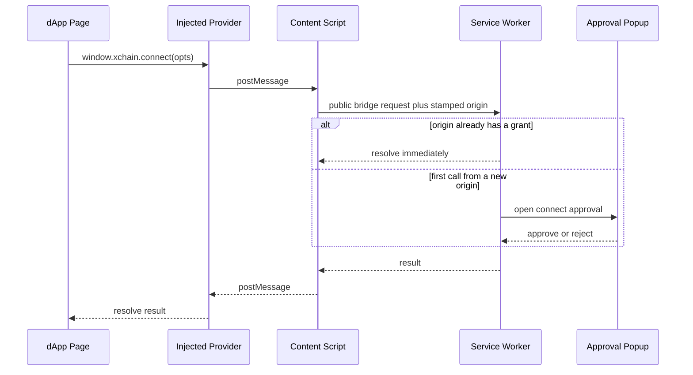

<!-- SPDX-License-Identifier: AGPL-3.0-or-later -->
<!-- Copyright © 2026 Dankest, LLC -->

# dApp Bridge: `window.xchain`

The Chrome MV3 extension exposes a typed `window.xchain` provider to dApps. The TypeScript contract and discovery helpers live in the wallet repository's private `@xchain-wallet/bridge-spec` workspace package. Its type definitions describe the public surface; this page also calls out places where the current extension runtime is narrower than those types.

## Scope

The bridge lets a webpage:

- Detect the XChain Wallet extension.
- Ask the user to grant access to selected accounts and chains.
- Read the granted accounts, addresses, balances, and chain catalogue.
- Ask the user to sign messages, supplied PSBTs, or the bridge's supported XChain ACTIONs.
- Request a passive MuSig2 co-signature.
- Authenticate through Sign-In with XChain (SIWX).
- Subscribe to the events the extension currently emits.

It does **not** let a dApp:

- Read the user's seed, master key, password, or derived private keys.
- Call the extension's privileged `wallet.*`, `action.*`, `settings.*`, or other internal handlers.
- Write arbitrary wallet data. `connect` stores a per-origin grant, remembered signing choices update that grant, and a successful bridge action creates the wallet's normal pending-transaction audit record.

The extension opens approvals as 400 by 620 pixel windows at its own `chrome-extension://<id>/approval.html` URL. Closing the window, closing the requesting tab, allowing the five-minute approval timeout to expire, locking the wallet, or suspending the service worker rejects the request.

## Provider lifecycle

The provider is implemented by these extension files:

- `packages/extension/src/content/contentScript.js` injects the page script and relays public messages.
- `packages/extension/src/inject/xchainProvider.js` installs `window.xchain` and implements the page-facing promises and events.
- `packages/extension/src/bridge/handlers.js` enforces grants and runs wallet flows in the service worker.
- `packages/extension/src/background/approvalBroker.js` owns approval-window lifecycle.

The manifest injects the content script at `document_start` into the top document on HTTPS pages and on `http://localhost/*` or `http://127.0.0.1/*`. It does not inject into iframes or arbitrary remote HTTP pages. The source currently builds this public provider only for the Chromium extension. The Electron preload exposes the wallet renderer's internal `window.xchainWalletBridge`; it does not expose `window.xchain` to external dApps.

Detection should not assume the provider is ready immediately on page load. The content script appends a second script to the page, and that script dispatches `xchain#initialized` after installing the provider.

```ts
import { isXChainAvailable, getProvider, PROVIDER_READY_EVENT } from '@xchain-wallet/bridge-spec';

if (isXChainAvailable()) {
    const provider = window.xchain;
    // ...
} else {
    window.addEventListener(PROVIDER_READY_EVENT, () => {
        const provider = window.xchain;
        // ...
    }, { once: true });
}

// Or use the helper that handles the race. Its default timeout is 1000 ms.
const provider = await getProvider({ timeoutMs: 3000 });
if (!provider) { /* not installed, not available on this page, or timed out */ }
```

Every provider exposes:

```ts
provider.version        // "0.1.0"
provider.isXChainWallet // true
```

## Quick start

```ts
import { getProvider } from '@xchain-wallet/bridge-spec';

const xchain = await getProvider({ timeoutMs: 3000 });
if (!xchain) throw new Error('XChain Wallet not available');

const result = await xchain.connect({
    appName: 'My DApp',
    appIcon: 'https://example.com/icon.png',
    requestedChains: ['bitcoin-mainnet', 'litecoin-mainnet'],
});

if (!result.ok) {
    console.error('Connect rejected:', result.error);
} else {
    console.log('connected', result.accounts, result.chains);
}
```

The current connect screen matches `requestedChains` against full chain IDs such as `bitcoin-mainnet`, despite the bridge type declaring this field as `CoinId[]`.



## Lifecycle

### `connect(opts?) → Promise<ConnectResult>`

For a new origin, `connect` opens an approval window. The user reviews the requesting origin, the dApp-declared name, the offered chains, and the wallet's own account list. Requested chains start selected. If `requestedChains` is omitted, every registered chain is offered but none starts selected. The primary account starts selected, and the user must grant at least one chain and one account.

If the origin already has a grant, `connect` updates its last-used time and returns it without another prompt. A blocked origin is rejected before either path. Developer Mode can also skip a new localhost connect prompt when **Auto-approve localhost dApps** is enabled; that path grants the active chains narrowed by `requestedChains`, or all active chains when the field is omitted, plus the primary account. It grants no remembered signing permission.

`ConnectOpts`:

| Field | Type | Description |
|---|---|---|
| `appName` | optional string | DApp-declared name shown next to the wallet-stamped origin. Defaults to the origin. |
| `appIcon` | optional string | Stored with the connected-site record. The handler does not validate that it is a URL. |
| `requestedChains` | chain ID array | Full chain IDs to offer and preselect, such as `bitcoin-mainnet`. The user may narrow the set. |
| `requiredBridgeVersion` | version range | Hard-rejects with `BRIDGE_VERSION_MISMATCH` when none of the wallet's supported bridge versions satisfies the range. |

On success:

```ts
{
    ok: true;
    version: string;
    supportedVersions: string[]; // runtime extension to the typed result
    accounts: Account[];
    chains: ChainId[];
    permissions: SitePermissions;
}
```

A failure resolves to `{ ok: false; error: BridgeErrorCode; message?: string }`, rather than rejecting the provider promise. See [Error codes](#error-codes).

### `disconnect() → Promise<void>`

Deletes the current origin's connected-site record and emits `disconnect` with the reason `user-requested`. Calling it without a record succeeds without changing anything. The page-facing type is `Promise<void>` even though the handler internally returns a diagnostic `{ disconnected }` object.

## Read methods

Except for `getSupportedChains`, read methods require an existing connected-site record. They reject their promises on failure because their return types have no `{ ok }` result envelope.

| Method | Returns | Notes |
|---|---|---|
| `getAccounts()` | `Account[]` | Account records within the site's grant. Rejects with `NOT_CONNECTED` before `connect`. |
| `getAddresses(chainId)` | `Address[]` | Vault addresses on the granted chain and in the granted accounts. |
| `getBalances(chainId, address)` | `Balance[]` | Native coin and token balances for one granted address. The current explorer reads supply confirmed amounts only, so both unconfirmed fields are returned as `"0"`. |
| `getSupportedChains()` | `ChainDescriptor[]` | The current registry catalogue. This is the only read allowed before `connect`, but blocked origins cannot call it. |
| `getActiveChains()` | `ChainId[]` | Chain IDs with seeded settings, filtered to the wallet's active network kind. |

`ChainDescriptor` exposes `id`, `coin`, `displayName`, `networkKind`, `color`, a web-loadable `icon` URL, `addressTypes`, `defaultAddressType`, `supportedActions`, and `uriScheme`. It omits endpoints, fee strategy, and derivation templates. The bundled registry contains Bitcoin, Litecoin, and Dogecoin on mainnet, testnet, and regtest. Verified remote descriptors and valid Developer Mode custom chains can extend the live catalogue.

The descriptor's `supportedActions` reports protocol capabilities for that chain. It does not report what `signAction` accepts. The bridge signing handler currently accepts only `SEND` and `SWEEP`.

Raw balance fields are integer base units encoded as decimal strings. Use `BigInt` or a big-number library. The formatted fields are decimal strings for display and must not be converted through a JavaScript `number` when exactness matters.

## Sign methods

Signing methods require a connection, enforce the granted chain and account scope, check the origin blocklist, and consume the per-origin sign-request throttle. Except for a standing `never` refusal and the documented Developer Mode localhost cache, the extension opens an approval window and asks for the wallet password for every allowed signing call.

### `signMessage(params) → Promise<SignMessageResult>`

The approval window displays the message and signs it with the key for the requested, granted address.

```ts
{ chainId: string; address: string; message: string; displayLabel?: string }
→ { ok: true; address; signature; signedMessage } | BridgeErrorResult
```

The current handler does not canonicalize the message, so `signedMessage` equals the input `message`. Messages beginning with the reserved `XChain Sign-In v2` prefix are rejected by this method and must go through `signIn`. `displayLabel` is present in the type but is not forwarded to the current approval payload.

### `signAction(params) → Promise<SignActionResult>`

The current handler accepts only `SEND` and `SWEEP`. It submits a supported action through the wallet's normal flow, signs it, broadcasts it, and returns once broadcast produces a transaction ID.

A `SEND` uses the published parameter names:

```ts
{
    chainId: 'bitcoin-mainnet',
    action: 'SEND',
    params: {
        fromAddress,
        toAddress,
        asset: 'BTC',
        amountRaw: '10000', // integer base units
        memo?: string,
    },
    feeStrategyHint?: 'low' | 'normal' | 'fast',
}
→ { ok: true; txid; chainId; actionIndex? } | UnsupportedActionResult | BridgeErrorResult
```

The wallet looks up the asset divisibility from the source address's balances and converts `amountRaw` exactly before showing and signing it. It rejects the request if it cannot establish that scale. `actionIndex` is normally absent because the indexer assigns it after confirmation.

For `SWEEP`, the published type supplies `fromAddress`, `toAddress`, and an optional `asset`. Single-asset sweep is not wired: the current handler ignores `asset` and uses the sweep flow's category defaults, which include balances and ownerships and exclude orders, swaps, and dispensers. Do not use the bridge to request a single-asset sweep.

`feeStrategyHint` is also not forwarded by the current handler, so it has no effect. The bridge rejects `legs` and `prebuiltPsbt`, because either could replace what the approval describes, and it drops other request keys that are outside the action flow's allowlist. The approval summary is built from the same mapped destination, asset, and amount passed into the wallet flow. This is a request-to-flow consistency check, not a byte-level comparison between the encoder's PSBT outputs and the requested intent.

An unsupported action resolves as:

```ts
{ ok: false; error: 'UNSUPPORTED_ACTION'; supportedActions: ['SEND', 'SWEEP']; message?: string }
```

### `signPsbt(params) → Promise<SignPsbtResult>`

Signs a dApp-supplied PSBT after explicit approval. The current extension requires `signingPaths` to be a non-empty array even though the type marks it optional.

```ts
{
    chainId: string;
    psbtHex: string;
    signingPaths: Array<{
        inputIndex: number;
        address?: string;
        derivationPath?: string;
        sighashType?: number;
    }>;
    broadcast?: boolean;
}
→ { ok: true; signedPsbtHex; txHex?; txid? } | BridgeErrorResult
```

Each path entry must contain exactly one of `address` or `derivationPath`. Every entry must resolve to an address the vault owns, within the site's account grant, on the requested chain, and all entries must resolve to one wallet. The software signer signs only the listed input indexes.

Before enabling approval, the window independently decodes the PSBT and displays destinations, amounts, change labels, and fee. An undecodable PSBT cannot be approved. After approval, the handler resolves the signing paths against the vault again and signs.

`broadcast` currently has no effect. This handler never calls a broadcast flow. It returns `signedPsbtHex`, and it includes `txHex` or `txid` only when the SDK finalizer produced those values locally. A returned `txid` therefore does not mean the transaction was broadcast.

### `coSign(params) → Promise<CoSignResult>`

Requests the wallet's passive half of a stored 2-of-2 MuSig2 co-signer account. The site names the aggregate address, supplies a PSBT, and supplies either one agent public nonce or a per-input nonce list.

```ts
{
    chainId: string;
    aggregateAddress: string;
    psbtHex: string;
    agentPublicNonce?: string;
    inputIndex?: number;
    inputs?: Array<{ index: number; agentPublicNonce: string }>;
    sighashType?: number;
}
```

The co-signer account must exist, be enabled, and belong to an account in the site's connect grant. `coSign` always opens an approval, decodes the PSBT, checks policy, and asks for the password. A successful single-input or multi-input response has `{ ok: true, approved: true, ...signature fields }`. A policy refusal is a successful protocol response shaped `{ ok: true, approved: false, reason, detail? }`; transport, permission, and approval failures use `{ ok: false, error }`.

### `signIn(params) → Promise<SignInResult>`

Sign-In with XChain asks the user to choose from addresses inside the site's account and chain grants, builds a challenge, signs it, and returns the structured fields plus the exact challenge string.

```ts
{ appId: string; nonce?: string; expiresInMs?: number; chains?: CoinId[] }
→ { ok: true; address; chainId; challenge; challengeParts; signature } | BridgeErrorResult
```

Here `chains` is a coin-family filter such as `['bitcoin']`, matching the published type. The default expiry window is five minutes, and the handler caps a requested window at one hour. If `nonce` is omitted or empty, the wallet generates a random 16-byte hex nonce.

The v2 wire format is:

```text
XChain Sign-In v2 | <appId> | <origin> | <address> | <nonce> | <timestamp> | <expiresAt>
```

The timestamps are Unix epoch milliseconds. The formatter rejects any field containing the reserved ` | ` separator. The `challenge` string is exactly what the wallet signs. Only v2 parses: `parseSignInChallenge` returns `null` for a v1-shaped string.

`<origin>` comes from the content-script trust boundary, not from `signIn` parameters. `appId` is page supplied and does not identify the requesting site by itself. A relying backend must verify the signature and use `validateSignInChallenge` to check the expected `appId`, origin, nonce, timestamp, and expiry.

```ts
import { makeSignInParams, parseSignInChallenge, validateSignInChallenge } from '@xchain-wallet/bridge-spec';

const params = makeSignInParams('mydapp.example');
const result = await provider.signIn(params);
if (!result.ok) { /* handle result.error */ }

const parts = parseSignInChallenge(result.challenge);
const failure = parts && validateSignInChallenge(parts, {
    appId: 'mydapp.example',
    origin: 'https://mydapp.example',
    nonce: params.nonce,
});
if (!parts || failure !== null) { /* reject */ }

// Also verify result.signature against result.address using the chain's scheme.
```

### `parallel(actions) → Promise<SignActionResult[]>`

`parallel` accepts 1 to 20 `SignActionParams` entries and processes them sequentially in input order. The extension's current `ApprovalBroker` does not implement the optional grouped-approval hook, so each supported action opens its own approval window. A rejection or failure becomes the result for that slot and processing continues with later entries.

There is no atomic multi-chain settlement. Successfully approved actions broadcast independently, and earlier broadcasts are not rolled back when a later entry fails. Only `SEND` and `SWEEP` are signable; every unsupported action produces an `UNSUPPORTED_ACTION` entry.

```ts
const results = await provider.parallel([
    {
        chainId: 'bitcoin-regtest',
        action: 'SEND',
        params: { fromAddress: btcFrom, toAddress: btcTo, asset: 'BTC', amountRaw: '10000' },
    },
    {
        chainId: 'litecoin-regtest',
        action: 'SEND',
        params: { fromAddress: ltcFrom, toAddress: ltcTo, asset: 'LTC', amountRaw: '20000' },
    },
]);

for (const result of results) {
    if (result.ok) console.log('sent', result.txid);
    else console.warn('not sent', result.error);
}
```

The provider rejects the `parallel()` promise for batch-level failures, including an empty array, more than 20 entries, a missing connection, a blocked origin, throttling, or a top-level transport failure. Those failures cannot be represented as an array entry.

## Events

```ts
provider.on('accountsChanged', (accounts) => { /* re-read user state */ });
provider.on('chainChanged', (chainId) => { /* re-fetch chain-scoped data */ });
provider.on('disconnect', (reason) => { /* clear session */ });

provider.off('accountsChanged', handler);
```

The typed event names all exist, but the current extension emits them only on these paths:

| Event | Payload | Current extension trigger |
|---|---|---|
| `accountsChanged` | `Account[]` | The active wallet changes, limited to accounts granted to that site. Permission-diff code can also emit it when an account grant changes. |
| `chainChanged` | `ChainId` | Permission-diff code emits it when exactly one chain is added to a non-empty grant. The active-network and ordinary chain-selection paths do not currently emit it. |
| `disconnect` | string reason | The dApp calls `provider.disconnect()`, which emits `user-requested`. |

Deleting or blocking a site from **Connected sites**, locking the wallet, and activating panic mode do not currently emit `disconnect`. Event delivery is best effort and only targets tabs that have called the bridge at that origin. A handler removed through `off` does not receive later events.

The bridge has no transaction-status or market-data events. A dApp that needs live network state must use the SDK or another data source.

## Permissions model

When the user approves `connect`, the wallet stores a connected-site record containing:

```ts
{
    origin: string;
    permissions: {
        chains: ChainId[];
        accounts: string[];
        canSignMessage: boolean;
        canSignAction: Record<string, 'always' | 'ask' | 'never'>;
    };
}
```

Fresh interactive grants store at least one chain and one account. Internally, an empty chain or account list is treated as a wildcard, so the connect handler narrows an empty account decision to the primary account. `canSignMessage` starts `false` and `canSignAction` starts empty, which means ask.

The sign approval's **Always allow** checkbox can set `canSignMessage: true` or an action entry to `always` after a successful signature. `never` causes an action request to fail as `USER_REJECTED`. The **Connected sites** screen displays these values and lets the user disconnect or block a site, but it does not edit individual grants.

Despite the stored `always` labels, the current extension still opens a sign approval for every non-localhost call. For a remembered message grant, the approval knows the permission already exists and asks for the password again. Action signing also prompts again. The exception is the separate Developer Mode setting **Cache password for localhost auto-sign**, which can keep a password in service-worker memory for five minutes or one hour after a real approval and reuse it for later localhost `signMessage` and single `signAction` calls. Both Developer Mode localhost options are off by default.

The **Connected sites** screen also controls blocked origins and the sign-request throttle. The throttle defaults to five signing requests per origin in 60 seconds and is configurable there. It applies to `signMessage`, `signAction`, `signPsbt`, `coSign`, `signIn`, and once to an entire `parallel` call.

## Error codes

The provider resolves failures as `{ ok: false, error, message? }` for `connect`, `signMessage`, `signAction`, `signPsbt`, `coSign`, and `signIn`. Read methods, `disconnect`, and batch-level `parallel` failures reject instead. Branch on the stable `error` code for result-union methods; `message` is diagnostic text.

| Code | Meaning in the current contract or runtime |
|---|---|
| `USER_REJECTED` | The user rejected or abandoned an approval, or an action policy is `never`. |
| `NOT_CONNECTED` | No connected-site record exists for this origin. |
| `WALLET_LOCKED` | A required vault or signer is locked. |
| `CHAIN_NOT_SUPPORTED` | The chain is unknown or outside this site's chain grant. Both internal cases map to this public code. |
| `ACCOUNT_NOT_AUTHORIZED` | The requested co-signer account is unavailable or unauthorized. |
| `ADDRESS_NOT_AUTHORIZED` | An address or derivation path is unknown or outside this site's account grant. |
| `UNSUPPORTED_ACTION` | `signAction` received anything other than `SEND` or `SWEEP`. The result includes `supportedActions`. |
| `INVALID_PARAMS` | The request is missing required data, has an invalid signing path or batch shape, or otherwise fails bridge validation. |
| `CHALLENGE_EXPIRED` | Reserved by the public result union. The current `signIn` handler does not emit it; `validateSignInChallenge` reports an expired challenge through its returned validation message. |
| `BROADCAST_FAILED` | An action was signed but its network broadcast failed. `signPsbt` does not broadcast. |
| `PANIC_MODE` | A signing flow is blocked by an active panic freeze. The default duration is 24 hours, but wallet settings allow other supported durations. A co-sign policy refusal can instead return `{ ok: true, approved: false, reason: 'PANIC_MODE' }`. |
| `THROTTLED` | The origin exceeded the per-origin sign-request rate limit. The result can include `retryAfterMs`, `burst`, and `windowMs`. |
| `BLOCKED_BY_USER` | The user explicitly blocked this origin, so it matches the blocked-origin list. The user must unblock it in **Connected sites**. |
| `BRIDGE_VERSION_MISMATCH` | `requiredBridgeVersion` does not match any supported bridge protocol version. |
| `INTERNAL_ERROR` | An unexpected wallet, signer, or transport failure that has no more specific public code. |

Use the `ok` discriminant before reading success fields:

```ts
const result = await provider.signAction(request);
if (!result.ok) {
    handleBridgeError(result.error, result);
    return;
}
console.log(result.txid);
```

## Versioning

The bridge protocol version is independent of the wallet package version:

```ts
import { BRIDGE_SPEC_VERSION, BRIDGE_SUPPORTED_VERSIONS } from '@xchain-wallet/bridge-spec';

// BRIDGE_SPEC_VERSION: "0.1.0"
// BRIDGE_SUPPORTED_VERSIONS: ["0.1.0"]
```

The injected provider also reports `version: "0.1.0"`, while wallet workspace packages use the wallet release version. `connect.requiredBridgeVersion` accepts exact versions, caret and tilde ranges, comparison ranges, comma or whitespace conjunctions, and `||` alternatives. An unparseable or unmatched range fails closed with `BRIDGE_VERSION_MISMATCH`.

## Test dApp

`@xchain-wallet/test-dapp` is a private workspace reference package, not a separately served browser application. Its `src/example.ts` demonstrates discovery, connect, reads, SIWX validation, message signing, `SEND`, unsupported-action handling, and disconnect against `src/mock-provider.ts`. It does not currently demonstrate `signPsbt`, `coSign`, or `parallel`, so it is not a complete executable reference for the whole provider surface.

## Security model

The bridge enforces these boundaries between a dApp and wallet secrets:

1. **Restricted injection and relay.** The content script runs only in allowed top-level pages. It accepts a fixed list of public `bridge.*` calls, overwrites the request origin with `window.location.origin`, and refuses malformed messages. The background independently confines web senders to the public namespace and compares the stamped origin with the browser-reported sender origin when that origin is available.
2. **Service-worker key boundary.** The page provider is a message shim. Vault access, permission checks, password handling, signing, and broadcasts run behind the extension service worker. The page never receives seed or private-key material.
3. **Per-origin scope.** Every protected read and sign operation resolves the requesting origin's connected-site record. Chain, account, address, co-signer, blocklist, and throttle checks run before signing.
4. **Independent approval UI.** Approval content runs on the extension origin. Sign approvals display the requesting origin and operation details, collect the password, and reject on close or timeout. PSBT and co-sign approvals block when their independent decode or policy checks fail.
5. **Flow parameter narrowing.** Bridge action requests cannot supply a prebuilt PSBT or alternate legs, and unapproved flow-control fields do not reach the action flow.

Developer Mode's two localhost options deliberately relax prompts for local development and are disabled by default. They do not widen the granted chain or account scope, bypass the blocklist or throttle, or persist the cached password.

See [Security & Threat Model](security.md) for the wallet's broader posture.

---

**Copyright &copy; 2026 Dankest, LLC**

Licensed under the **GNU Affero General Public License v3.0** (AGPL-3.0-or-later).
See [LICENSE](../../LICENSE.md) and [NOTICE](../../NOTICE.md) for full terms.
