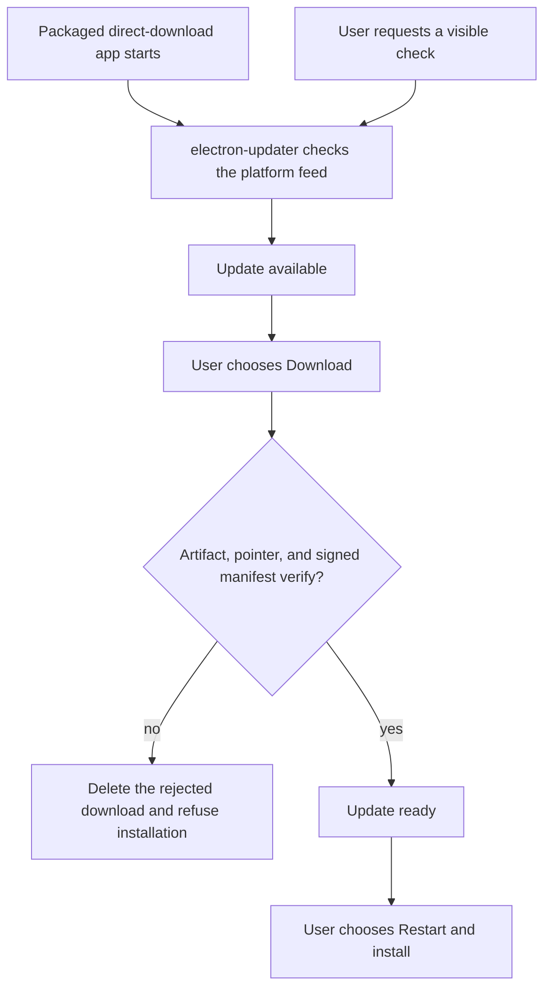

<!-- SPDX-License-Identifier: AGPL-3.0-or-later -->
<!-- Copyright © 2026 Dankest, LLC -->

# Build & Release

This document covers the wallet's release process: synchronized versioning, per-shell build pipelines, signing, packaging, and distribution channels.

## Synchronized versioning

The root package and every package under `packages/` ship at the **same version number**. The current lockstep set is:

- `package.json` (root), the release version used for the tag
- `packages/core/package.json`
- `packages/web/package.json`
- `packages/extension/package.json`
- `packages/desktop/package.json`
- `packages/mobile/package.json`
- `packages/bridge-spec/package.json`
- `packages/test-dapp/package.json`
- `packages/signers-trezor/package.json`
- `packages/signers-ledger/package.json`

The membership rule is the root plus every `packages/*/package.json`, not a hard-coded package list in the release tool. A new package enters the lockstep set as soon as its `package.json` exists.

The `test/e2e/package.json` (`@xchain-wallet/e2e`) is **excluded** from synchronized versioning. It tracks the Playwright suite independently.

The lockstep check also covers the extension manifest's `version` and `version_name`, `WALLET_VERSION` in `packages/core/src/buildInfo.js`, the README version badge and status line, and the matching `CHANGELOG.md` section. Every shell's About screen reads the shared `WALLET_VERSION`, so users see the same release version in the web, extension, desktop, and mobile shells.

`CHANGELOG.md` at the repo root is authoritative; sub-packages don't maintain their own changelogs.

### Release bump procedure

1. Add the release entries under `## [Unreleased]` in `CHANGELOG.md`.
2. Run `node tools/release/bump-version.mjs <version>`. The tool updates the root and every package version, the extension manifest, `WALLET_VERSION`, the README version copies, and the changelog section and date. It refuses an empty Unreleased section.
3. Run `node test/smoke/audits/version-lockstep.smoke.js` and `node test/smoke/audits/extension-manifest-audit.smoke.js`.
4. Commit the bump and require a successful CI run for that commit.
5. Create the signed annotated tag `v<version>` and push it. The release workflow verifies the tag signature, the tag-to-package version match, and the successful CI run before its signing jobs start.

### Extension version derivation

Chrome's `version` field rejects semver prerelease tags such as `1.0.0-rc.6`. The wallet's derivation helper accepts stable `M.m.p` versions and `M.m.p-rc.N` versions, mapping them to a Chrome-valid tuple of one to four integers in the range 0 to 65535:

| Wallet semver | Chrome `version` | Chrome `version_name` |
|---|---|---|
| `0.341.3` | `0.341.3` | `0.341.3` |
| `1.0.0` | `1.0.0` | `1.0.0` |
| `1.0.0-rc.1` | `0.1.0.1` | `1.0.0-rc.1` |
| `1.0.0-rc.6` | `0.1.0.6` | `1.0.0-rc.6` |
| `1.2.3` | `1.2.3` | `1.2.3` |

Stable versions keep their three-part semver. An RC maps to `0.M.m.N`, which keeps successive RCs ordered and places an RC for a major version of at least 1 below that major version's stable release. It does not place a `1.0.0-rc.N` above an existing stable `0.x` release, so that prerelease form is not suitable for an in-place Chrome Web Store upgrade from the current `0.x` line.

The automated bump path is currently stable-only: `bump-version.mjs` writes its target string directly into both extension manifest fields, while the extension manifest audit expects the derived Chrome tuple and the version-lockstep smoke expects the manifest version to equal the root version. An RC release therefore requires those release tools to be reconciled before the tag is cut.

## Per-shell build

| Shell or artifact | Command | Output |
|---|---|---|
| Web | `pnpm --filter @xchain-wallet/web build` | `packages/web/dist/`: static SPA |
| Extension | `pnpm --filter @xchain-wallet/extension build` | `packages/extension/dist/`: unpacked Manifest V3 extension |
| Desktop renderer | `pnpm --filter @xchain-wallet/desktop build:renderer` | `packages/desktop/renderer/dist/`: renderer files included in the Electron asar |
| Desktop installers | `pnpm --filter @xchain-wallet/desktop run dist --<platform> --x64 --arm64` | `packages/desktop/dist/`: `.dmg` and mac zip on macOS, NSIS `.exe` and Windows zip on Windows, or `.AppImage` and `.deb` on Linux |
| Reproducible Linux build | `pnpm --filter @xchain-wallet/desktop reproduce` | `reproduce-out/RELEASE_HASHES.txt` for the packaged x64 and arm64 `.AppImage` and `.deb`, plus `UNPACKED_HASHES.txt` for diagnostics |
| Mobile web bundle | `pnpm --filter @xchain-wallet/web build && pnpm --filter @xchain-wallet/mobile build` | `packages/mobile/www/`, Android version properties, and iOS version configuration |
| Android release | `bash tools/release/android-ceremony.sh --tag vX.Y.Z --output release-artifacts/vX.Y.Z` | Play `.aab` and store-profile direct `.apk`; setting `XCHAIN_BUILD_ANDROID_FULL=1` also produces the full-profile direct `.apk` |
| iOS release | `pnpm --filter @xchain-wallet/mobile sync:ios`, then `tools/release/ios-archive.sh` and `tools/release/ios-export.sh` | `packages/mobile/ios/build/xchain-wallet-ios-vX.Y.Z.ipa` |

The release toolchain pins Node 22.23.2 and pnpm 11.8.0. Release lanes install with `pnpm install --frozen-lockfile`; the reproducible Linux lane performs that install inside its digest-pinned container. Release-relevant package versions include Electron 44.7.0, electron-builder 26.15.7, electron-updater 6.8.9, and Capacitor 8.5.2.

## Signing

| Shell | Signing and verification |
|---|---|
| Web | No OS signature. Deployment checks the tarball's SHA-256 against the release manifest row for that tag before switching the served version, and also verifies the manifest's GPG signature when the web host has GPG and the release keyring. |
| Extension | The staged zip has no maintainer-side platform signature. The Chrome Web Store repackages and signs the delivered CRX; the submitted zip is covered by the signed release manifest. |
| Desktop macOS | The app and disk image use the Developer ID identity. Release builds enable the hardened runtime, sign the `.dmg`, notarize with Apple, and staple the result. |
| Desktop Windows | The NSIS installer and executable payload use the Dankest, LLC Authenticode certificate through the configured eSigner adapter. |
| Desktop Linux, hosted | The `.AppImage` and `.deb` have no OS-level code signature. Users verify them with the GPG-signed SHA-256 release manifest, and both formats are reproducible on x64 and arm64. |
| Android | The Play `.aab` uses the Play upload key. Google re-signs Play delivery. Both direct APK profiles use the pinned direct-download signing key. |
| App Store and Snap Store packages | Store-bound artifacts are signed or re-signed by their receiving store. The desktop updater is disabled for Mac App Store, Microsoft Store, and Snap Store installs because the store owns updates. |

Signing identities live with the publisher, Dankest, LLC. The release manifest records the exact artifacts and build profiles covered by its detached GPG signature. See [Reproducible Builds](reproducible-builds.md) for the narrower byte-for-byte claims made for each shell.

## Distribution

| Shell | Channel and current lane state |
|---|---|
| Web | Static web app at `https://wallet.xchain.io/` |
| Extension | Chrome Web Store. The publish log records a main-item upload, while the authoritative shipped-lane declaration still marks the extension lane `NOT-SHIPPED`. |
| Desktop | `https://downloads.xchain.io/wallet/desktop/`, also used by `electron-updater`. The shipped-lane declaration marks macOS and Linux `SHIPPED` and Windows `NOT-SHIPPED`; see [desktop/windows.md](release/desktop/windows.md). |
| Android | Direct APKs under `https://downloads.xchain.io/wallet/android/`. Both the store-profile direct lane and the full-profile direct lane are marked `SHIPPED`; Google Play distribution remains pending. See [mobile/android-play.md](release/mobile/android-play.md). |
| iOS | App Store package only; the iOS lane is `NOT-SHIPPED`. See [mobile/ios-app-store.md](release/mobile/ios-app-store.md). |
| Desktop stores | Mac App Store, Microsoft Store, and Snap Store lanes are `NOT-SHIPPED`; each has its page under [Release engineering](release/README.md). |

`tools/release/shipped-lanes.txt` is the release gate's authority for whether an optional distribution lane has shipped and must remain present in later releases. `tools/release/expected-artifacts.txt` separately defines which filenames, build profiles, architectures, and signature classes are allowed or required.

Auto-update for direct-download desktop builds:

- `electron-updater` performs a quiet check at launch. The application menu also exposes a user-visible check.
- `autoDownload` is disabled. When an update is available, the user chooses Download.
- After download, the wallet verifies the artifact hashes, the channel pointer, and the detached release-manifest signature against the pinned release key. Platform signature checks remain an additional control on macOS and Windows.
- A verified update becomes ready, and the user chooses Restart to install it. Installation on ordinary app quit is disabled.
- Mac App Store, Microsoft Store, and Snap Store builds do not initialize the direct-download updater.

Chrome Web Store updates are store-managed. The wallet has no private extension-update channel.

## Chrome Web Store submission

The submission flow uses the release zip produced by the tag workflow and covered by a signed release manifest. `tools/release/cws-upload.mjs` can upload that zip through the store API and optionally publish it to trusted testers or the default audience; a default-audience publish requires an additional explicit confirmation flag.

The repository carries:

- Listing copy, permissions and data-disclosure answers in the submission runbook
- Three generated listing screenshots: popup, side panel, and signing approval
- A 440 by 280 promotional tile
- A capture pin and verification tooling for detecting stale listing images
- Privacy-policy URL verification, manifest audits, remote-code audits, and post-publish store verification
- A publish log that records the version, zip hash, item, operator, and submission date

The wallet README lists Chrome Web Store completion, the external security audit, and the external accessibility audit as the three user-driven items before v1.0.0 GA.

## Release artifact list

The production artifact contract is `tools/release/expected-artifacts.txt`. The signing gate refuses a missing required artifact, a missing required architecture, an incorrect build profile or signature class, and any staged file that matches no declared row. For a release `vX.Y.Z`:

| Artifact | Source | Production declaration |
|---|---|---|
| `xchain-wallet-web-vX.Y.Z.tar.gz` | Static SPA bundle | required |
| `xchain-wallet-extension-vX.Y.Z.zip` | Chrome Web Store submission bundle | required |
| `xchain-wallet-X.Y.Z-<arch>.dmg` and `xchain-wallet-X.Y.Z-<arch>-mac.zip` | macOS installer and updater zip, x64 and arm64 | required |
| `xchain-wallet-setup-X.Y.Z-<arch>.exe` and `xchain-wallet-X.Y.Z-<arch>-win.zip` | Windows NSIS installer and zip, x64 and arm64 | required |
| `xchain-wallet-X.Y.Z-<arch>.AppImage` and `xchain-wallet_X.Y.Z_<arch>.deb` | Hosted Linux packages, x64 and arm64 | required |
| `xchain-wallet-android-vX.Y.Z.aab` and `xchain-wallet-vX.Y.Z.apk` | Play upload bundle and store-profile direct APK | optional rows, required when the shipped Android lane is signed |
| `xchain-wallet-vX.Y.Z-full.apk` | Full-profile direct APK | optional row, required when the shipped Android-full lane is signed |
| `xchain-wallet-ios-vX.Y.Z.ipa` | iOS App Store package | optional |
| `xchain-wallet-X.Y.Z-universal-mas.pkg` | Mac App Store package | optional |
| `xchain-wallet-X.Y.Z-<arch>-appx.appx` | Microsoft Store package, x64 and arm64 | optional |
| `xchain-wallet_X.Y.Z_<arch>.snap` | Snap Store package, x64 and arm64 | optional |
| `RELEASE_HASHES/vX.Y.Z.txt` and `.asc` | Signed SHA-256 manifest for the covered release lanes | written by signing, not declared as an input artifact |

The publisher routes hosted web, extension, desktop, and APK artifacts under `https://downloads.xchain.io/wallet/`, with signed manifests under `RELEASE_HASHES/`. The `.aab` is explicitly excluded from the download host because it is the bundle submitted to Play. Store package delivery follows the corresponding store runbook. See [Reproducible Builds](reproducible-builds.md) for which published outputs can be rebuilt byte for byte.

## Pre-launch readiness gates

Before tagging `v1.0.0` GA:

| Gate | Status in the wallet source |
|---|---|
| All four implementation phases | Complete |
| Autonomous portion of the pre-launch track | Complete |
| External security audit | Pending |
| External accessibility audit | Pending |
| Chrome Web Store completion | Pending in the README; the publish log records a main-item upload, and the shipped-lane declaration remains `NOT-SHIPPED` |
| Reproducible release coverage | Implemented for web and extension bundles and for the hosted Linux `.AppImage` and `.deb` on x64 and arm64; no byte-for-byte claim is made for signed macOS or Windows artifacts, iOS exports, or Snap packages |

## Release notes

Every release has one root `CHANGELOG.md` section. The bump tool promotes the non-empty `Unreleased` entries into `## [X.Y.Z] - YYYY-MM-DD`. Entries use the applicable Keep a Changelog categories, including Added, Changed, Fixed, and Removed, and describe observable changes in concise present-tense prose.

---

**Copyright &copy; 2026 Dankest, LLC**

Licensed under the **GNU Affero General Public License v3.0** (AGPL-3.0-or-later).
See [LICENSE](../../LICENSE.md) and [NOTICE](../../NOTICE.md) for full terms.
