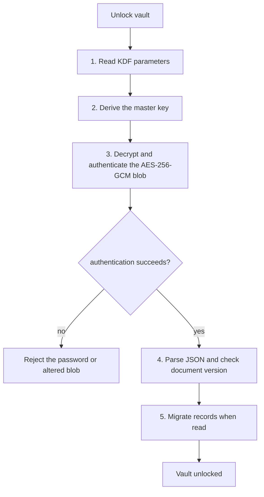

<!-- SPDX-License-Identifier: AGPL-3.0-or-later -->
<!-- Copyright © 2026 Dankest, LLC -->

# Keys & Signing

This document covers the path from a wallet password to an encrypted vault and a signed transaction: key derivation, vault encryption, mnemonic handling, HD derivation, signer implementations, and recovery.

## Master key derivation

The wallet derives a 32-byte master key from the user's password with **Argon2id**. Vaults and wallets created through the shells use these floor parameters:

| Parameter | Value |
|---|---|
| Algorithm | Argon2id (`@noble/hashes`) |
| Memory | 64 MiB |
| Iterations | 3 |
| Parallelism | 1 |
| Salt | 16 random bytes, stored with the KDF parameters |
| Output | 32 bytes for AES-256-GCM |

`packages/core/src/crypto/kdf.js` also provides a calibration helper that raises the iteration count toward a 1,000 ms target while keeping memory and parallelism fixed, up to 32 iterations in JavaScript and 4 when timed against a native mobile implementation. Core flows use it only when a caller supplies no parameters; the current web, extension, desktop, and mobile onboarding paths pass the floor parameters above directly. Persisted parameters are validated before use, including upper bounds of 1 GiB of memory, 64 iterations, and 8 lanes to limit denial-of-service input from a crafted wallet or backup.

Web, extension, and desktop use the `@noble/hashes` implementation. The mobile shells register native Argon2id providers. Core first checks a native provider against a known-answer vector and falls back to JavaScript if the provider is unavailable, fails, or returns the wrong shape.

The same primitive protects two layers of data:

- The vault document is encrypted under the key derived from the device password and the vault metadata's KDF parameters.
- Each software-wallet record encrypts its mnemonic, imported WIFs, and optional BIP39 passphrase under that wallet record's own password-derived key and KDF parameters. The wallet created or imported during onboarding stores the same password and KDF parameters as the vault, so its key is identical to the vault master key and the wallet reuses it. A wallet restored from an encrypted backup gets a fresh salt, and a change to a wallet's own password re-keys only that record, so those keys differ from the vault key.

Changing the unlock password re-seals the vault key together with every wallet the old password opens, in one vault write that keeps the KDF parameters. The new password then unlocks and the old one is refused. The write is atomic, so a failure leaves the old password in force. Two guards protect it:

- The change is refused, with nothing written and a retryable conflict reported, if a wallet record changes (a rename, an imported key, a second change from another window) between the time the replacements are prepared and the write.
- A lock that lands during the change, from `wallet.lock` or the idle auto-lock, keeps the wallet locked. The change does not write the new session key or signing password back or re-pool signers.

A shell that cannot supply a keyring refuses the change before any write.

`Vault` keeps a private copy of the vault key while it is open and zeroes that byte buffer on close. Shell session behavior differs:

- The extension stores the vault key and a signing-capable copy of the password in `chrome.storage.session`, so its MV3 service worker can rebuild the signer pool. Both slots are cleared on lock and when the browser session ends.
- Desktop keeps the vault key in memory and, when Electron `safeStorage` has a real OS keychain backend, persists only an OS-protected ciphertext so a later app launch can resume the session. It refuses disk persistence with Electron's `basic_text` fallback.
- Plain web has no equivalent session backend, so a page reload locks the wallet.
- Android and iOS add a device-bound encryption layer around the already encrypted vault blob. This protects an extracted app file but does not replace the password-derived vault encryption.

Sensitive byte arrays are cleared where the runtime permits it. JavaScript strings, including the password supplied by a form, cannot be reliably overwritten, so the implementation does not claim that the password string is zeroed.

## Biometric unlock (password wrap)

Biometric unlock is an opt-in shortcut that wraps the wallet password, not the vault master key. The unlock flow rebuilds software signers from the password, and a wallet whose KDF parameters differ from the vault's cannot be opened with the vault key alone.

Core owns the provider seam in `packages/core/src/flows/biometricUnlock.js`. The shared unlock and settings UI delegates to the provider installed by the shell:

| Shell | Mechanism | Stored wrap | Binding |
|---|---|---|---|
| Web, extension, desktop | WebAuthn platform authenticator with the PRF extension | `localStorage` record containing the credential ID, random PRF salt, and AES-GCM ciphertext | Platform authenticator, resident credential, and user verification are required. Registration fails if PRF output is unavailable. |
| Android | `BiometricPrompt` and an `AndroidKeyStore` AES-GCM key | App-private `biometric.wrap` sidecar | Class 3 biometrics, authentication for each use, no device-PIN fallback, and key invalidation after biometric enrollment changes. |
| iOS | Face ID or Touch ID protecting a Keychain item | iOS Keychain generic-password item | `biometryCurrentSet`, `kSecAttrAccessibleWhenPasscodeSetThisDeviceOnly`, and non-synchronizable storage. |

The wrap has to live outside the vault because it is read before the vault opens. Disabling biometric unlock or wiping the wallet clears the provider's record. Changing the unlock password also turns biometric unlock off, because the wrap holds the old password; the screen says so, including when the clear fails, and the user re-enrols afterward. Changing only a wallet's own password leaves the enrolment alone. If the credential or platform key is lost or invalidated, the wallet returns to password unlock.

## Vault encryption

The vault document is one AES-256-GCM blob. `packages/core/src/storage/codec.js` serializes the document as JSON and packs a random 12-byte IV, ciphertext, and 16-byte authentication tag. `packages/core/src/storage/Vault.js` encrypts on every saved mutation by default.

On unlock the wallet:

1. Reads the vault KDF parameters from the shell's metadata backend.
2. Derives the master key from the device password.
3. Opens the vault ciphertext and verifies its authentication tag.
4. Parses the plaintext JSON and checks the document version.
5. Migrates contained records through `packages/core/src/schemas/migrations.js` as collections are read. Writes validate the current record schema.



The current vault document contains wallets, accounts, addresses, contacts, connected sites, pending transactions and deploys, hardware-signer metadata, pending airdrops, watchlist entries, price alerts, multisig signing sessions, co-signer accounts, gated-content keys, autopay records, and settings. See [Architecture; Vault and state model](architecture.md) for the broader state model.

## Mnemonic handling

Two mnemonic formats are supported on import:

- **BIP39**: 12, 15, 18, 21, or 24 English words, validated by `@scure/bip39`. The create UI offers 12 words by default or 24 words. Core accepts the corresponding 128, 160, 192, 224, or 256-bit generation strengths. A non-empty BIP39 passphrase can be supplied on create or import.
- **Counterwallet legacy**: exactly 12 words from Counterwallet's 1,626-word list. `packages/core/src/crypto/counterwallet.js` decodes each three-word group to produce the 16 raw seed bytes that Counterwallet passes to BIP32. This format is import-only and does not accept a BIP39 passphrase.

Despite the wallet field name `encryptedSeed`, an HD wallet record stores the UTF-8 mnemonic encrypted with AES-256-GCM. On unlock, `SoftwareSigner` decrypts the mnemonic and derives either a 64-byte BIP39 seed or the 16-byte Counterwallet seed in memory. The mnemonic is never stored in plaintext.

The create flow displays a new mnemonic for backup and verifies selected words before saving it. Settings can reveal the recovery phrase again, but only after the user enters the wallet password. `packages/core/src/shared/routes/ViewPrivateKey.jsx` is a separate WIF-export screen and does not display the mnemonic.

For a new passphrase-enabled BIP39 wallet, the passphrase is encrypted under the same password-derived key that seals the wallet's mnemonic, with passphrase-specific authenticated data. A wallet record from an older schema can have `passphraseEnabled: true` and no stored encrypted passphrase. At the next unlock, `SignerPool.captureOne` requires the passphrase, verifies that it derives one of the wallet's stored addresses, encrypts it, and then adds the signer to the session. Until that capture succeeds, the wallet remains listed but its software signer is not pooled.

Counterwallet migration is implemented by `packages/core/src/shared/routes/MigrateToBip39.jsx`. It creates a separate 12-word BIP39 wallet, verifies the new backup, and presents per-chain sweep links from legacy addresses to the corresponding new-wallet addresses. The legacy wallet remains present and continues to control its old addresses; migration does not transform its derivation tree in place.

## HD derivation

`ChainRegistry` in `packages/core/src/registry/index.js` owns derivation templates, while `packages/core/src/crypto/hd.js` walks the BIP32 tree with `@scure/bip32`.

| Purpose | Address type | Standard | Built-in coin families |
|---|---|---|---|
| `44'` | P2PKH | BIP44 | Bitcoin, Litecoin, Dogecoin |
| `49'` | P2SH-P2WPKH | BIP49 | Bitcoin, Litecoin |
| `84'` | P2WPKH | BIP84 | Bitcoin, Litecoin |
| `86'` | P2TR | BIP86 | Bitcoin |

For BIP39 wallets, the template is:

```
seed -> m / purpose' / coinType' / account' / change / index
```

The built-in descriptors use their mainnet coin-type slot on mainnet, testnet, and regtest. For example, Bitcoin P2WPKH starts at `m/84'/0'/0'/0/0`, and Bitcoin P2TR starts at `m/86'/0'/0'/0/0` on all three network kinds.

| Coin family | Coin type | Default | Other supported address types |
|---|---:|---|---|
| Bitcoin | 0 | `p2wpkh` | `p2pkh`, `p2sh-p2wpkh`, `p2tr` |
| Litecoin | 2 | `p2wpkh` | `p2pkh`, `p2sh-p2wpkh` |
| Dogecoin | 3 | `p2pkh` | None |

Counterwallet-format wallets bypass these templates and use the single-account path `m/0'/change/index` for every chain. Their default address type is P2PKH.

`packages/core/src/flows/discoverUsedAddresses.js` can scan the default address type, all descriptor types, or an explicit list. It queries explorer history and stops after a default gap of 20 consecutive unused addresses. The flow returns a report and does not itself write discovered addresses to the vault.

## Signer interface

Every signer extends `packages/core/src/signers/Signer.js`. The abstract surface uses getters for identity and methods whose parameters are objects:

```
id
displayName
kind
requiresPhysicalConfirmation
getStatus({ chainId })
getAddresses({ chainId, accountIndex, change, startIndex, count, addressType, verify })
getPublicKey({ chainId, path })
signPsbt({ psbtHex, chainId, signingPaths, reveal, envelopeReveal })
signMessage({ message, chainId, path, addressId })
signMultisigPsbt({ chainId, psbtHex, signingPaths })
signMultisigClassical({ chainId, path, msgHash })
signMusig2Round1({ chainId, path, sessionRef })
signMusig2Round2({ chainId, path, sessionRef, aggNonceHex })
subscribe(listener)
```

The base class does not expose a `firmwareVersion()` method. Firmware version is pairing metadata stored in a hardware `SignerRecord`.

### Unsupported operations

Signer methods reject by throwing. A subclass that does not implement a base method throws `AbstractMethodError`.

`TrezorSigner` and `LedgerSigner` implement both MuSig2 methods as explicit refusals. Those errors use the stable code `HW_MUSIG2_UNSUPPORTED`, plain-language display text, and a technical `cause`. Their classical multisig methods also refuse because the vendor-specific policy and transaction wiring is not implemented. The direct methods throw plain `Error` objects; `signMultisigLocally` tags the recognized hardware deferral as `HW_SIGNER_DEFERRED` for its caller.

Hardware signers also refuse Taproot script-path envelope reveals, partial input coverage, non-default sighash modes, unsupported script types, and unsupported networks before asking the device to sign.

## Concrete signers

### `SoftwareSigner`

`packages/core/src/signers/SoftwareSigner.js` owns the decrypted mnemonic, derived seed, imported WIF byte buffers, and a session copy of the wallet master key while unlocked. `lock()` clears those mutable byte buffers.

- **Addresses**: derives the descriptor path with `@scure/bip32`, then delegates address encoding to the selected `xchain-sdk` wallet.
- **PSBT signing**: derives or decrypts one WIF and calls `sdk.wallet.signPsbt`. Separate SDK methods handle P2SH/P2WSH reveal transactions and Taproot envelope reveals.
- **Message signing**: calls `sdk.auth.signMessage`. BIP44, BIP49, and BIP84 paths select the matching compact-signature mode; the SDK message signer does not support P2TR paths.
- **Multisig**: implements classical ECDSA contributions, partial PSBT signing, and both MuSig2 rounds.
- **Execution boundary**: signing runs in the extension background worker, the desktop main process, or the web/mobile JavaScript host. The explicit private-key export flow is the supported exception that returns a WIF to UI code.

### `TrezorSigner`

`packages/signers-trezor/src/TrezorSigner.js` wraps Trezor Connect. The web wallet loads Trezor's hosted Connect script. Desktop loads it in a named bridge window governed by the Electron permission and window policy. The extension and mobile shells do not provide a Trezor factory.

- **Networks**: Bitcoin, Litecoin, and Dogecoin mainnet only. Bitcoin testnet and regtest are refused because Trezor derives coin type `1'`, while the wallet descriptors deliberately use Bitcoin coin type `0'` on every network. Litecoin and Dogecoin testnet/regtest coin definitions are unavailable through this path.
- **Address types**: P2PKH, P2SH-P2WPKH, and P2WPKH where the chain supports them. P2TR address derivation is refused because this signer cannot spend that type through its current transaction path.
- **Pairing**: reads device features and records model, a device identifier, last-reported firmware version, and a user-facing label. It does not persist a public key or xpub in the signer record.
- **Transaction signing**: `packages/signers-trezor/src/trezorFormat.js` converts the decomposed PSBT to a Trezor `signTransaction` request. The signer returns the device's finalized transaction and checks it against the decomposed PSBT before returning it.
- **Message signing**: uses Trezor Connect's native `signMessage` call.
- **Models in the bundled firmware manifest**: Model One, Model T, Safe 3, and Safe 5.

### `LedgerSigner`

`packages/signers-ledger/src/LedgerSigner.js` uses `@ledgerhq/hw-app-btc` over WebHID. Factories are present in the web, extension, and desktop Chromium renderers. Mobile has no Ledger factory, and Firefox and Safari do not provide the required WebHID transport.

- **Networks**: Bitcoin, Litecoin, and Dogecoin mainnet only. The signer selects and verifies the matching device app for each operation.
- **Address types**: P2PKH, P2SH-P2WPKH, and P2WPKH where the chain supports them. P2TR is refused by the current signer path.
- **Pairing**: requires the Bitcoin app, derives an opaque device identifier from the public key at `m/44'/0'/0'`, and records model and app version metadata.
- **Transaction signing**: `packages/signers-ledger/src/ledgerFormat.js` converts a decomposed PSBT to `createPaymentTransaction`. Ledger returns a finalized raw transaction rather than a signed PSBT, and the signer verifies that transaction against the decomposed PSBT before returning it.
- **Message signing**: uses the device app's `signMessage` call and converts its `v`, `r`, and `s` values to the compact Bitcoin-message signature format.
- **Models in the bundled firmware manifest**: Nano S, Nano S Plus, Nano X, and Stax.

`packages/core/src/signers/firmware-manifest.js` is bundled with the wallet and sets model-level minimum and recommended versions. `checkFirmware.js` produces `ok`, `outdated`, `vulnerable`, `unsupported`, or `unknown` verdicts. Pairing and the firmware banner consult it; the signer classes do not call it before every privileged operation.

### `RemoteSigner`

`RemoteSigner` is an in-process shell bridge, not cross-device pairing. It lets background wallet flows call a live Trezor or Ledger signer held in a renderer, where WebHID and Trezor Connect require a user gesture and window context.

The injected transport forwards `status`, `getAddresses`, `getPublicKey`, `signPsbt`, and `signMessage` requests through shell messaging. The extension uses runtime ports, and desktop uses its renderer/main bridge. `RemoteSigner` does not implement the multisig methods, does not connect a web or extension wallet to a desktop seed, and does not fall back to a software signer after transport failure.

### Multisig orchestration (Phase 4+)

A concrete `MultisigSigner` class is not implemented. Multisig is implemented by `packages/core/src/flows/multisigSigning.js`, `multisigSignLocally.js`, the persisted `multisigSigningSessions` collection, and the signing-session UI. The creation UI currently offers multisig on Bitcoin networks.

- **Classical P2SH/P2WSH**: each software cosigner contributes one DER-encoded ECDSA signature for the session sighash. The coordinator collects threshold contributions and then passes the session PSBT to the SDK finalizer; it does not merge the stored signatures into that PSBT first (see [Multisig](multisig.md)).
- **Taproot MuSig2**: round 1 collects 66-byte public nonces. After nonce aggregation, round 2 collects 32-byte partial signatures. The coordinator aggregates and stores the final Schnorr signature; as with the classical path, finalization does not insert it into the session PSBT.
- **Hardware status**: local contribution currently requires the wallet password and the built-in software signer. Trezor and Ledger classical multisig and MuSig2 methods explicitly defer.
- **Transport**: `packages/core/src/uri/multisigPsbtEnvelope.js` wraps request and reply JSON in `XCW-MS:` envelopes. The UI transfers chunked frames as animated QR codes or one plain-text chunk per line. This is not a BIP21 envelope.

See [Multisig](multisig.md) for the configuration and signing-session model.

## Backup, recovery, and dry-run restore

The wallet exposes these key and backup paths:

- **View private key**: `ViewPrivateKey` exports WIF only for HD and imported-WIF addresses. It always shows a warning and requires the wallet password, even in an unlocked session. After password confirmation, the user must tap to reveal the WIF. The screen hides it after 30 seconds, on window blur, on session change, or when leaving. Hardware and watch-only addresses have no export path.
- **Recovery phrase**: Settings requires the wallet password before revealing the mnemonic and, when stored, its BIP39 passphrase.
- **Encrypted backup file**: `packages/core/src/flows/backupFile.js` exports one wallet plus its accounts and addresses, contacts, scoped connected-site grants, settings, and optionally its pending transactions. The payload reserves a signer field but currently exports no hardware pairing records. A separate backup password encrypts the envelope.
- **Mnemonic and passphrase**: recreates the HD keys and addresses. Imported WIFs are not derived from the mnemonic and require their own record or an encrypted backup.

Backup-file restore has three distinct password roles: the backup-file password opens the envelope, the old wallet password opens the encrypted mnemonic, WIFs, and stored passphrase inside it, and the destination device password protects the restored records. Restore creates a fresh KDF salt, keeps the previous cost parameters unless overridden, and re-encrypts each secret under the destination password.

`packages/core/src/flows/dryRunRestore.js` checks a proposed mnemonic and passphrase without modifying the vault. By default it derives ten external addresses per registered chain and compares paths and addresses with records already stored for the selected wallet. It reports matches, divergences, and missing records. It does not query on-chain history. Address discovery is the separate `discoverUsedAddresses` flow.

`importSingleWif` creates a `wif-only` wallet with no mnemonic or HD seed. `importWif` adds an encrypted WIF and a chain-specific address to an existing wallet. `SoftwareSigner` can use an imported key through an `addressId` signing path, but a WIF-only wallet cannot derive additional HD addresses and cannot be recovered from a mnemonic.

**What the stored BIP39 passphrase protects**: the mnemonic and passphrase are separate inputs to BIP39 seed derivation. A leaked mnemonic does not derive the wallet's keys without the passphrase. The encrypted passphrase is available to anyone who can unlock the wallet with its password, so it does not protect against compromise of both the device data and wallet password. BIP39 passphrases do not create a separately managed hidden-wallet feature in this application. The unrelated duress passphrase feature arms a signing freeze and does not derive a wallet.

## Label sync

Label sync is opt-in through the `privacy.labelsSurviveRestore` setting. `packages/core/src/crypto/labelSync.js` derives an AES-256 key as `SHA256("xchain-wallet-label-sync" || seed)`. The encrypted payload contains labeled wallet addresses and contacts. Its discovery name is the SHA-256 hash of that commitment key.

`packages/core/src/flows/labelSync.js` publishes the ciphertext as a `FILE` action on a user-selected chain after the normal prepare, confirm, sign, and broadcast flow. Restore searches matching `FILE` actions by discovery name, decrypts the newest usable payload with the seed-derived key, and merges it into the local vault. The ciphertext and discovery name are public on-chain; the labels remain confidential unless the seed is known. Hardware and WIF-only wallets cannot use this seed-derived path.

---

**Copyright &copy; 2026 Dankest, LLC**

Licensed under the **GNU Affero General Public License v3.0** (AGPL-3.0-or-later).
See [LICENSE](../../LICENSE.md) and [NOTICE](../../NOTICE.md) for full terms.
