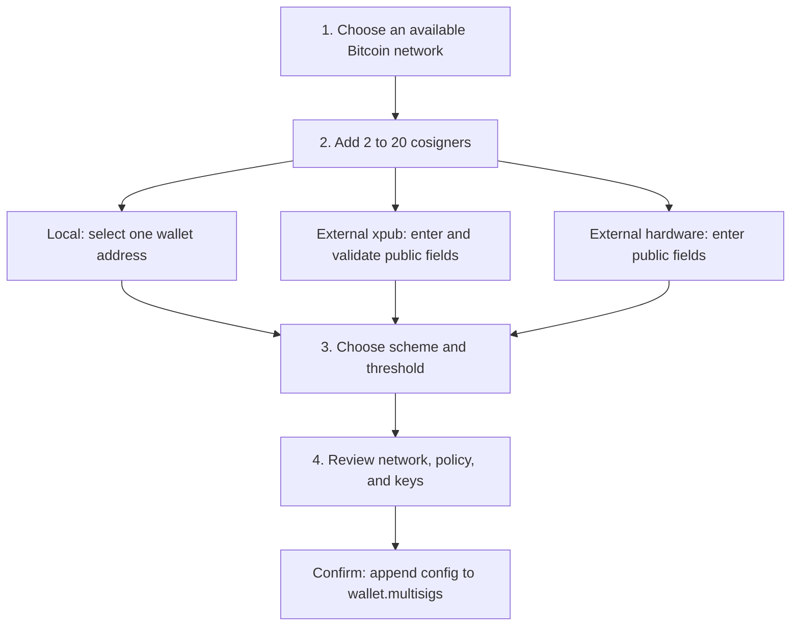
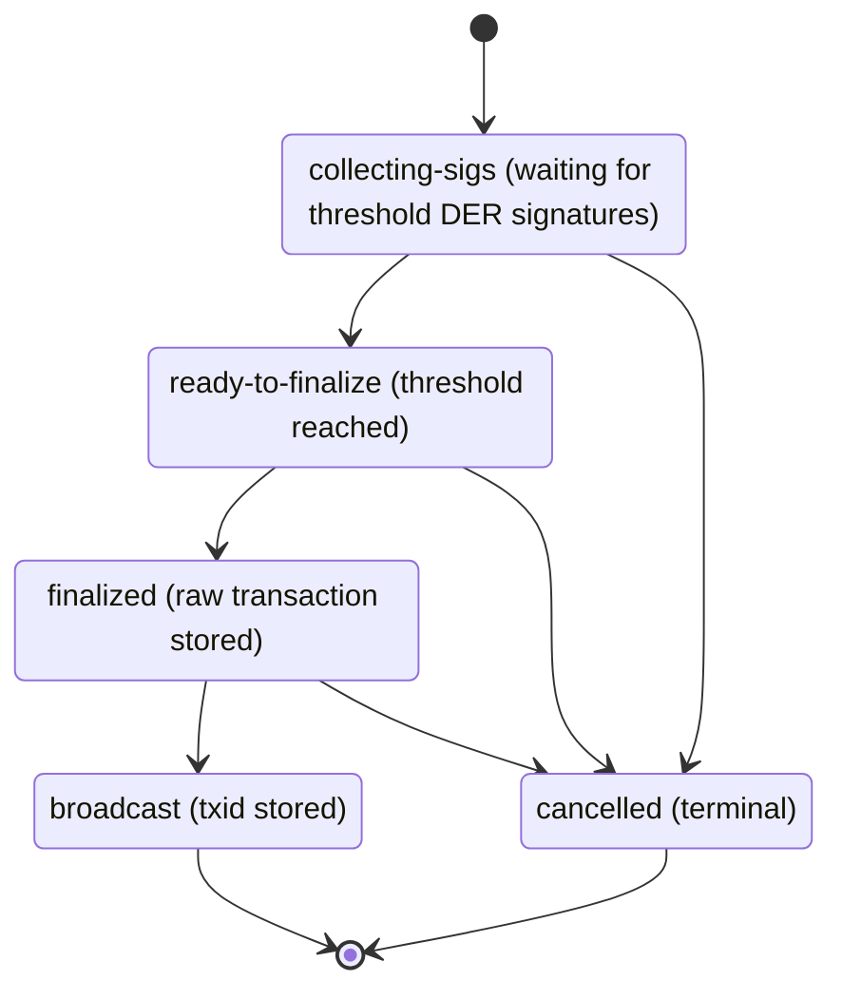

<!-- SPDX-License-Identifier: AGPL-3.0-or-later -->
<!-- Copyright © 2026 Dankest, LLC -->

# Multisig

The wallet supports three Bitcoin multisig schemes:

- **Classic multi-signature** (`p2sh-multisig`): a threshold P2SH script with up to 15 cosigners.
- **SegWit multi-signature** (`p2wsh-multisig`): a threshold P2WSH script with up to 20 cosigners. This is the default scheme in the create form.
- **Taproot multi-signature** (`taproot-musig2`): BIP327 MuSig2 with up to 20 cosigners. It is n-of-n, so every configured cosigner must participate. The aggregate Schnorr signature looks like a single-key Taproot signature on-chain.

The create form lists Bitcoin mainnet, testnet, and regtest networks for which the wallet already has an address. Litecoin and Dogecoin are not offered. The shared create and signing routes are wired into the web, desktop, and browser-extension shells. The mobile shell does not expose these routes.

## Schema

Wallet schema v3 stores zero or more multisig configuration records in `wallet.multisigs`. Each configuration uses multisig-config schema v2 as defined by `packages/core/src/schemas/multisigConfig.js`:

```js
{
    schemaVersion: 2,
    id: 'cfg-uuid',
    scheme: 'p2wsh-multisig',
    threshold: 2,
    cosigners: [
        {
            name: 'Alice',
            pubkey: '03aa...',
            fingerprint: '73c5da0a',
            origin: 'local',
            localSignerId: 'wallet:wallet-id',
            xpub: null,
            derivationPath: "m/84'/0'/0'/0/0",
            addedAt: '2026-04-24T...',
        },
        {
            name: 'Bob',
            pubkey: '03bb...',
            fingerprint: 'a1b2c3d4',
            origin: 'external-xpub',
            localSignerId: null,
            xpub: 'xpub...',
            derivationPath: "m/84'/0'/0'/0/0",
            addedAt: '2026-04-24T...',
        },
    ],
    scriptTemplate: 'multi:2:03aa...:03bb...',
}
```

The record does not store a configuration name, chain, address, or top-level derivation path. `packages/core/src/flows/multisigAddress.js` derives an address on demand from `scriptTemplate`, `scheme`, and the requested network's SDK. For MuSig2, `scriptTemplate` is `musig2:<aggregated-x-only-pubkey>`.

A wallet can store multiple configurations. The create flow rejects a second configuration with the same `scriptTemplate`; this is per-wallet multi-config support, not multiple configurations attached to one address record.

## Create flow

`packages/core/src/shared/routes/MultisigCreate.jsx` uses a compose, review, and confirmation flow:

1. **Choose a Bitcoin network**: only networks on which the wallet already has an address are selectable.
2. **Add at least two cosigners**: the form starts with one local cosigner and one external-xpub cosigner.
   - **Local**: selects one of this wallet's addresses on the chosen network. The public key and derivation path come from the address record. The unlocked signer supplies the master fingerprint when it can; otherwise the user enters it. A configuration can contain at most one local cosigner.
   - **External xpub**: requires an xpub, compressed public key, master fingerprint, and derivation path. The form checks that the xpub network and derived public key agree with the entered values.
   - **External hardware**: records a compressed public key, master fingerprint, and derivation path for a device controlled outside this wallet. The UI describes its exchange path as file transfer, but the stored record contains no transport state.
3. **Choose a scheme and threshold**: the default is 2-of-2 P2WSH. P2SH allows at most 15 cosigners; P2WSH and MuSig2 allow at most 20. MuSig2 requires the threshold to equal the cosigner count.
4. **Review and persist**: the review screen shows the network, scheme, threshold, and every cosigner field. Confirmation appends the config to `wallet.multisigs`.

The create screen does not derive or display the shared address before confirmation. After persistence, the Receive screen derives and displays one address and QR code per stored config.

### Sharing this wallet as a cosigner

The collapsed **Share this wallet as a cosigner** panel lets the user select an HD software-seed address. It displays a JSON payload as both QR and text, plus individually copyable xpub, public key, master fingerprint, and derivation path fields. The payload contains public key material, the network kind, and the selected address, but no seed or private key.

Watch-only and imported-WIF addresses cannot be shared from this panel. Hardware-backed addresses must be exported with the device or its companion wallet.

The create flow does not assign BIP48 paths. A local cosigner keeps the selected address's existing path, such as a BIP84 or BIP86 path, and external cosigners supply their paths. There is no `DerivationPathCrossCheck.jsx` module; the review screen and cosigner-sharing panel are where users compare key details.



## Signing session state machine

`packages/core/src/schemas/multisigSigningSession.js` defines the persisted session record, and `packages/core/src/flows/multisigSigning.js` implements its transitions. A caller starts a session by supplying a wallet id, chain id, 32-byte message hash, PSBT hex, and optionally a config id. The flow snapshots the selected config's scheme, threshold, and ordered cosigner keys into `vault.multisigSigningSessions`.

The source does not automatically start this flow when a user spends from a multisig address, and it does not replicate sessions to other devices. The signing screen lists and operates on sessions already present in the local vault.

### Classical n-of-m



Each contribution stored by the session is a DER-encoded ECDSA signature associated with a configured compressed public key. It is not a partial PSBT. Reaching the threshold changes the status to `ready-to-finalize`; finalization calls `sdk.wallet.finalizeMultisigPsbt(session.psbtHex)` and stores the returned transaction hex. The session flow does not merge its stored DER signatures into `psbtHex` before that call. Broadcasting then calls the chain SDK's `encoder.broadcastTx`.

### MuSig2

MuSig2 uses a two-round BIP327 flow and is always n-of-n:

```mermaid
stateDiagram-v2
    [*] --> collecting_nonces
    collecting_nonces: collecting-nonces (collect one 66-byte public nonce per cosigner)
    collecting_sigs: collecting-sigs (aggregate nonce stored; collect 32-byte partial signatures)
    ready_to_finalize: ready-to-finalize (64-byte Schnorr signature stored)
    finalized: finalized
    broadcast: broadcast (txid recorded)
    cancelled: cancelled (terminal)

    collecting_nonces --> collecting_sigs
    collecting_sigs --> ready_to_finalize
    ready_to_finalize --> finalized
    finalized --> broadcast
    broadcast --> [*]

    collecting_nonces --> cancelled
    collecting_sigs --> cancelled
    ready_to_finalize --> cancelled
    finalized --> cancelled
    cancelled --> [*]
```

The session persists public nonces, the aggregate nonce, partial signatures, and the aggregate Schnorr signature. Secret nonces are not persisted. `SoftwareSigner` deterministically regenerates its round-one nonce for round two using the private key, session fingerprint, derivation path, and the session's random UUID. Including that UUID keeps the derived nonce distinct across separate signing sessions for the same transaction. The flow also refuses a second contribution from the same cosigner in the same round. As with the classical path, the finalization flow does not insert the stored aggregate signature into `psbtHex`.

## Cosigner transport

`packages/core/src/shared/routes/MultisigSigningSession.jsx` provides these exchange paths:

- **Export request**: encodes the current request as XCW chunks and displays them with `AnimatedQrFrames.jsx`. The same chunks are available as copyable plain text.
- **Scan reply**: `QrScanner.jsx` sends each scanned XCW frame to the chunk collector.
- **Paste reply**: accepts one XCW chunk per line and sends the same reassembled bytes through the reply handler.

The import paths accept XCW-framed reply envelopes, not arbitrary pasted partial PSBTs or raw JSON. `packages/core/src/uri/multisigPsbtEnvelope.js` validates the envelope shape, session fingerprint, expected reply kind, cosigner public key, and contribution length before adding it to the active session. The fingerprint detects a reply for a different session, but it is not an authentication signature.

The route does not consume a signing-request envelope or generate a reply envelope for another coordinator. It only exports requests and imports replies for an existing local session, so an end-to-end XChain-to-XChain cosigner round trip is not wired into the current UI.

Animated QR display defaults to 3 fps. **Settings > Appearance > Reduced motion** defaults to **Follow system** (`reducedMotion: 'auto'`). Effective reduced motion, whether selected in the app or reported by `prefers-reduced-motion`, disables auto-advance and exposes previous and next controls.

The shared signing route is present in web, desktop, and the extension. The extension uses the same React tree in its popup and `sidepanel.html`. Camera scanning still depends on camera and scanner support in the host; pasted chunks remain available when scanning is unavailable.

See [URI Schemes: Multisig PSBT envelope](uri-schemes.md#multisig-psbt-envelope).

## Hardware signer status

| Signer | Classical n-of-m | MuSig2 |
|---|---|---|
| Software | Implements raw ECDSA contributions and full-PSBT partial signing | Implements nonce generation and partial signing |
| Trezor | `signMultisigClassical` and `signMultisigPsbt` are explicit unsupported stubs | Both rounds reject with `HW_MUSIG2_UNSUPPORTED` |
| Ledger | `signMultisigClassical` and `signMultisigPsbt` are explicit unsupported stubs | Both rounds reject with `HW_MUSIG2_UNSUPPORTED` |
| Remote | Does not override the base multisig methods, so they reject as abstract | Does not override the base MuSig2 methods, so they reject as abstract |

The current signing UI requires a wallet password and tells users that hardware-held keys cannot co-sign shared wallets yet. The Trezor and Ledger classes contain clear stubs describing the missing vendor-specific transaction or wallet-policy work; they do not provide a working firmware-gated path. [Keys & Signing: Unsupported operations](keys-signing.md#unsupported-operations) describes the signer error contract.

## Coordinator role

The schema has no coordinator field. The wallet that owns the local session record drives request export, reply import, aggregation, finalization, and broadcast. A session may be cancelled from any state except `broadcast` or an already cancelled state.

The implemented transport is direct QR or text exchange. There is no centralized multisig relay and no automatic forwarding to other cosigners. Coordinator handoff is not implemented as a wallet workflow.

## Address browsing

`packages/core/src/shared/routes/AddressList.jsx` derives every configured multisig address for the active Bitcoin network. If a derived address is not already in the address table, the route adds a synthetic **Multisig receive** row. Each matching row shows one `MultisigBadge` with its threshold and Classic, SegWit, or Taproot tag; its detail view repeats the badge.

There is no Multisig-only filter. Multisig rows appear under **All** and **Misc**, and can also be narrowed with the network filter or address search.

## Sweep flow

The wallet has no multisig-specific retirement, sweep, configuration-removal, or archive flow. The generic `SweepForm.jsx` does not create a multisig signing session, and Settings has no Multisig archive action. Funds at a multisig address therefore require the signing-session path described above; the documentation does not treat the generic single-signer sweep as a multisig retirement mechanism.

---

**Copyright &copy; 2026 Dankest, LLC**

Licensed under the **GNU Affero General Public License v3.0** (AGPL-3.0-or-later).
See [LICENSE](../../LICENSE.md) and [NOTICE](../../NOTICE.md) for full terms.
