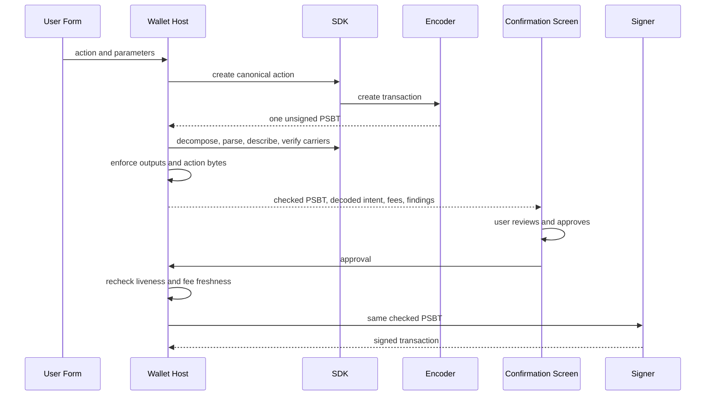

<!-- SPDX-License-Identifier: AGPL-3.0-or-later -->
<!-- Copyright © 2026 Dankest, LLC -->

# Security & Threat Model

This document names what the wallet defends against, what it deliberately doesn't, and which mitigations ship today. It tracks the [threat model](threat-model.md) and the §12 + §14 sections of the wallet specification.

The shipped shells are the web app, Chrome MV3 extension, desktop app for Windows / macOS / Linux, and native Android app. The repository also contains the iOS shell, which is pending App Store release. The built-in registry supports Bitcoin, Litecoin, and Dogecoin today on mainnet, testnet, and regtest; Developer Mode can add validated custom chain descriptors.

## Protected assets

| Asset | Location | Consequence of compromise |
|---|---|---|
| BIP39 seed phrase and optional passphrase | Shown in plaintext during creation or reveal and held by an unlocked software signer in memory. Stored as `encryptedSeed` and, when present, `encryptedPassphrase` in each wallet record inside the encrypted vault | Full loss of funds for the chains and accounts derived from that seed |
| Vault master key | Derived from the device password with Argon2id; held by the open vault while unlocked | Decryption of the vault document, including wallet records and settings. It does not by itself decrypt each wallet record's separately encrypted seed |
| Vault blob | `chrome.storage.local` (extension), IndexedDB (web), an encrypted file under Electron `userData` (desktop), or an app-private file additionally wrapped by Android Keystore / iOS Keychain through the native vault plugin (mobile). The vault document itself uses AES-256-GCM | Offline access to ciphertext and KDF metadata. The password-derived key is still required to open the vault document; mobile storage adds a device-bound encryption layer |
| Unlocked-session secrets | Extension: the vault master key and a separate plaintext password byte string in `chrome.storage.session`. Desktop: the master key in memory and, when a real OS keychain backend is available, a `safeStorage`-encrypted `session.bin`. Web and mobile: process memory | An extension-session compromise is signing-capable because the cached password can repopulate software signers. A master-key-only compromise opens the outer vault but does not open separately encrypted wallet seeds |
| User password | A JavaScript string while entered or used. The extension also keeps it in `chrome.storage.session` for the unlocked browser session. Biometric unlock keeps an encrypted copy. Developer Mode can opt into a short-lived service-worker memory cache for localhost dApp auto-sign | Opens the vault and the password-encrypted software signers on that device |
| Connected-site grants | The vault's encrypted `connectedSites` collection | Disclosure of connected origins and their account, chain, message, and action scopes; mutation could widen or deny a site's stored policy. Signing requests still pass the bridge's current approval and password gates except for the opt-in localhost auto-sign exception described below |

## In scope

### Browser-execution threats

- **XSS against the dApp bridge.** The extension content script runs in an isolated world, accepts only same-window messages whose event origin equals `window.location.origin`, allow-lists the public `bridge.*` message types, and stamps the current origin before relaying a request. The background rechecks the public surface and rejects a missing or unconnected origin. These controls live in `packages/extension/src/content/contentScript.js`, `packages/extension/src/bridge/publicSurface.js`, and `packages/extension/src/bridge/handlers.js`.
- **Malicious same-origin scripts in the web app.** The web shell keeps the vault and unlocked signers in the page process, so its isolation is weaker than the extension's. Its production CSP allows application scripts, the hosted Trezor Connect origin, and a hash-authorized import map; blocks evaluated script and other inline script; and limits network destinations. The mobile store profile removes the Trezor script and frame exceptions because hardware-wallet integration is unavailable there. A reload drops the in-memory session and re-locks the web wallet. The extension-detect banner offers to switch to the extension when its provider is present.
- **Compromised extension UI.** Popup and full-screen pages run in the extension origin, separate from page content. Passwords and signing requests cross only the trusted extension messaging boundary to the background host; they are never returned to the dApp page.

### Storage threats

- **Offline attacker with the encrypted blob.** Fresh vaults use Argon2id with a 64 MiB, 3-iteration, 1-lane floor. Per-wallet seed encryption calibrates iterations toward a 1-second target when it creates fresh KDF parameters, while mobile native calibration is capped at 4 iterations so backups remain usable by the JavaScript fallback. AES-256-GCM protects both the vault document and each password-encrypted seed record.
- **Tampering with ciphertext or KDF parameters.** An AES-GCM tag mismatch fails the open or seed-unlock operation. KDF parameters are validated before use, including load-time ceilings of 1 GiB, 64 iterations, and 8 lanes to prevent a crafted blob from demanding unbounded work.
- **Extension session recovery.** `chrome.storage.session` holds both the 32-byte vault master key and a separate signing-secret slot containing the password. Both are cleared by explicit lock, auto-lock, reset, or browser-session end. They are not available to the dApp page, but compromise of the extension runtime while unlocked defeats this boundary.
- **Desktop session recovery.** Electron `safeStorage` encrypts the cached master key before `session.bin` is written. The backend refuses the Linux `basic_text` fallback and keeps the key only in process memory when a confidential OS-keychain backend is unavailable. Manual lock, auto-lock, or reset clears the cache; an enforceable auto-lock record gates launch-time auto-unlock and fails closed when missing or unreadable.
- **Biometric password wrap.** Biometric unlock is opt-in and stores an encrypted copy of the password, not the vault master key, because each wallet record's seed also requires the password. Browser-based shells use WebAuthn with the PRF extension, request a platform authenticator with user verification and a resident credential, derive an AES-GCM key from the PRF result, and store the credential ID, random PRF salt, and ciphertext in `localStorage`. A missing PRF result refuses registration. Android stores `biometric.wrap` beside the vault and protects it with an auth-per-use Android Keystore AES-256-GCM key restricted to Class-3 biometrics and invalidated by biometric enrollment changes. iOS stores the password directly in a non-synchronizable, this-device-only Keychain item protected by `biometryCurrentSet` and a device passcode. Disabling biometric unlock, changing the password, or resetting the wallet clears the wrap. Loss of the wrap falls back to password entry.

### Network threats

- **MITM against SDK endpoints.** Built-in mainnet and testnet Explorer, Encoder, and Hub endpoints use HTTPS. Built-in regtest endpoints use loopback HTTP. Settings accepts remote endpoint overrides only over HTTPS, while HTTP is limited to regtest or loopback hosts.
- **Malicious Hub / Explorer.** Remote services cannot sign because private keys remain in the wallet. Token-balance and action rows can request local light-client verification against quorum-signed checkpoints, but the UI currently keys balance verification by address and token and action verification by action index. It does not compare the returned proven amount or action payload with the separately fetched row before badging it. Native-coin balances and UTXOs are not in the XChain state tree and remain informational. A malicious service can also withhold data or proofs.
- **Malicious Encoder.** The action-confirm pipeline builds one PSBT before approval and blocks missing or unexpected addressed outputs. It checks inline OP_RETURN action bytes exactly, verifies P2SH/P2WSH carrier scripts and payloads through the SDK, and checks Taproot envelope reveals. The same PSBT is previewed and signed. Bare `MULTISIGN` carrier content remains shape-checked rather than byte-checked, and change to a wallet-owned address is allowed by the output-set check.

### Proof verification (SPV)

The wallet calls the SDK light client through `packages/core/src/flows/verifyBalances.js`. Verification runs as progressive enhancement after the fast Explorer-backed rows render. It never makes a remote service capable of signing or spending.

- **What is checked.** Token proof jobs are bound to the requested chain, address, and tick. Action proof jobs are bound to the requested chain and action index. Native coins are skipped because they are not in the state SMT. The `verifyProofs` setting defaults to `true`; demo balances are excluded. The current Settings UI does not expose a proof-verification toggle.
- **What a badge means.** Rows render **Verified**, **Proof failed**, **Unverified**, or **Verifying**. A valid proof establishes a checkpointed proof for the requested identity. Because the hook neither feeds the displayed balance into verification nor compares the proof result back to the displayed row, a Verified badge does not currently prove that the visible amount or action fields equal the proven payload.
- **Failure semantics.** Proof, key, leaf, subroot, and requested-identity mismatches become `failed`. Transport errors, unsupported light clients, pre-commitment data, and not-yet-checkpointed actions become `unavailable`. A checkpoint quorum failure becomes `failed` only when verification uses a pinned trust root; on the Explorer-selected tier it remains unavailable.
- **Trust root.** The wallet asks `sdk.light.getPinnedCheckpoint(coin)` for each verification. A present SDK or caller-supplied checkpoint produces the `pinned` tier and avoids using the Explorer to select the validator set. Without one, the `explorer` tier still checks signatures, quorum, and proofs locally, but trusts the Explorer-selected qualifying set. See the SDK [Light Client](../sdk/light-client.md) reference for the tier model and validator rotation behavior.

### dApp-bridge threats

- **Origin spoofing.** The content script verifies the page message's event origin, replaces any page-supplied origin with `window.location.origin`, and the background rejects unstamped or unconnected requests.
- **Approval bypass.** Connected sites are scoped by origin, chain, and account. `signMessage`, `signPsbt`, `signAction`, `coSign`, and `signIn` route through approval UI; `parallel` presents one grouped approval for up to 20 signing requests. The public `signAction` bridge currently supports `SEND` and `SWEEP`. Stored `never` action policy rejects before signing, and successful prompts can save message or action policy. The explicit exception is Developer Mode localhost auto-sign: after a real approval, an opt-in 5-minute or 1-hour setting can reuse a password held only in service-worker memory. The default is off. Per-origin throttling and the user blocklist run before bridge signing.
- **Replay across origins.** Sign-In with XChain formats a challenge containing the stamped origin, selected address, nonce, timestamp, and expiry. The formatter rejects its reserved separator in page-supplied `appId` or nonce values, and expiry is capped at one hour.

### User-error threats

- **Forgotten password.** The password cannot be recovered. The Locked screen's **Forgot password?** flow can erase the local vault and open recovery-phrase or encrypted-backup restore. Erasure is destructive and requires recovery material for every wallet that must be restored.
- **Lost recovery phrase.** An unlocked local wallet can still reveal its recovery phrase by decrypting the stored seed after password confirmation, and an encrypted backup can restore it. If the device vault is lost or reset and neither the phrase nor a usable backup exists, the wallet and support cannot recover the funds. Creation requires a saved-phrase acknowledgement and a word quiz before the mnemonic is imported and persisted; closing at the phrase or quiz stage leaves no wallet behind.
- **Phishing domain.** The web app detects the injected extension provider and offers to use the extension, whose browser-managed origin is a stronger trust anchor than page content. Users must still verify the site or extension identity and never disclose a recovery phrase to a page or support contact.

## Out of scope

- **Zero-day browser sandbox escapes.** A browser or OS compromise can reach an unlocked software wallet. Higher-risk workflows can use watcher / signer mode, PSBT-QR transfer, or a supported hardware signer (see [URI Schemes](uri-schemes.md)).
- **Vendor firmware bugs.** Hardware-signer firmware and hosted vendor integrations are outside the wallet's audit boundary; the wallet relies on the vendor device and its signed firmware.
- **Supply-chain attacks on dependencies.** CI runs `pnpm audit --prod --audit-level=high`, dependency review, bundle audits, and reproducible-build gates. These controls detect known or observable drift but cannot guarantee that an upstream dependency contains no malicious code. See [Dependencies](dependencies.md) and [Reproducible Builds](reproducible-builds.md).
- **Physical access to an unlocked device.** An attacker who controls an already unlocked wallet process can use the authority present in that session. Manual lock and the `Auto-lock after` setting reduce the window; the default is 15 minutes. Foreground timers cover web, extension, and desktop, and the native app lifecycle checks the same timeout when the app resumes. The extension also enforces the window from its service worker with the popup closed, desktop checks it while running and before keychain auto-unlock at launch, and a closed web tab loses its in-memory session.
- **Raw-password attacks.** Argon2id raises offline guessing cost, unlock throttling slows repeated attempts in supported shells, and the password's strength remains the user's responsibility.
- **Blockchain consensus.** The wallet trusts the SDK's transaction and protocol rules and each underlying coin network's selected chain. SPV checks can prove checkpointed token state and action inclusion under the selected validator-set trust tier, subject to the UI binding limitation above; they do not validate native-coin consensus or replace a full node.

## Sign-screen safety rails

Wallet action forms use the shared single-encode confirmation pipeline in `packages/core/src/flows/composeForConfirm.js`, `packages/core/src/flows/composeActionForConfirm.js`, and `packages/core/src/flows/confirmChecks.js`:

1. The form supplies an action and parameters to the host-side compose route.
2. `xchain-sdk` creates the canonical action string and the Encoder returns one unsigned PSBT.
3. Before the confirmation screen opens, the wallet decomposes that PSBT and rejects missing or unexpected addressed outputs. It compares inline action bytes exactly, verifies P2SH/P2WSH carrier commitments and payloads, and validates an envelope reveal when present.
4. The SDK parses and describes the composed action string. The confirmation screen renders that description, exact PSBT-derived fees when available, projected deltas, and preflight findings rather than rebuilding intent from form state.
5. The user reviews and approves. The wallet rechecks stale inputs and applicable native protocol fees at approval time.
6. The signer signs the same PSBT bytes that passed the checks and appeared in the confirmation flow.

These checks make encoder tampering blocking rather than merely visible. The limits are explicit: a bare `MULTISIGN` carrier is recognized by output shape without an independent content-byte check, carrier output value is not independently predicted on chunk lanes, and wallet-owned change outputs are accepted. The confirmation screen's total debit and exact fee display remain important review data for those cases.

## Audit posture

The wallet is pre-v1.0 GA at `0.341.3`. External security and accessibility audits, plus Chrome Web Store submission, remain user-driven release items before v1.0.0 GA. Audit-readiness material ships in the wallet repository.

The security audit scope includes vault and KDF code, unlocked-session secrets, software and hardware signers, the single-encode confirmation checks, dApp permissions and approvals, and shell trust boundaries. The accessibility target is WCAG 2.2 AA across keyboard, screen-reader, contrast, motion, forced-colors, touch-target, zoom, and reflow behavior.

Static gates run on every commit and protect against regressions in both surfaces between audits:

- `packages/core/scripts/a11y-audit.js`: mechanical checks for button names, image alternatives, input labels, textarea labels, and keyboard semantics on clickable `div` elements
- `packages/core/scripts/extension-manifest-audit.js`: 18 MV3 manifest, version, CSP, icon, permission, content-script, and web-accessible-resource rules
- `packages/core/scripts/repro-build-audit.js`: 19 reproducible-build scaffolding and documentation rules
- `test/smoke/audits/release-gates.smoke.js`: release-readiness checks

## Disclosure

Report vulnerabilities privately through [GitHub Private Vulnerability Reporting](https://github.com/XChain-Platform/xchain-wallet/security/advisories/new), or email `security@dankest.llc`. Do not open a public issue or pull request for a suspected vulnerability.

The response targets are acknowledgement within 72 hours, triage and severity assignment within 7 days, and a fix or mitigation within 30 days for high or critical findings and 90 days for lower severities. Coordinated public disclosure occurs within 90 days of the initial report, or sooner after a fix ships and users are protected. The wallet supports security fixes on the latest tagged release.

---

**Copyright &copy; 2026 Dankest, LLC**

Licensed under the **GNU Affero General Public License v3.0** (AGPL-3.0-or-later).
See [LICENSE](../../LICENSE.md) and [NOTICE](../../NOTICE.md) for full terms.
