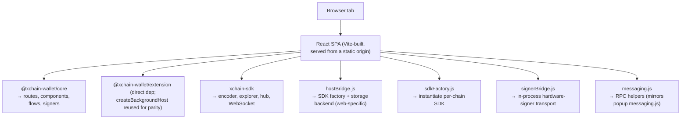

<!-- SPDX-License-Identifier: AGPL-3.0-or-later -->
<!-- Copyright © 2026 Dankest, LLC -->

# Shell: Web

`@xchain-wallet/web` is the browser SPA shell. It renders the shared React routes and components from `@xchain-wallet/core` in a Vite build. In a browser, it persists the encrypted vault in IndexedDB and keeps the open vault and session secrets in memory.

## When to use the web shell

- **No-install access.** The web shell loads from a URL. No extension install, no desktop download. Lowest friction for first-time users.
- **Mobile browser access.** The Android app, a Capacitor wrapper around the same built SPA, shipped in `v0.336.0`. The iOS wrapper is built and pending App Store release. The browser SPA remains available on mobile platforms, and its layout responds to the width of its own container.
- **Extension-backed access.** When the XChain Wallet extension is present, the web app can connect to it and route supported account, balance, and signing calls through the extension. Wallet creation, import, unlock, and lock remain local to the web app.

The web shell has a weaker key-isolation boundary than the extension and desktop shells. Its vault host and UI run in the same JavaScript realm, so script executing in the page origin can reach in-memory wallet state. The CSP and generated Subresource Integrity metadata described below reduce that risk, but they do not create a process boundary.

## Architecture



`hostBridge.js` is the web analog of the extension service worker. It owns the in-tab Vault, signer pool, SDK registry, notification watchers, and the `createBackgroundHost` instance reused from the extension package. There is no service-worker or IPC boundary between that host and the page UI. Reloading the page discards the in-memory host and returns the wallet to its locked state.

## Storage

| Bucket | Backend |
|---|---|
| Encrypted vault document, including wallet records, settings, and `connectedSites` | IndexedDB database `xchain-wallet`, object store `vault` |
| KDF parameters (salt, memory, iterations) | `localStorage` via `WebMetaBackend` (not secret; needed to derive the master key before reading IndexedDB) |
| Open Vault, master key, signer instances, and host state | In-memory only |
| UI preferences and caches outside the encrypted vault | `localStorage` or `sessionStorage`, depending on the feature |

Browser storage is origin-scoped. Tabs on the same origin share the IndexedDB database and Web Storage namespaces; cross-origin pages cannot read them through those APIs. During session-status checks, the shell also makes a best-effort `navigator.storage.persist()` request once per page load.

## Build

```bash
pnpm --filter @xchain-wallet/web dev      # Vite dev at http://localhost:5173
pnpm --filter @xchain-wallet/web build    # Production SPA bundle to dist/
pnpm --filter @xchain-wallet/web preview  # Serve the production bundle locally
```

The package declares React `^18.3.0`, Vite `^6.4.3`, `@vitejs/plugin-react` `^4.3.0`, `vite-plugin-node-polyfills` `^0.22.0`, and `xchain-sdk` `0.22.4`. Production builds always load the real SDK. The dev server selects the deterministic mock by default; set `VITE_XCHAIN_REAL_SDK=1` to use the real SDK in development. `VITE_HTTPS=1` or `HTTPS=1` enables `@vitejs/plugin-basic-ssl` for LAN testing in a secure context; plain `localhost` is already treated as a secure context by browsers.

## Mobile responsiveness

The shell measures its layout container, not the browser viewport, and selects one of three navigation tiers:

| Breakpoint | Layout |
|---|---|
| < 640 px | Compact tier with a bottom tab bar and no sidebar |
| 640–899 px | Icon-only navigation rail |
| >= 900 px | Labelled sidebar |

Individual routes add their own narrower layout rules where needed. Measuring the container lets the same shared components render correctly in a full browser tab, a narrow embedded frame, and the extension surfaces.

## Camera and WebHID

| API | When | Notes |
|---|---|---|
| `getUserMedia` + `BarcodeDetector` | Live QR scanner | Requires a secure context and camera permission. The web path also requires browser `BarcodeDetector` support |
| WebHID | Ledger pair and sign | Requires a secure context and `navigator.hid`; the UI directs users to desktop Chrome, Edge, or Brave |
| Hosted Trezor Connect | Trezor pair and sign | Loaded on demand from `connect.trezor.io` and uses the Trezor Connect popup/frame flow |

The mobile `store` build has no WebHID path and removes the Trezor script and frame origins from its CSP. Hardware-signer support therefore belongs to the default browser build, not the Capacitor store profile.

## Extension-detect banner

When the injected `window.xchain` provider is detected, the web SPA shows an "XChain Wallet extension detected" banner with **Use extension wallet** and **Not now** actions. Accepting performs the extension's connect handshake. After approval, supported account, address, balance, and signing calls use the provider; the banner switches to an active state with **Switch back**.

The accepted preference is stored in `localStorage` and survives reloads, but it is effective only while a branded XChain provider is present. Dismissal is stored in `sessionStorage`, so the offer returns in a new tab session. Switching back clears the preference but does not revoke the extension's connected-site grant. The user can revoke that grant in the extension.

## CSP

Production builds inject a Content-Security-Policy meta tag into `index.html`, so most of the policy travels with the bundle. The development server does not inject it because Vite hot reload requires inline script, evaluation, and a WebSocket connection.

Strict, and load-bearing:

- `default-src 'self'`
- `script-src 'self' https://connect.trezor.io` plus the generated hash for the inline integrity import map. There is no `unsafe-inline`, `unsafe-eval`, or `wasm-unsafe-eval`. The Trezor origin supplies the hosted Trezor Connect build at pairing time instead of being bundled.
- `object-src 'none'`, `base-uri 'none'`, `form-action 'none'`
- `frame-ancestors 'none'` in the full header policy. It is deliberately omitted from the meta tag because browsers cannot enforce that directive from a meta policy; the fronting server must send it as a response header.
- `frame-src 'self' https://connect.trezor.io`, because Trezor Connect runs its signing UI in a cross-origin frame it hosts.
- `img-src 'self' data: blob:` and `font-src 'self' data:` for QR codes and the favicon, and `worker-src 'self' blob:`. No third-party fonts, analytics, ads, or trackers.
- `connect-src` is generated from the fixed web/mobile egress registry, the bundled chain descriptors' explorer, encoder, and hub endpoints, the regtest miner default, and the corresponding explorer WebSocket origins. It does not allow arbitrary `https:` or `wss:` destinations.

Relaxed, on purpose:

- `style-src` allows `'unsafe-inline'` because the UI uses React inline styles and runtime-injected `<style>` elements. This widens style injection impact but does not permit script execution.

The mobile `store` profile uses the same directive set minus the Trezor origins in `script-src` and `frame-src`. Profiles can only subtract from the default policy.

The build also adds Subresource Integrity attributes to emitted script and stylesheet tags and injects an integrity import map for lazy JavaScript chunks. `packages/web/src/csp.js` and `packages/web/sri.js` in the wallet repository are the sources of truth.

## Session lifetime

- **Tab close or refresh**: the in-memory host disappears, while the already encrypted vault document remains in IndexedDB. A reload returns to the locked state.
- **Manual lock**: stops notification watchers, locks live signers, closes the Vault, zeros the Vault's cached master-key copy, tears down the host, and releases the browser vault lease.
- **Foreground auto-lock**: defaults to 15 minutes idle and shares the configurable policy used by the extension and desktop shells. Users can select Never; demo wallets do not auto-lock because their generated session password is not available for a later unlock.
- **Multi-tab**: an unlocked browser tab holds an exclusive Web Lock named `xchain-wallet:vault-session`. A second tab cannot open the vault until the first tab locks or closes. Browser runtimes without Web Locks are refused rather than allowed to make concurrent writes.

Session secrets are not persisted to IndexedDB or Web Storage. Reloading therefore requires the wallet password again, unless the user chooses the extension-backed mode and completes whatever unlock or approval the extension requires.

## Test coverage

| Suite | What it covers |
|---|---|
| Shared Vitest suites | Core routes, components, flows, storage, responsive behavior, and shell integration |
| `test/smoke/onboarding/web-onboarding.smoke.js` | Browser storage, create/import, lock/unlock, and fresh-vault guards through the in-page host |
| `test/smoke/shells/web-send.smoke.js` / `web-shell.smoke.js` | Web route and messaging wiring, host session states, storage, and the dev-mock send failure path |
| Web unit, integration, CSP, SRI, and multi-tab tests | SDK selection, signer bridge, extension handoff, IndexedDB persistence, policy generation, artifact integrity, and exclusive vault leasing |
| `@xchain-wallet/e2e` (Playwright) | Browser flows against the dev server, including onboarding, send review, responsive layouts, and accessibility; separate regtest specs build the production bundle and exercise real signing and broadcast |

The default Playwright configuration explicitly selects the dev mock. It supplies deterministic browser data and composition behavior, but its signing and broadcast path fails by design. `playwright.regtest.config.js` builds and previews the production bundle with the real SDK for the specs that sign and broadcast. dApp bridge flows remain extension concerns and are covered by `test/smoke/bridge/bridge-e2e.smoke.js` and the [test-dApp runbook](release/extension/test-dapp-runbook.md).

## Hosting

The build output is a static SPA in `packages/web/dist`, but deployment still has security and path requirements. Serve it from the origin root over HTTPS, preserve the generated HTML, assets, CSP, and integrity metadata without rewriting them, and return `index.html` for application entry requests. The fronting server must also send `Content-Security-Policy: frame-ancestors 'none'`, which a meta policy cannot enforce. Application chunks are same-origin; the only runtime third-party script allowed by the default profile is the hosted Trezor Connect build.

---

**Copyright &copy; 2026 Dankest, LLC**

Licensed under the **GNU Affero General Public License v3.0** (AGPL-3.0-or-later).
See [LICENSE](../../LICENSE.md) and [NOTICE](../../NOTICE.md) for full terms.
