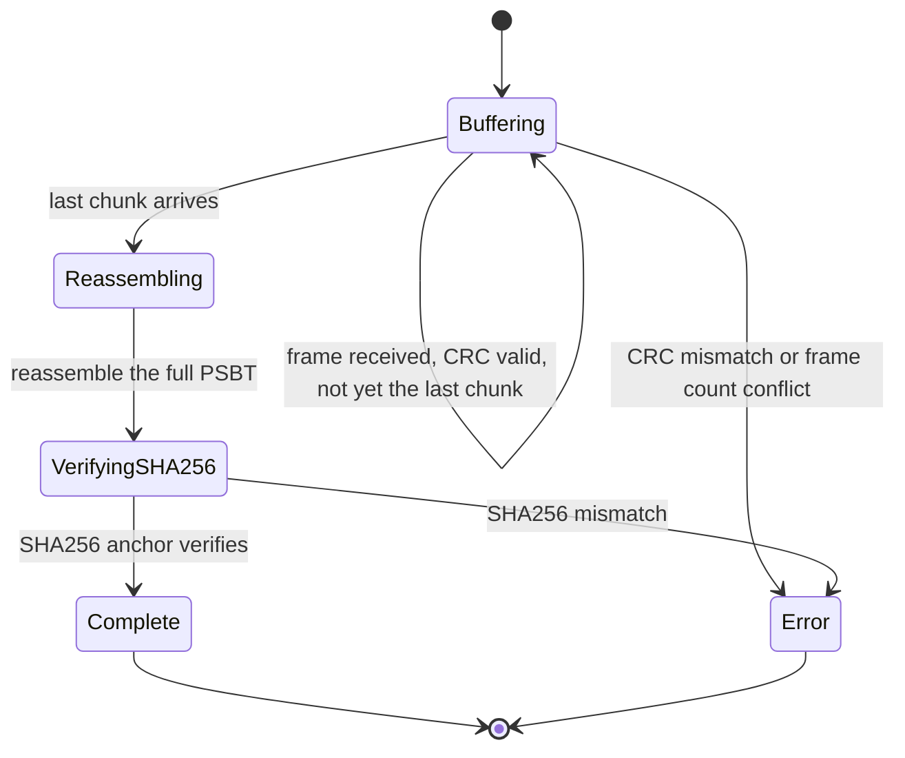

<!-- SPDX-License-Identifier: AGPL-3.0-or-later -->
<!-- Copyright © 2026 Dankest, LLC -->

# URI Schemes & QR Transport

The wallet routes scanned or pasted input through `core/src/uri/detectQrContent.js`, which classifies the string into one of the following types:

- **BIP21** (`type: 'bip21'`): chain payment URIs (`bitcoin:`, `dogecoin:`, `litecoin:`)
- **XChain URI** (`type: 'xchain-uri'`): `xchain:` URIs (action-share links, dApp deep-links, multisig invitations)
- **XCW chunk** (`type: 'xcw-chunk'`): a single frame from a chunked PSBT-QR stream
- **PSBT hex** (`type: 'psbt-hex'`): raw PSBT bytes in lowercase hex
- **WIF** (`type: 'wif'`): a WIF-encoded private key
- **BIP39 mnemonic** (`type: 'mnemonic-bip39'`): a 12/15/18/21/24-word BIP39 phrase
- **Counterwallet mnemonic** (`type: 'mnemonic-counterwallet'`): a legacy 12-word Counterwallet phrase
- **Address** (`type: 'address'`): a bare coin address (heuristic match)
- **Unknown** (`type: 'unknown'`): unrecognised input

## URI registration

| Scheme | Used for | Classifier type |
|---|---|---|
| `bitcoin:` | BTC payment requests, generated by Receive | `bip21` |
| `dogecoin:` | DOGE payment requests | `bip21` |
| `litecoin:` | LTC payment requests | `bip21` |
| `xchain:` | XChain-specific URIs: action-share links, multisig invitations, dApp deep-links | `xchain-uri` |

`xchain:` is a distinct classifier type from BIP21 chain URIs. In `detectQrContent.js`, a `bitcoin:` / `dogecoin:` / `litecoin:` URI resolves to `type: 'bip21'` (with a `scheme` field); an `xchain:` URI resolves to `type: 'xchain-uri'`. The structural parse is the same (`parseBip21Uri`), but the dispatch path and handler are separate. This matters for implementors: a scanner that treats `xchain:` as a BIP21 sub-case will hand it to the wrong handler.

Per-shell registration:

| Shell | Schemes claimed | Mechanism |
|---|---|---|
| Web | `web+xchain:`, plus bare `xchain:` where the browser accepts it | `navigator.registerProtocolHandler` at boot (`packages/web/src/main.jsx`), pointing at `/?uri=%s`. `web+xchain` is always allowed; a browser that rejects the bare `xchain` scheme is ignored, so `web+xchain:` is the dependable form. Effective only on https origins (and localhost). The web shell registers no coin schemes. |
| Extension | `web+xchain:` (declared only) | `packages/extension/manifest.json` declares a `protocol_handlers` entry mapping `web+xchain:` to `popup.html?uri=%s`. No shipped build acts on it: the extension ships only for Chromium browsers, which ignore the key (Chrome warns of an unrecognized key at load), and the key is kept for a future Firefox port. The extension registers no coin schemes and installs no redirect page; it ships only the popup, approval and side-panel pages. |
| Desktop | `xchain:` as default handler; `bitcoin:`, `litecoin:`, `dogecoin:` declared, default only after an opt-in | `packages/desktop/electron-builder.config.cjs` declares all four schemes to the OS at install time, and `packages/desktop/main/protocol.js` calls `app.setAsDefaultProtocolClient('xchain')` on every launch. The app makes itself the default handler for the coin schemes only when the user opts in, which is off by default and has no settings toggle yet. The OS may still route a coin URI to the app where no other app is the default handler, and the app then parses it as BIP21 and opens it like any other deep link. |
| Mobile | `xchain:`, `bitcoin:`, `litecoin:`, `dogecoin:` | Android intent filters (`AndroidManifest.xml`, beside an https App Link for `xchain.io/wallet/link/`) and iOS `CFBundleURLSchemes` (`Info.plist`). |

## BIP21

`core/src/uri/bip21.js` parses and serializes BIP21 URIs:

```
bitcoin:bc1qmyaddress?amount=0.001&label=Payment&message=Thanks
```

Supported parameters:

| Parameter | Source | Purpose |
|---|---|---|
| `amount` | BIP21 | Native-coin amount in BTC / LTC / DOGE |
| `label` | BIP21 | Receiver-facing label |
| `message` | BIP21 | Free-text note |
| `tick` | XChain extension | Token name (for token sends) |
| `tokenamount` | XChain extension | Token amount |
| `r` | BIP70 | Payment-request URL (rejected: wallet doesn't speak BIP70) |

Receive view (`Receive.jsx`) generates a BIP21 URI on demand with the user-supplied amount + label. Send view (`Send.jsx`) parses an incoming URI from paste or QR scan and pre-populates the form.

## PSBT-QR

PSBTs that exceed the single-frame QR capacity are encoded as a chunked stream of frames. `core/src/uri/psbtQr.js` handles encode + decode; `AnimatedQrFrames.jsx` paints the stream at 3 fps with auto-advance, or with manual prev / next when `prefers-reduced-motion: reduce` is set at the OS level.

Frame format:

```
XCW:<n>/<total>:<crc32-hex>:<base64-bytes>
```

| Field | Purpose |
|---|---|
| `<n>/<total>` | Frame index (1-based) and total frame count, repeated in every frame so out-of-order arrival still works |
| `<crc32-hex>` | Lowercase 8-character CRC32 hex over the decoded base64 bytes; per-frame integrity check |
| `<base64-bytes>` | Base64 chunk content. Chunk 1 prepends a 32-byte SHA256 of the full reassembled PSBT as an integrity anchor |

The collector buffers frames until all `total` are seen and verifies the SHA256 against chunk 1 before handing the PSBT to the caller. Out-of-order arrival is fine; the receiver's camera doesn't have to capture frames in order, only all of them eventually.

`QrScanner.jsx` reads frames continuously and calls back with the reconstructed PSBT once the buffer fills.

Implementors building a scanner directly against `psbtQr.js` use the `XcwCollector` progressive-scan API:

```js
import { createXcwCollector, addChunkToCollector } from 'core/src/uri/psbtQr.js';

const state = createXcwCollector();
// call addChunkToCollector(state, rawFrame) for each scanned frame string
// state.complete becomes true when all chunks are in and SHA256 verifies
// state.psbt holds the reassembled Uint8Array; state.error holds any failure reason
```

`createXcwCollector` returns a mutable state object. `addChunkToCollector(state, frame)` parses and CRC-validates the frame, extracts the SHA256 anchor from chunk 1, and accumulates payload slices. When the last chunk arrives it reassembles the full PSBT and verifies the SHA256. Duplicate scans (the animated QR loops) are silently ignored. `state.error` is set (and `state.complete` stays false) on any CRC mismatch, hash mismatch, or frame count conflict.



## UR (ur:crypto-psbt) ingestion

Air-gapped hardware signers in the Keystone / Passport family speak the Uniform Resources (UR) animated-QR format rather than the wallet's own XCW framing. `core/src/uri/urPsbt.js` is a clean-room decoder for `ur:crypto-psbt` frames: bytewords decoding, minimal CBOR unwrapping, and Luby-transform fountain-code reassembly (Xoshiro256-seeded part selection), validated against bc-ur gold vectors including all-mixed fountain streams.

Because UR uses a fountain code, the receiver does not need every frame; it accumulates parts until the payload reconstructs, so a looping animated QR can be scanned starting anywhere.

```js
import { parseUrFrame, UrPsbtDecoder, decodeUrPsbt } from 'core/src/uri/urPsbt.js';

const decoder = new UrPsbtDecoder();
// feed each scanned `ur:crypto-psbt/...` frame string:
//   decoder.receive(frame)  -> true when the frame contributed
//   decoder.complete        -> flips true when the PSBT reassembles
//   decoder.psbt / .psbtHex -> the decoded bytes (throws while incomplete)
// or decode a captured frame array in one shot: decodeUrPsbt(frames)
```

Both the PSBT sign form's paste inbox and the camera scanner accept UR frames alongside XCW frames; decode failures raise a typed `UrError`. This is ingestion-only: the wallet displays outgoing PSBTs in its own XCW framing.

## Multisig PSBT envelope

`core/src/uri/multisigPsbtEnvelope.js` wraps the multisig round-trip in a typed JSON envelope carried over the XCW chunked transport (prefix `XCW-MS:`). The envelope identifies the session by a fingerprint derived from the signing round parameters and carries the cosigner's contribution:

```json
{
  "v": 1,
  "kind": "<multisig-request-nonce | multisig-round-1-reply | ...>",
  "fingerprint": "<32-byte hex>",
  "sessionRef": { "scheme": "...", "threshold": N, "cosignerPubkeys": [...], ... },
  "contribution": { ... }
}
```

| Field | Purpose |
|---|---|
| `kind` | Protocol step: `multisig-request-nonce`, `multisig-round-1-reply`, `multisig-request-partial`, `multisig-round-2-reply`, `multisig-request-signature`, `multisig-classical-reply`, or `multisig-finalized` |
| `fingerprint` | SHA256 of the canonical `sessionRef`; routes the envelope to the right local session without shipping a UUID |
| `sessionRef` | Session invariants (scheme, threshold, cosigner pubkeys, msgHash, psbtHex); present on request and finalized envelopes |
| `contribution` | Round-specific output from the cosigner (public nonce, partial sig, or classical DER sig); present on reply and finalized envelopes |

The paste-inbox in `MultisigSigningSession.jsx` accepts these envelopes (received as XCW QR frames or pasted as the raw JSON string). The session state machine routes each round's contribution to the right slot and surfaces a green check.

## Sign-in challenge

Sign-In with XChain challenges are not URI-encoded by the wallet; they're produced and consumed by the bridge (`@xchain-wallet/bridge-spec`). Sign-in challenges are not classified by `detectQrContent`; the bridge layer handles them independently.

See [Bridge; Sign-In with XChain](bridge.md#signinparams-promisesigninresult).

## Detect-and-route

`core/src/uri/detectQrContent.js` is the single entry point for any scanned or pasted string:

```js
const detected = detectQrContent(input);
switch (detected.type) {
    case 'bip21':                   return handleBip21(detected);
    case 'xchain-uri':              return handleXChainUri(detected);
    case 'xcw-chunk':               return handleXcwChunk(detected);
    case 'psbt-hex':                return handlePsbtHex(detected);
    case 'wif':                     return handleWif(detected);
    case 'mnemonic-bip39':          return handleMnemonic(detected);
    case 'mnemonic-counterwallet':  return handleMnemonic(detected);
    case 'address':                 return handleBareAddress(detected);
    default:                        return handleUnknown(detected);
}
```

The same function powers the camera scanner, the paste handler in every form, and the URI-scheme entry-point on each shell. Every QR / URI / clipboard input the user feeds the wallet goes through this single classifier.

## Animated QR cadence

| State | Cadence label | Behavior |
|---|---|---|
| Single-frame PSBT | `single` | Static frame, no controls |
| Multi-frame, default motion | `3 fps` | Auto-advance every 333 ms |
| Multi-frame, `prefers-reduced-motion: reduce` | `manual` | Auto-advance suspended; Prev / Next buttons rendered below the frame |

The reduced-motion flip is observed via `window.matchMedia('(prefers-reduced-motion: reduce)')` with both modern (`addEventListener`) and Safari-<14 (`addListener`) listener wiring. The preference can flip mid-session and the component reacts. The wrapper exposes a `data-reduced-motion` attribute for downstream styling and tests.

The choice of "manual stepping" over "frozen first frame" preserves function: multi-frame PSBT-QRs (multisig partials, large PSBTs) are non-functional if you can't reach frames 2…N. Manual prev / next removes the motion while preserving reachability, vestibular-trigger users still complete the workflow.

---

**Copyright &copy; 2026 Dankest, LLC**

Licensed under the **GNU Affero General Public License v3.0** (AGPL-3.0-or-later).
See [LICENSE](../../LICENSE.md) and [NOTICE](../../NOTICE.md) for full terms.
