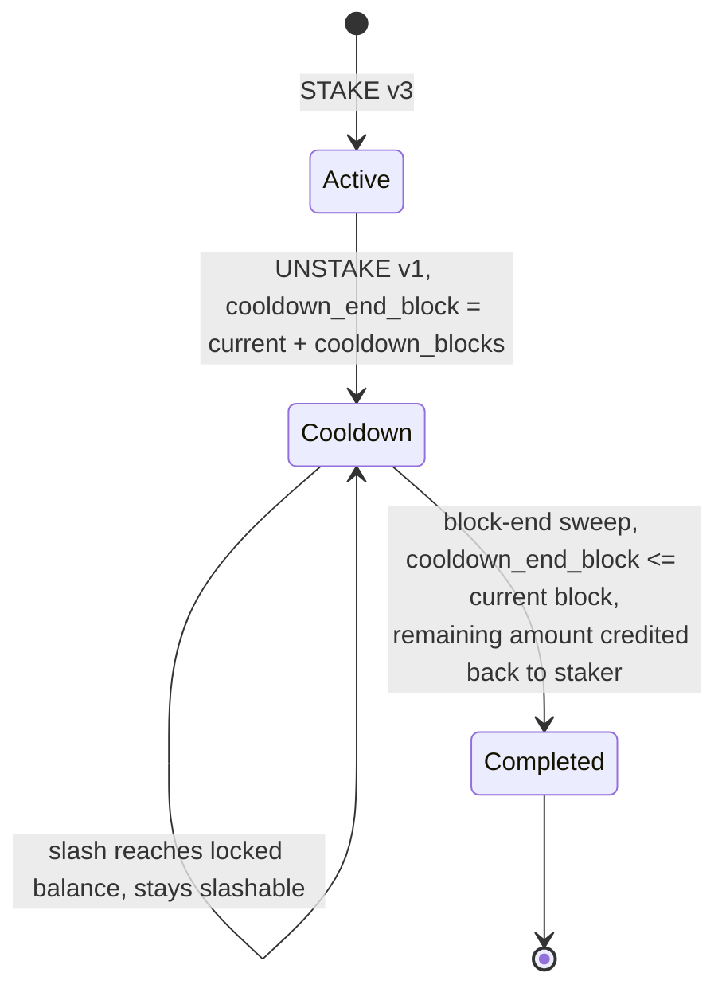
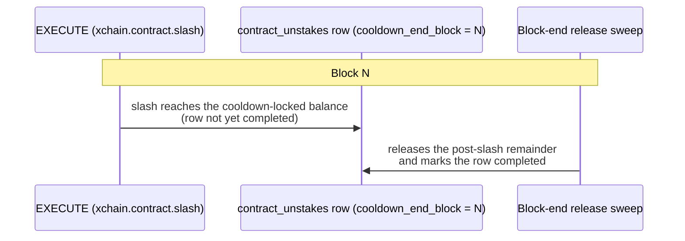

# Contract-Targeted Staking

Smart contracts on XChain can declare themselves as staking targets at deploy time. Stakers can lock any token against a specific contract, and the contract's own logic (running in the VM) decides what staking unlocks and when to slash. This is layered on top of the existing capability-based staking (`price`, `cross_chain`, `oracle_publish`, `attestation`, `full_node`); the two systems coexist, share no state, and use the same wire-level actions (`STAKE`, `UNSTAKE`, `DELEGATE`) at different version numbers.

## Wire formats

Contract-targeted staking uses new versions of three existing actions; capability versions are unchanged.

| Action | Capability version | Contract version |
|---|---|---|
| STAKE | v1 (new) / v2 (top-up) | **v3** |
| UNSTAKE | v0 | **v1** |
| DELEGATE (rotate) | v0 | **v1** |
| DELEGATE (revoke) | v2 | **v3** |
| DEPLOY | v0 | **v1** (adds optional staking metadata) |

```
STAKE|3|AMOUNT|SIGNING_PUBKEY|TARGET_CONTRACT_INDEX|TICK
UNSTAKE|1|SIGNING_PUBKEY|TARGET_CONTRACT_INDEX|TICK[|AMOUNT]
DELEGATE|1|NEW_SIGNING_PUBKEY|TARGET_CONTRACT_INDEX|TICK
DEPLOY|1|CODE_ENCODING|GAS_LIMIT|CONSTRUCTOR_PARAMS|COOLDOWN_BLOCKS|SLASH_DESTINATION
```

### STAKE v3

| Field | Type | Description |
|---|---|---|
| AMOUNT | decimal string | Positive. Decimal places must not exceed the token's `decimals` value. |
| SIGNING_PUBKEY | 64-hex | Ed25519 pubkey. A given pubkey may be used independently for capability staking AND contract staking, but cannot collide across multiple contracts. |
| TARGET_CONTRACT_INDEX | unsigned int | The `action_index` of a stakeable contract, deployed via either `DEPLOY v1` (inline) or `DEPLOY v3` (chunked) with `COOLDOWN_BLOCKS` set. Must be in `valid` status. |
| TICK | string | Any registered token. Must exist in `tokens` at the action's block. |

Top-up vs. new is auto-detected: if `(target_contract_index, signing_pubkey, tick)` already has a valid row, whether or not that stake is still active, the action is treated as a top-up and the row must be owned by the same `SOURCE`; a different `SOURCE` is refused with `SIGNING_PUBKEY (already staked to this contract by another source)`. The first valid staker keeps the key, and only a DELEGATE rotation that rewrites a live row's signing key moves a row off it. Otherwise the action creates a new row.

Activation delay is calibrated per chain for roughly **60 minutes of reorg protection**: **6 blocks on BTC** (~10 min/block), **24 blocks on LTC** (~2.5 min/block), and **60 blocks on DOGE** (~1 min/block). Because contract staking runs on every chain, a single block count would give materially different wall-clock protection (6 blocks ≈ 6 minutes on DOGE). Each chain's `STAKING.ACTIVATION_DELAY_BLOCKS` is therefore a fixed, chain-wide consensus constant in the bundled chain configuration, shared by every node. Changing it requires a coordinated consensus upgrade, not a local or per-deployment override. A local edit either fails the consensus pin check where that pin is armed or makes the node compute different stake activation heights and diverge from the network where it is not. This activation delay is separate from the contract's deploy-time `COOLDOWN_BLOCKS`, which controls how long an UNSTAKE remains locked. (Capability staking is BTC-only and uses the same 6-block BTC value.)

### UNSTAKE v1

Initiates the cooldown for a specific `(target_contract_index, signing_pubkey, tick)` triple. The cooldown duration is the contract's own `cooldown_blocks` value (NOT the global 1000-block cooldown used by capability staking).

The trailing `AMOUNT` is optional. Without it (or with an `AMOUNT` equal to the full staked balance), the whole triple enters cooldown. With a smaller `AMOUNT`, only that amount enters cooldown and the residual stays staked with no gap in stake weight. The field is gated by `PARTIAL_UNSTAKE_COLLECT`; see [Partial Unstake](actions/unstake.md#partial-unstake-optional-amount) for the activation and validation rules.

Cooldown-locked balances **remain slashable** until they're released by the block-end sweep, withdrawing your stake is not a way to escape an imminent slash. Even in the final block of the cooldown (`cooldown_end_block = N`), a slash executing in block `N` reaches the locked balance before the sweep releases it (see [Cooldown release → Intra-block ordering](#intra-block-ordering-consensus-critical).

### DELEGATE v1

Rotates the signing pubkey on a contract-targeted stake. Pubkey-collision check is scoped to `contract_stakes` + `contract_delegations` only; a pubkey can simultaneously be a capability validator and a contract-stake signer.

### DEPLOY v1

Two new trailing fields beyond `DEPLOY v0`:

| Field | Type | Description |
|---|---|---|
| COOLDOWN_BLOCKS | unsigned int | Bounded [1, 100000]. If omitted, the contract is **not stakeable** (`STAKE v3` targeting it is rejected). Locked at deploy time: immutable. |
| SLASH_DESTINATION | address or `BURN` | Where slashed tokens are routed. `BURN` resolves to the chain's burn address. If `COOLDOWN_BLOCKS` is present but `SLASH_DESTINATION` is omitted, defaults to `BURN`. Locked at deploy time: immutable. |

`SLASH_DESTINATION` without `COOLDOWN_BLOCKS` is invalid.

## VM API: `xchain.contract.*`

A contract executing in the VM can read its own stake state and slash stakers via four methods. All four are gas-metered.

### `xchain.contract.getStake(pubkey, token) → string`

Returns the sum of active stake amounts for `(pubkey, token)` targeting **this** contract. Returns `'0'` if not found. Pre-activation stakes (within the `ACTIVATION_DELAY_BLOCKS` window: 6 on BTC, 24 on LTC, 60 on DOGE) are not yet visible. Gas: `VM_STATE_READ` (100).

### `xchain.contract.getTotalStaked(token) → string`

Total amount staked across all stakers of `(token)` on **this** contract. Gas: `VM_STATE_READ` (100).

### `xchain.contract.getStakers(token) → [{pubkey, amount}, ...]`

Array of stakers on `(token)` for **this** contract, sorted by `amount` descending, **capped at 1000 entries**. Contracts with more stakers see only the top 1000, design contract logic accordingly. Gas: `VM_STATE_READ` (100).

### `xchain.contract.slash(pubkey, token, amount) → void`

Slashes `amount` of `token` from the staker identified by `pubkey` on **this** contract. Slashed tokens are routed to the contract's `SLASH_DESTINATION` (locked at deploy time).

- **Authorization is implicit.** The VM accessor only sees this contract's stakes; the slash can only target stakers of this contract.
- **Slash reaches active stakes first** (LIFO by activation block), then cooldown-locked balances if there's a remainder.
- **Over-slash is silently capped** at the staker's available balance. Asking to slash 500 when only 200 is available takes 200 without an over-slash error. Malformed arguments still throw as described below.
- **Atomic with the EXECUTE.** If the executing method reverts, the slash also rolls back.

#### Throws and argument validation

`xchain.contract.slash` charges `VM_EMISSION` gas before validating its arguments. A validation error throws synchronously before a SLASH emission is added. Contract code can catch the exception and continue; if it is not caught, the calling EXECUTE fails and its changes roll back:

- `pubkey` must be a string of exactly 64 hexadecimal characters
- `token` must be a non-empty string. Once the token-delimiter guard is active, it must not contain `|`
- `amount` must be a decimal string with digits before the decimal point, no sign, exponent or whitespace, and no trailing decimal point. The fractional ceiling is 8 digits before the amount-precision rider and 18 digits after it. The pattern accepts zero, despite the gateway error text calling the value "positive"

Both riders are active from genesis on testnet and regtest and follow the contract-era activation on mainnet. See [Cohort A riders that mint no constant](./protocol-activation.md#cohort-a-riders-that-mint-no-constant) for activation details.

#### Amount precision and flooring

The VM validation above checks the amount's shape, not the staked token's `DECIMALS`. Once [`SLASH_GRID_ACTIVATION`](./activation-catalogue.md#r-through-x) is active, the indexer floors the requested amount once to the token's decimal grid before any deduction. It never rounds the punishment up. Contract authors should calculate slash amounts at the token's own precision.

An amount that floors to zero is a successful no-op: it still costs `VM_EMISSION` gas, but it deducts and credits nothing and writes no `slash_events` row. The indexer rule is active from genesis on mainnet and regtest. On testnet it starts at BTC block **155001**, LTC block **4906040**, and DOGE block **67962387**. Testnet blocks below those heights retain the legacy half-up arithmetic at the token's decimals, even though the VM already accepts up to 18 fractional digits there.

Gas: `VM_EMISSION` (500).

A `slash_events` row is written for every slash that deducts a non-zero amount: `{execution_index, target_contract_index, signing_pubkey_id, tick_id, amount, destination_id, block_index}`. A slash that finds no slashable stake, or whose amount floors to zero, writes no row.

## Cooldown release

When a `contract_unstakes` row's `cooldown_end_block` ≤ current block:

1. The remaining `amount` (after any slashing) is credited back to the staker's source address.
2. The row is marked `completed` so it won't be swept again.

Tokens are debited from the staker at STAKE time and only credited back at the block-end sweep that catches the cooldown completion. There is no intermediate "release" action; it happens automatically.

The same sweep also finalizes capability `unstakes` (previously unaddressed), contract staking and capability staking share the same cooldown finalization pass.



### Intra-block ordering (consensus-critical)

Within a single block `N`, **all transaction processing (including every EXECUTE and therefore every `xchain.contract.slash(...)` emission) runs BEFORE the cooldown release sweep.** The sweep is a block-END pass, never a block-start pass.

The boundary case this ordering decides: a `contract_unstakes` row with `cooldown_end_block = N` that is also slashed by an EXECUTE in block `N`. Canonical order:

1. The slash EXECUTE runs first and still reaches the cooldown-locked balance; the row has not been released yet and is not yet `completed`, so it remains inside the slash's reach (active stakes first, then cooldown-locked remainders).
2. The block-end sweep then releases only the **post-slash remainder** and marks the row `completed`.

An implementation that ran the release sweep at block START would credit the staker back before the slash EXECUTE, the same slash would find nothing slashable, and its ledger would diverge from the canonical one; a chain fork. **Slash-before-release within the same block is normative**, not an implementation detail.



## Isolation between capability and contract staking

| Property | Capability staking | Contract staking |
|---|---|---|
| Table | `stakes` / `unstakes` / `delegations` | `contract_stakes` / `contract_unstakes` / `contract_delegations` |
| Token | XCHAIN only | Any registered token |
| Qualification | Amount thresholds per built-in capability | Contract code decides what stake unlocks |
| Cooldown | Global 1000 blocks | Per-contract (declared at deploy, [1, 100000]) |
| Slash destination | Governance-level | Locked at contract deploy time |
| Wire version | STAKE v1/v2, UNSTAKE v0, DELEGATE v0/v2, COLLECT | STAKE v3, UNSTAKE v1, DELEGATE v1/v3 |

A pubkey staked in one system does NOT count toward the other. They are tracked entirely separately.

## What's intentionally not in v1

- **Per-contract slash rate limits.** Contracts self-regulate via their own reward/bond logic.
- **Partial-slash schedules.** `slash` is atomic; contracts implement graduated penalties by calling `slash` multiple times.
- **Pagination for `getStakers`.** Capped at 1000 entries; expand to offset/limit in a future version if needed.

## Worked example

```javascript
// Deploy a stakeable contract with 50-block cooldown, slashing to BURN
DEPLOY|1|<base64_code>|500000||50|BURN

// Stake 200 XCHAIN against contract #42 with a specific signing pubkey
STAKE|3|200.00000000|abc...64hex...|42|XCHAIN

// Contract method (in JS source):
//   - any caller can check whether `pubkey` has at least 100 XCHAIN staked
//   - only the contract itself can slash via xchain.contract.slash
// Return true when a >= b exactly, by the sign of the exact subtract ('-0' is zero).
// xchain.math.gt/gte/lt/lte/eq/compare treat values within max(1e-12 relative, 1e-15) as
// equal, so custody, cap and payment guards use this; `a <= b` is isAtLeastExact(xchain, b, a).
// A non-finite difference ('Infinity', '-Infinity', 'NaN') returns false, so the guard fails closed.
function isAtLeastExact(xchain, a, b) {
    var diff = String(xchain.math.subtract(a, b));
    var neg = diff.charAt(0) === '-';
    var nonzero = false;
    for (var i = neg ? 1 : 0; i < diff.length; i++) {
        var c = diff.charAt(i);
        if (c >= '1' && c <= '9') nonzero = true;
        else if (c !== '0' && c !== '.') return false;
    }
    return !(neg && nonzero);
}

module.exports = {
    meta: {
        name:        'Stake Gate',
        description: 'Reads whether a signing pubkey holds at least 100 XCHAIN staked, and slashes on misbehavior.',
        version:     '1.0.0'
    },
    isStaked: function(xchain) {
        let pubkey = xchain.getInputParam(0)
        return isAtLeastExact(xchain, xchain.contract.getStake(pubkey, 'XCHAIN'), '100') ? 'yes' : 'no'
    },
    punishMisbehavior: function(xchain) {
        let pubkey = xchain.getInputParam(0)
        // Malformed values throw here; catch the exception if this method should continue.
        // Slash 50 XCHAIN; funds go to BURN address per the deploy-time config.
        xchain.contract.slash(pubkey, 'XCHAIN', '50')
    }
}

// Begin unstaking (cooldown_end_block = current + 50)
UNSTAKE|1|abc...64hex...|42|XCHAIN

// Or unstake only part of it: 50 XCHAIN enters cooldown, the remainder stays staked
UNSTAKE|1|abc...64hex...|42|XCHAIN|50

// Funds remain slashable during cooldown. 50 blocks later, the block-end sweep
// credits the remaining (post-slash) amount back to the staker's source address.
```
