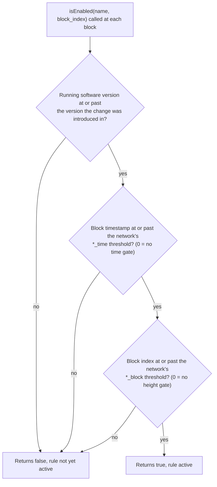
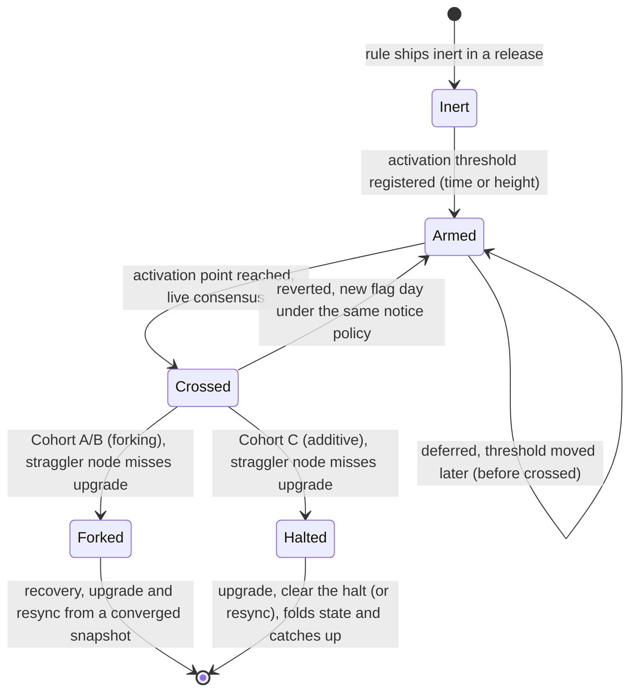

# Protocol Activation (Flag Days)

**Status:** mechanism in production; the first coordinated multi-cohort activation was armed 2026-07-07.

A consensus change cannot simply ship and take effect the moment a node updates: nodes update at
different times, and any node that evaluates a block under different rules than its peers computes a
different ledger and forks. XChain solves this the same way Bitcoin soft-forks do, with a **flag
day**: the new rule ships inert in a release, carries a fixed activation point (a block time or a
block height, per network), and every node switches to the new rule at exactly that point regardless
of when it installed the release.

This document describes the activation mechanism, the three activation cohorts, where the values
live, and what happens to a node that misses an upgrade. For the minimum lead time between shipping
an activation value and the moment it fires, see [Upgrade Notice Policy](./upgrade-notice-policy.md).

## The gate

Every gated rule is registered once with an activation threshold per network. In the indexer this is
`protocol_changes.js`:

```
addChange(name, version, mainnet_time, testnet_time, regtest_time, mainnet_block, testnet_block, regtest_block)
```

At each block the indexer asks `isEnabled(name, block_index)`, which returns true only when **all** of
these hold for the node's own network:

1. **Version has caught up.** The running software version is at or past the `version` the change was
   introduced in (semantic compare). A node running older code treats the rule as not-yet-active even
   past the activation point, which is what lets a release ship the rule inert ahead of the flag day.
2. **The block is at or past the time threshold.** The block's timestamp is `>=` the network's
   `*_time` value (0 means "no time gate").
3. **The block is at or past the height threshold.** The block's index is `>=` the network's `*_block`
   value (0 means "no height gate").



A gate is keyed on **time** or **height**, not both: set the one you want and leave the other 0. The
choice matters (below). The check is per network, so mainnet, testnet, and regtest each carry their
own threshold and cross independently.

A rule may also leave **both** at 0, in which case condition 1 is the whole gate. That is how the
ACTIONs themselves are registered: all 38 carry `0` for every time and height, 21 at version `0.1.0`
and 17 at `0.2.0`, so an action becomes available as soon as the node runs new enough code. Every
non-zero threshold in the registry therefore belongs to a *behaviour* change applied to an
already-live action, not to the arrival of an action.

Format-specific behavior can have its own gate even when the ACTION name is already live. BET
Version `4` uses the height-keyed `bet_feed_list_edit_activation.BET_FEED_LIST_EDIT_ACTIVATION` row:
at or above the configured height, the creator of an open feed may edit its allow and block list
references; below it, Version `4` is invalid. The row is
armed on every testnet chain at that chain's own height, unarmed on mainnet, and active on regtest
from genesis. It must be armed through the normal flag-day process before the format is accepted on
mainnet.

### Time-keyed vs height-keyed

- **Height-keyed** gates pin activation to a specific block on one chain. Use this when the change is
  anchored to a single chain's timeline, e.g. a Bitcoin-anchored validator rule pinned to a BTC
  height.
- **Time-keyed** gates pin activation to a wall-clock instant. Use this when one coordinated cutover
  must land on **multiple chains at once**. Bitcoin, Litecoin, and Dogecoin heights diverge by
  millions of blocks, so no single shared height names one moment across all three; a single Unix
  timestamp does. The contract-era gates (which run on all three chains) are time-keyed for exactly
  this reason.

## Where the values live

**The mainnet time-keyed values themselves are on [Flag-Day Values](./flag-days.md)**, a page
generated straight from the indexer's registry. No page in this documentation set quotes a flag-day
date in prose, this one included: a flag-day value is the current setting of a constant, it has been
repinned before, and prose cannot notice its source moving. Pages name the gate and link there.

[`constants.js`](constants.js) in this repository is the canonical source for the **validator-era
(Cohort B)** and **state-commitment (Cohort C)** gates below, and for the six **decoder-carried**
gates ([below](#decoder-carried-gates)), which sit outside all three cohorts because they are
evaluated in the decoder rather than the indexer. Each consuming service carries a
**byte-identical twin** of the maps it needs, and a cross-repo conformance gate fails CI if a twin
drifts. Cohort A (contract-era) values are not carried in `constants.js` at all: they are
service-carried in `xchain-indexer/src/protocol_changes.js` and the `xchain-vm` gate constants (see the
table below), byte-guarded against each other rather than against this file, pending a future
consolidation.

Twelve later consensus gates are armed but **not yet folded into `constants.js`**: they currently live
only as service-carried modules (see [Additional armed gates](#additional-armed-gates-service-carried)
below). Until they are consolidated here, `constants.js` is not the complete inventory, and each of
those twelve is guarded against whatever twin it has rather than against this file. Several are
**indexer-only** by design: a gate on the execution path (which actions or deploys validate) has no
`xchain-sync` twin at all, because `BlockHasher` replicates already-materialized rows and never
re-runs an action handler, a deploy validator, or the VM.

| Service | Carries |
|---|---|
| `xchain-indexer` | `protocol_changes.js` (contract-era gates) + the state-commitment and validator-era activation modules |
| `xchain-vm` | the seven contract-era VM gate constants (async ban, binary-alloc metering, deploy-linter hardening, state-key NUL-reject, state-key type normalization, metering eval-order fix, call-spread metering) plus the own-date `REST_PATTERN_METER_GATE_BLOCK_TIME` (destructuring rest-pattern metering and the deploy rejection of rest positions the meter cannot reach; it does not ride the contract-era instant, its value is on [Flag-Day Values](./flag-days.md), and its indexer twin is `REST_PATTERN_METER`) plus the own-date `TOSTRING_SIZE_METER_GATE_BLOCK_TIME` (the toString size meter module in `index/tostring_size_meter.js`, whose rule is `index/armed_harness/tostring_size_meter.js`; while active, the metered URI, escape, `parseInt` and `parseFloat` globals convert a non-string argument once and charge the converted length, and `padStart` and `padEnd` coerce their length before charging; it sits at the unarmed sentinel on mainnet, testnet runs it from the v0.25.0 shared instant and regtest from genesis, and its indexer twin is `TOSTRING_SIZE_METER`) plus `JSON_STRINGIFY_HOOK_GATE_BLOCK_TIME` (hook-aware depth guarding for values transformed by `JSON.stringify`; it keys on its own flag day, arms testnet at its own instant and stays inert on mainnet until the operator arms it, its status is on [Flag-Day Values](./flag-days.md), and its indexer twin is `JSON_STRINGIFY_HOOK`) plus five constant-less contract-era riders that key on the binary-alloc instant instead of minting a constant ([Cohort A riders that mint no constant](#cohort-a-riders-that-mint-no-constant)) plus fourteen per-coin height-keyed maps: `PKG3_SANDBOX_ACTIVATION` (the armed runtime half of VM deploy-lint Pkg 3, [below](#additional-armed-gates-service-carried)), the genesis-armed `EXEC_LINT_ACTIVATION` and `LINT_GLOBAL_ALIAS_ACTIVATION`, `LINT_BANNED_WITH_ACTIVATION` (the deploy linter's `with`-statement ban, which the indexer's DEPLOY lint resolves through its `vm_lint_banned_with_heights` registry row; armed on testnet at each chain's own height, unarmed on mainnet until an operator arms it; regtest runs it from genesis), the mainnet-unarmed `LINT_OPTIONAL_CHAIN_ACTIVATION` ([VM gates](#vm-gates-service-carried)), `BIGINT_SURFACE_STRIP_ACTIVATION` in `index/bigint_surface_strip_heights.js` (armed on testnet at each chain's own height, unarmed on mainnet until an operator arms it; regtest runs it from genesis), `LINT_DESTRUCTURE_ACTIVATION` in `index/lint_destructure_heights.js` (the deploy linter's destructuring checks, which the indexer's DEPLOY lint resolves through its `vm_lint_destructure_heights` registry row; armed on testnet at each chain's own height, unarmed on mainnet until an operator arms it; regtest runs it from genesis), and seven maps that are null on every mainnet and testnet chain until an operator arms them, with regtest running each from genesis and each twinned by the indexer registry row named after it: `LINT_SYNTAX_DEPTH_ACTIVATION` in `index/lint_syntax_depth_heights.js` (deploy and execute-time lint refuse a source nested past the fixed syntactic depth before any recursive pass runs; twin `vm_lint_syntax_depth_heights`), `GAS_CEILING_EXHAUSTED_ACTIVATION` in `index/gas_ceiling_exhausted_heights.js` (a run whose gas tracker crossed its ceiling settles as out of resource with gasUsed at the ceiling, whichever path it reached the host by; twin `gas_ceiling_exhausted_heights`), `RESOURCE_FAULT_SIGNAL_ACTIVATION` in `index/resource_fault_signal_heights.js` (out_of_stack requires a trip report from the in-isolate depth guards rather than a thrown value a contract can construct, and a memory-limit disposal settles as out_of_memory instead of timeout; twin `resource_fault_signal_heights`), `HOST_ERROR_STACK_STRIP_ACTIVATION` in `index/host_error_stack_strip_heights.js` (an error thrown on the host side reaches the contract with an empty stack instead of harness frame text; twin `host_error_stack_strip_heights`), `JSON_STRINGIFY_REENTRY_ACTIVATION` in `index/json_stringify_reentry_heights.js` (a nested `JSON.stringify` on the value-hook path returns its own result instead of overwriting the outer call's; twin `json_stringify_reentry_heights`), `HOST_FAULT_HALT_ACTIVATION` in `index/host_fault_halt_heights.js` (a wrapper compile or setup fault halts the host instead of settling as a contract error; it is null on every mainnet and testnet chain, regtest runs it from genesis, and its indexer twin is the `host_fault_halt_heights` registry row) and `NATIVE_STACK_TERMINAL_ACTIVATION` in `index/native_stack/activation.js` (a native stack overflow becomes the same terminal out_of_stack the depth counter raises, and frames and pushed argument lists count against the depth budget; twin `native_stack_terminal_heights`) plus eight network-keyed block-time maps, all unarmed on mainnet: `ACCESSOR_OWN_KEY_ACTIVATION` in `readonly-accessors.js` (a readonly snapshot lookup resolves only own keys, so an inherited name such as `constructor` reads as absent; testnet and regtest run it from genesis, and its indexer twin is `READONLY_ACCESSOR_OWN_KEY`), `GAS_CEILING_SUCCESS_ACTIVATION` in `gas.js` (a run that reached the host as a success although a charge crossed the gas ceiling inside the isolate fails instead; it is a static on `GasTracker`, not a module export; it is armed on testnet at its own instant and unarmed on mainnet, regtest runs it from genesis, and its indexer twin is `GAS_CEILING_SUCCESS`), `ITER_SET_METER_ACTIVATION` in `index/runtime/activations.js` (meters iterator helpers, String well-formedness and the Set algebra family, and while active also turns on call-spread metering; testnet runs it from its own instant and regtest from genesis, and its indexer twin is `ITER_SET_METER`), `APPLY_LENGTH_METER_ACTIVATION` in `index/apply_length_meter.js` (charges long-argument `Function.prototype.apply` by argument count and `ArrayBuffer` `resize`, `transfer` and `transferToFixedLength` by their new byte length; testnet runs it from its own instant and regtest from genesis, and its indexer twin is `APPLY_LENGTH_METER`), `HOST_CALL_BOUNDS_ACTIVATION` in `index/host_call_bounds.js` (an emission refused at the cap is not billed, a value that contains itself throws a catchable TypeError instead of faulting out_of_stack, and a host-call argument holds the same nesting a plain `JSON.stringify` of it does; testnet runs it from the v0.24.0 shared instant and regtest from genesis, and its indexer twin is `HOST_CALL_BOUNDS`), `STRING_RECEIVER_METER_ACTIVATION` in `index/string_receiver_meter.js` (meters the String receiver length; testnet runs it from the v0.25.0 shared instant and regtest from genesis, and its indexer twin is `STRING_RECEIVER_METER`), `STRING_RESULT_METER_ACTIVATION` in `index/string_result_meter.js` (meters String HTML and `String.raw` results; testnet runs it from the v0.25.0 shared instant and regtest from genesis, and its indexer twin is `STRING_RESULT_METER`) and `PER_ELEMENT_METER_ACTIVATION` in `index/per_element_meter.js` (charges iterator-helper callbacks and yields, Set algebra over a non-Set argument, `String.raw` segments and object spread and rest per element; testnet runs it from the v0.24.0 shared instant and regtest from genesis, and its indexer twin is `PER_ELEMENT_METER`) |
| `xchain-hub` | the nine validator-era gate modules it consumes (checkpoint, equivocation header, stake-weighted quorum, anchor reward, archive reward, cross-chain royalty canonical, retraction signing, attestation relay, price signature tally). The tenth Cohort B gate, attestation admission, is indexer-only |
| `xchain-decoder` | the six activation maps consumed in the decoder's own parse path: `ORACLE_FEE_OUTPUT_ACTIVATION`, `ORACLE_FEE_SET_CAPTURE_ACTIVATION`, `DISPENSER_EXPIRY_REALIGN_ACTIVATION` and `BATCH_SUBCOMMAND_OUTPUT_CAPTURE_ACTIVATION` (block-time-keyed) plus `ENVELOPE_RECOGNITION_ACTIVATION` and `ENVELOPE_CARRIER_RECOGNITION_ACTIVATION` (per-chain local height) |
| `xchain-sync`, `xchain-explorer`, `xchain-sdk` | the subset each needs to verify or display |

Because the values are byte-identical everywhere, a heterogeneous fleet and any from-genesis replay
evaluate every historical block the same way.

## The three cohorts

Activation values are grouped into cohorts by what kind of point they key on. Grouping lets one
coordinated fleet rollout retire a whole batch at once.

| Cohort | Keyed on | Rules | Straggler behavior |
|---|---|---|---|
| **A (contract era)** | one shared **time** (all three chains) | base64 DEPLOY encoding, VM async ban, VM binary-alloc metering, VM deploy-linter hardening, VM state-key NUL-reject, VM state-key type normalization, VM metering eval-order fix, VM call-spread metering, VM consensus wall-clock budget, controller guards, VM balance/token-info surface, issuance-fee exemption, unstake-cooldown completion, cross-chain royalty create-side, XCALL undeliverable-result retirement, VM slash token-delimiter guard, VM slash amount-precision widening, VM math-output metering, VM emission prototype-key strip, VM non-finite gas clamp | **forks** |
| **B (validator era)** | a **BTC height** (not always the same height across every Cohort B rule; see below) | checkpoint commitment, equivocation header, stake-weighted quorum, anchor reward, cross-chain royalty canonical, attestation admission, archive reward, retraction signing, attestation relay, price signature tally | **forks** |
| **C (state commitment)** | per-chain **local height** | light-client state commitment (state root + block-merkle root) and its state-hash classes (e.g. token-supply, poll-finalize) | **halts, recoverable** |

Almost every Cohort A leg turns a rule on. One instead pins a **number**: at the contract-era
instant the wall-clock net around a single contract execution becomes
`CONSENSUS_MAX_WALL_MS`, **30,000 ms**, the same on every node. Before it the net is the node's
own `limits.maxCpuTimeMs`, which is not a consensus value, so two differently configured
validators could return a different status and a different `gasUsed` for the same execution and
an operator's config file could fork the fleet. The bound mints no activation constant of its
own: it rides the binary-alloc metering instant already in this cohort, pinned AT the fleet's
documented default so nothing a default-configured node ever executed changes outcome across
the boundary. Tightening the value later is a different change and would need a flag day of its
own. Enforcement detail is on
[VM Configuration](../components/vm/configuration.md#resource-limits); the constant lives in
`xchain-vm/src/consensus-wall-clock.js`, and its activation predicate `isConsensusWallClockActive` is
defined in `xchain-vm/src/index/runtime/activations.js` and applied in `xchain-vm/src/index.js`.

### Cohort A riders that mint no constant

The wall-clock bound is not the only rule of that shape. Five further VM rules key on the same
shared contract-era instant and mint no activation constant of their own, so anything that
inventories gates by constant name cannot see them. They ride
`BINARY_ALLOC_GATE_BLOCK_TIME` (`xchain-vm/src/index/runtime/activations.js`, the binary-alloc metering leg already in
this cohort; the value is on [Flag-Day Values](./flag-days.md#contract-era-flag-day)) rather than
minting one, which is deliberate: a new constant would move the frozen six-gate consensus pin and
the cross-repo `CONTROLLER_GUARD` equality check that goes with it. They fork like the rest of
Cohort A, so a straggler node that has not upgraded reaches a different verdict.

| Rider | Resolved in | Enforced in | What changes at the instant |
|---|---|---|---|
| **contract.slash token delimiter guard** (`isSlashTokenDelimGuardActive`) | `xchain-vm/src/index/runtime/activations.js` | `xchain-vm/src/gateway/contract_stake.js`, on `readOnlyData.slashTokenDelimGuardOn` | A `contract.slash` whose `token` carries a `\|` stops emitting and throws, closing the one emit path that never rejected a character the indexer may pipe-join |
| **contract.slash amount-precision widening** (`isSlashAmountPrecisionActive`) | `xchain-vm/src/index/runtime/activations.js` | `xchain-vm/src/gateway/contract_stake.js`, which swaps an 8-fractional-digit amount pattern for an 18-digit one | A slash amount carrying 9 to 18 fractional digits stops throwing and emits. The ceiling is `MAX_SLASH_AMOUNT_DECIMALS` 18, which must equal the indexer's `MAX_TOKEN_DECIMALS`: STAKE v3 admits a stake at the token's own decimals and the slash arithmetic computes the deduction at that precision, so the narrower pattern made an exact partial slash of a 9-to-18-decimal token impossible |
| **Math-output metering** (F-MO, the `mathOutputMeterOn` predicate) | `xchain-vm/src/index/runtime/gateway_options.js` | the gateway's math hook | An oversized `pow()` or format result is charged gas, which moves `gasUsed` |
| **Emission prototype-key strip** (F-PS, the `emissionDeepStrip` predicate) | `xchain-vm/src/index/runtime/execute.js` | `EmissionCollector` | Prototype-shaped own keys are stripped recursively rather than only at the top level, which can drop a key from a pathological emitted param and so moves that emission's hash |
| **Non-finite gas clamp** (F-NR, the `nonFiniteFailClosed` predicate) | `xchain-vm/src/index/runtime/gas_reference.js` | the sandbox gas reference | A non-finite metering size resolves to `Number.MAX_SAFE_INTEGER` and yields a ceiling-clamped `out_of_gas` instead of collapsing to 1 gas, which moves the hashed status and `gasUsed` |

The two `contract.slash` riders are **network-aware** and resolve exactly like the state-key gates:
`testnet` and `regtest` are active from genesis, and any other network (including an unrecognized
one, read conservatively as mainnet) activates at the shared instant, with a non-finite block time
reading as pre-activation. The three inline riders are **not** network-aware: they compare block
time alone, so they activate at the shared instant on every network, and a non-finite block time
likewise reads as pre-activation.

No mainnet verdict is reinterpreted by any of the five. The shared instant has already passed, and
mainnet has carried no DEPLOY, EXECUTE or SLASH action and no contract at all (see
[The mainnet genesis arm](#the-mainnet-genesis-arm)), so the riders are live on arrival rather than
live and diverging. Changing any of these predicates later is a different change and would need a
flag day of its own under the [notice policy](./upgrade-notice-policy.md).

The ten Cohort B rules arm in two batches. Six share mainnet BTC height 961000: checkpoint
commitment, equivocation header, stake-weighted quorum, anchor reward, cross-chain royalty canonical,
and attestation admission. The other four share 963000, one deploy-train boundary later: archive
reward, retraction signing, attestation relay, and price signature tally. So "one BTC height" is
shorthand for "a BTC height per rule, in two batches" rather than a single shared value across the
whole cohort.

The cohort is its **armed** rules. `constants.js` also carries validator-era maps that sit outside
it. Four of them are **armed at genesis** (`0`) on mainnet under the
[mainnet genesis arm](#the-mainnet-genesis-arm): `SNAPSHOT_BURIAL_ACTIVATION`,
`ANCHOR_REWARD_DERIVE_ACTIVATION`, `ROLLCALL_ACTIVATION` (keyed on the BTC
`EPOCH_HEIGHT` a ROLLCALL carries) and `ATTEST_RESPONSIBLE_WIDENING_ACTIVATION`. Arming them at `0`
was state-neutral on the indexed mainnet history, which holds no validator, roll call or
attestation, so none of them needed a mainnet flag day; they are still not counted in the cohort
table above. `ATTEST_RESPONSE_MIRROR_ACTIVATION` is the one of the five that still holds `null` on
mainnet, which is the encoding of "never" and the fail-closed default until an operator ratifies a
height; the 2026-09-09 ruling holds it back until its quorum defect is closed. It was also the one
of them unarmed on **testnet**; it was ratified there at block 151324 in the v0.15.0 train, so
testnet exercises the hub response-mirror path alongside regtest from that height on.
The enumeration is the **height-keyed validator-era** maps
specifically: the block-time [decoder-carried gates](#decoder-carried-gates) also read `null` as
disarmed, and a block-time map can encode the same "not yet" as a far-future sentinel instant
rather than as `null`.

`ANCHOR_ACTIVATION` is height-keyed and carries a ratified height on both live networks, but sits
outside the three cohorts: it is keyed on the anchor's own DOGE mined height (`mainnet` 6360000,
`testnet` 67858600, `regtest` 0), not on a shared instant, a BTC anchor, or each chain's own local
height. Its keys are the bare network names, with no coin prefix, because DOGE is the height basis
and not part of the key. At or above it the restarted ANCHOR wire set parses (versions 0, 1 and 2;
version 3 also needs `ANCHOR_FOLD_ACTIVATION`, below); below it an ANCHOR of any version is
`invalid: ANCHOR before activation`. Both heights
are already past: the DOGE mainnet tip passed 6360000 near 2026-09-03 (tip 6371762 on 2026-09-12)
with no arming ruling, and the 2026-10-09 ruling accepts it as live with the value unchanged, so the
restarted wire set is active on mainnet. Stragglers **fork**.

`ARCHIVE_MATCH_COUNT_ACTIVATION` gates validation that an archive head's `MATCH_COUNT` equals its
archive member count. It remains inert on mainnet until the operator arms it. Testnet is armed per
chain through the map's `BTC:testnet`, `LTC:testnet` and `DOGE:testnet` heights in
[`constants.js`](./constants.js), and regtest is genesis-active. The map is indexed on
[Flag-Day Values](./flag-days.md#canonical-activation-maps) without presenting the mainnet sentinel
as an activation instant.

`ANCHOR_BUNDLE_ORDER_ACTIVATION` gates validation that ANCHOR bundle CHAIN sections and PUBKEY pairs
are in ascending byte order. It remains inert on mainnet until the operator arms it. Testnet is
armed per chain through the map's `BTC:testnet`, `LTC:testnet` and `DOGE:testnet` heights in
[`constants.js`](./constants.js), and regtest is genesis-active. The map is indexed on
[Flag-Day Values](./flag-days.md#canonical-activation-maps) without presenting the mainnet sentinel
as an activation instant.

`PRICE_V1_CANONICAL_ACTIVATION` gates the [PRICE](./actions/price.md) v1 canonical form: a `VALUE`
and `FEE` with no leading zero and within the length caps `PRICE_V1_VALUE_MAX_LENGTH` and
`PRICE_V1_FEE_MAX_LENGTH`, keyed on the action's own block time. It remains inert on mainnet until
the operator arms it, is armed on BTC, LTC and DOGE testnet at an instant of its own, and regtest
is genesis-active. That testnet instant is in the registry row
`price_scale_activation.PRICE_V1_CANONICAL_ACTIVATION`
(`xchain-indexer/src/protocol_changes/shared_rows_2.js`). [Flag-Day Values](./flag-days.md) reads
only the mainnet slot of a registry row like this one, so it lists the gate once mainnet is armed.

`ANCHOR_FOLD_ACTIVATION` gates [ANCHOR](./actions/anchor.md) version 3, the folded bundle that
carries every checkpointed chain section plus at most one archive section in one transaction. It
is keyed on the anchor's own DOGE mined height like `ANCHOR_ACTIVATION` and always sits at or above
it. Below the gate, version 3 is `invalid: VERSION (unknown)`; at or above it, versions 0, 1 and 2
stay valid. The fold changes the publishing shape, but `anchor_archive` minting stops only when
`ANCHOR_ARCHIVE_FOLD_TERM_ACTIVATION` and `ANCHOR_FOLD_ACTIVATION` are both active. If either gate
is inactive, v1 archive rewards retain their pre-fold behavior. The fold gate uses the house
UNARMED sentinel on mainnet. Testnet is armed per chain through the map's `BTC:testnet`,
`LTC:testnet` and `DOGE:testnet` heights in [`constants.js`](./constants.js). Its regtest entry is
null by default, and `XC_ANCHOR_FOLD_REGTEST_ACTIVATION` arms it for a private regtest venue.

`ARCHIVE_SECTION_VERDICT_STATE_HASH_ACTIVATION` is the fold's companion gate. At or above it, a
folded action's own archive failure stamps only the archive row instead of the whole action. It
carries the fold's values on every network, so testnet is armed per chain at the same heights, and
the same regtest variable arms both gates at the same height.

`ATTEST_BATCH_HEAD_STATE_HASH_ACTIVATION` gates the state-hash class for the batch-completion stamp
on a surviving version 5 attestation head. At or above it, a version 6 continuation that completes
with a reassembly or quorum failure changes the state hash through the stamped head, so a follower
that drops the stamp halts on the mismatch. The height map remains unarmed on mainnet and testnet;
regtest is genesis-active.

`BRIDGE_POLICY_DETACH` gates the destination half of a bridged policy list detach, described under
[policy inheritance](./token-bridge.md#policy-inheritance). It is read at the destination chain's
own block height. At or above it, a bridged copy whose origin issuer detached its allow or block
list gets that list detached too; below it, the copy's list stays attached. It is armed on testnet
at each chain's own height (`BTC:testnet` 155001, `LTC:testnet` 4906040, `DOGE:testnet`
67962387), stays unarmed on mainnet until the operator arms it, and regtest is genesis-active.

`BET_FEED_LIST_EDIT_ACTIVATION` is the per-chain height gate reserved for edits to an open BET
feed's allow-list and block-list references. It is armed on testnet at each chain's own height and
stays unarmed on mainnet until a release arms it there, while
regtest exercises the gated path from genesis.

Regtest runs every cohort **genesis-active** (threshold 0), so a fresh regtest stack exercises the
post-activation behavior end to end. Testnet runs the time-keyed (Cohort A) and BTC-height-keyed
(Cohort B) gates genesis-active as well, with exceptions in every cohort:

- **Nine Cohort A rules are not genesis-active on testnet** (values and current status on
  [Flag-Day Values](./flag-days.md), which derives them from the registry and is the one place they
  are written down). Testnet already carries history these rules would reinterpret, so a
  genesis-active arm would fork an already-synced testnet node against a fresh reindex. Each of the
  nine arms testnet at an instant of its own, listed on [Flag-Day Values](./flag-days.md):
  - `ISSUE_INHERITED_MINT_WINDOW`, because the ISSUE mint-window re-parameterization fix is a
    validity loosening and testnet already held a recorded rejection under the pre-fix rule.
  - `DEPLOY_DEFERRED_ASSEMBLY`, because testnet holds a recorded out-of-order assembler group that
    a genesis-active arm would re-decide.
  - `CONTRACT_META_REQUIRED`, because testnet already holds deployed contracts that export no
    meta-shaped object, so a genesis-active arm would flip every one of them from its recorded
    verdict.
  - `OWNER_WITHDRAW_OPT_IN`, because the rule keys on a contract's DEPLOY block, so a contract
    deployed and withdrawn from before the fleet roll would grade differently under a
    genesis-active arm than it did on a node that indexed it live; its status is on
    [Flag-Day Values](./flag-days.md).
  - `UNIFIED_FEES_SWEEP_CALLBACK`, because the public testnet has carried real SWEEP and CALLBACK
    traffic since launch, so a genesis-active arm would re-price fees already committed there.
  - `BROADCAST_FEE_LENGTH`, which rejects a fee wider than the 11-character storage column; it arms
    testnet at its own instant (see [Flag-Day Values](./flag-days.md)).
  - `CONTROLLER_CUSTODY_GUARD`, which runs controller guards on DEPOSIT and WITHDRAW custody legs;
    it arms testnet at its own instant (see [Flag-Day Values](./flag-days.md)).
  - `CONTROLLER_GUARD_LEG_SAVEPOINTS`, which makes a later guard's denial roll back the earlier
    sibling guards on the same native-action leg; it arms testnet together with
    `CONTROLLER_CUSTODY_GUARD` (see [Flag-Day Values](./flag-days.md)).
  - `JSON_STRINGIFY_HOOK`, which gates hook-aware depth guarding for values transformed by
    `JSON.stringify`; it arms testnet at its own instant (see [Flag-Day Values](./flag-days.md)).
- **One more time-keyed rule arms testnet at an instant of its own** rather than at genesis. It was
  sized to give the fleet deploy headroom on the live public ledger, and mainnet waits on an
  instant an operator has not yet named (both are on [Flag-Day Values](./flag-days.md)):
  - `PRICE_ZERO_VALIDITY_ACTIVATION`, which bounds an on-chain PRICE to the range the hub accepts.
- **Thirteen more time-keyed rules are not genesis-active on testnet either**: they were registered
  after the public testnet launch, and the v0.23.0 release cut armed all of them on testnet together
  at one shared instant of their own, while mainnet keeps them unarmed until an operator arms it
  (the instant and status are on [Flag-Day Values](./flag-days.md)):
  - `DISPENSER_REFILL`, which makes a dispenser refill that adds escrow consult the token's trade
    controller.
  - `EXACT_INTEGER_WIRE_FIELDS`, which rejects a non-integer value in the integer wire fields of
    BET, dispenser, ORDER and SWAP actions.
  - `ITER_SET_METER`, the indexer twin of the VM's `ITER_SET_METER_ACTIVATION`, which meters
    iterator helpers, the `String` well-formedness methods and the `Set` algebra family by size.
  - `STAKE_DELEGATED_SIGNING_KEY`, which refuses a contract STAKE whose signing key a contract
    delegation already uses.
  - `STAKE_SNAPSHOT_DECIMAL_STRINGS`, which changes how the VM stake snapshot carries amounts to a
    contract.
  - `DELEGATION_ROTATE_IN_WINDOW`, which lets a matured signing-key rotation also rewrite stake rows
    still inside their deactivation delay.
  - `GAS_CEILING_SUCCESS`, the indexer twin of the VM's `GAS_CEILING_SUCCESS_ACTIVATION`, which
    fails a run that reached the host as a success although a charge crossed the gas ceiling inside
    the isolate.
  - `APPLY_LENGTH_METER`, the indexer twin of the VM's `APPLY_LENGTH_METER_ACTIVATION`, which
    meters long-argument `Function.prototype.apply` and `ArrayBuffer` resize and transfer.
  - `SLASH_XANCPUB_PUBLISHER_PAIR`, which judges an XANCPUB equivocation proof as a
    publisher-only pair.
  - `STAKE_SNAPSHOT_SLASH_WINDOW`, which caps a mid-UNSTAKE stake row in the VM stake snapshot at
    what its open unstake rows still hold.
  - `SLASH_ATTEST_MULTIROUND_EXEMPT`, which stops an XATTEST base-leg pair from being slashable.
  - `SEND_GATED_TOTAL_TICK_ID_ACTIVATION`, which totals a gated SEND's amount per resolved
    `TICK_ID` rather than per literal `TICK`.
  - `ATTEST_RELAY_RESPONSE_DEADLINE_ACTIVATION`, which rejects an ATTEST relay response that lands
    on its origin chain after the request's deadline.
- **Seven more time-keyed rules are not genesis-active on testnet either**: they were registered
  after the v0.23.0 cut, and the v0.24.0 release cut armed all of them on testnet together at one
  later shared instant of their own, while mainnet keeps them unarmed until an operator arms it
  (the instant and status are on [Flag-Day Values](./flag-days.md)):
  - `EMISSION_DEPTH_EXECUTE_ONLY`, which stamps the incremented call depth only on an EXECUTE
    emission, so other emissions keep the emitter's depth.
  - `ARCHIVE_REPLAY_WRAPPER_WATERMARK`, which lets the archive replay guard's checkpoint watermark
    read the wrapper chain row of each v3 archive.
  - `LEGACY_ANCHOR_REWARD_PIN`, which stops the anchor reward mint from minting a pinned legacy
    reward tuple again.
  - `GUARD_STAKE_SNAPSHOT_DECIMAL_STRINGS`, which hands the VM decimal strings in the
    controller-guard stake snapshot, as the primary EXECUTE path already does.
  - `HOST_CALL_BOUNDS`, the indexer twin of the VM's `HOST_CALL_BOUNDS_ACTIVATION`, which bounds
    emission charges, self-containing values and host-call argument depth.
  - `PER_ELEMENT_METER`, the indexer twin of the VM's `PER_ELEMENT_METER_ACTIVATION`, which charges
    iterator, set algebra, `String.raw` and object spread work per element.
  - `CALLBACK_ARGS_EXACT`, which runs an ATTEST, XCALL or binding VOTE callback with the argument
    array its injector built.
- **Three more time-keyed rules are not genesis-active on testnet either**: they were registered
  after the v0.24.0 cut, and the v0.25.0 release cut armed all of them on testnet together at one
  later shared instant of their own, while mainnet keeps them unarmed until an operator arms it
  (the instant and status are on [Flag-Day Values](./flag-days.md)):
  - `STRING_RECEIVER_METER`, the indexer twin of the VM's `STRING_RECEIVER_METER_ACTIVATION`,
    which meters the String receiver length.
  - `STRING_RESULT_METER`, the indexer twin of the VM's `STRING_RESULT_METER_ACTIVATION`, which
    meters String HTML and `String.raw` results.
  - `TOSTRING_SIZE_METER`, the indexer twin of the VM's toString size meter, which charges the
    converted length of a non-string argument to the metered globals once.
- **One more time-keyed rule is not genesis-active on testnet**: it was registered unarmed in v0.26.1,
  and the v0.26.2 testnet arming patch armed it on testnet at an instant of its own, while mainnet
  keeps it unarmed until an operator arms it (the instant and status are on
  [Flag-Day Values](./flag-days.md)):
  - `ISSUE_CARET_TICK_NO_CREATE`, which refuses token creation through a caret `^<id>` TICK that
    resolves to no existing token.
- **Cohort C (state commitment) is armed at future _per-chain_ heights on testnet, not from genesis**
  (`STATE_COMMITMENT_ACTIVATION`: `BTC:testnet 145000`, `LTC:testnet 4805000`,
  `DOGE:testnet 67000000`), because it gates on each chain's own local block height rather than a
  BTC-anchored flag-day.
- **The checkpoint commitment (Cohort B) is armed at `BTC:testnet` 146000**, the first testnet anchor
  past all three of those state-commitment heights. At 0 it forced the SPV root suffix from testnet
  genesis, before the indexer had computed any roots, so the hub refused to sign every testnet
  checkpoint. It is the only Cohort B rule not genesis-active on testnet; the other nine carry
  `testnet: 0`.

No **cohort** rule is genesis-active on mainnet: every cohort gate is armed at a real, non-zero
threshold. Gates outside the three cohorts are a separate question, and several of them do read `0`
there under [the mainnet genesis arm](#the-mainnet-genesis-arm): the validator-era maps above and
`DISPENSER_EXPIRY_REALIGN_ACTIVATION` in the decoder-carried table. Several of the cohort thresholds
have since been crossed. Cohort C's mainnet heights are past (`BTC:mainnet` 958500 and
`LTC:mainnet` 3143000 both sit below the envelope heights that crossed 2026-08-03), the main Cohort B
anchor 961000 went by with them, and the shared Cohort A instant has passed as well. A crossed value
stays in the tree for the same reason the envelope map does: below its threshold each gate still runs
its legacy path, which is what keeps a from-genesis replay matching history, so the constant is
history rather than a control. Still scheduled ahead of mainnet, as of 2026-08-15, are the BTC 963000
Cohort B batch, the later per-chain gates under
[Additional armed gates](#additional-armed-gates-service-carried) below, and the four time-keyed
gates that carry a date of their own (`BATCH_ISSUANCE_LIMITS`, `CONTRACT_DELEGATION_MATERIALIZE`,
`DISPENSER_ORACLE_PER_TOKEN_PRICE`, `CROSS_CHAIN_ROYALTY`), whose instants are on
[Flag-Day Values](./flag-days.md). More time-keyed gates with a date of their own landed after that
snapshot, among them `REST_PATTERN_METER` (the `xchain-vm` `REST_PATTERN_METER_GATE_BLOCK_TIME`
destructuring rest-pattern meter and its indexer twin) and
[the mainnet launch gate](#the-mainnet-launch-gate) (`MAINNET_LAUNCH_ACTIVATION`). This page keeps no
count of them: [Flag-Day Values](./flag-days.md) is generated from the gate registry, lists every
gate that does not ride the shared contract-era instant together with its own date, and is the
source for which of them have passed.

## Additional armed gates (service-carried)

These twelve consensus gates are **armed** on mainnet but are not yet mirrored into
[`constants.js`](constants.js); each currently lives only in the service module named below (where a
gate has a second copy it is byte-identical, and that pair is the drift guard; an execution-path gate
has no second copy, see [above](#where-the-values-live)). They are listed here so the flag-day
inventory stays complete pending consolidation into the canonical file, and because
[Flag-Day Values](./flag-days.md) covers only the time-keyed thresholds: every height-keyed one is
inventoried on this page, the armed ones in this table and the three VM-carried ones under
[VM gates](#vm-gates-service-carried), two of them armed at genesis on mainnet and the
optional-chain gate still unarmed.

| Gate | Keyed on | Mainnet threshold | Straggler | Lives in |
|---|---|---|---|---|
| **SWQ source cap** (`SWQ_SOURCE_CAP_ACTIVATION`, caps `STAKE_WEIGHT_MAX_SOURCES=1000`, `STAKE_WEIGHT_MAX_KEYS_PER_SOURCE=64`) | BTC height | `BTC:mainnet` 960000 (after state commitment 958500, before stake-weighted quorum 961000; LTC/DOGE inert) | forks | `xchain-indexer` / `xchain-sync` `src/consensus/gates/swq_source_cap_gate.js` |
| **Slash burns pending stake** (`SLASH_BURNS_PENDING_STAKE`) | BTC height | 961000 (Cohort-B anchor) | forks | `xchain-indexer/src/protocol_changes.js` |
| **Slash oracle-round discriminated** (`SLASH_ORACLE_ROUND_DISCRIMINATED`, the sibling registry entry one row from slash-burns) | BTC height | 961000 (Cohort-B anchor) | forks | `xchain-indexer/src/protocol_changes.js` |
| **VM deploy-lint Pkg 3** (`VM_DEPLOY_LINT_PKG3_ACTIVATION`, adds the two Package-3 deploy-blocking `CONSENSUS_RULES`, so it changes which contracts the chain accepts) | per-chain local height | `BTC:mainnet` 961000, `LTC:mainnet` 3154250, `DOGE:mainnet` 6319000 (armed 2026-07-22) | forks | registry row `vm_deploy_lint_pkg3_activation.VM_DEPLOY_LINT_PKG3_ACTIVATION` in `xchain-indexer/src/protocol_changes/gates_3.js`; the runtime half is `PKG3_SANDBOX_ACTIVATION` in `xchain-vm/src/index/runtime/activation_heights.js`, pinned to the same three heights so the deploy-time and execution-time halves stay coherent |
| **Oracle snapshot-age causality** (`ORACLE_SNAPSHOT_AGE_CAUSALITY_ACTIVATION`, caps the snapshot-age query at the processing block; the uncapped value is VM-visible and forks `contract_hash` between a synced and a catching-up node) | per-chain local height | `BTC:mainnet` 961000, `LTC:mainnet` 3154250, `DOGE:mainnet` 6319000 (armed 2026-07-22) | forks | registry row `oracle_snapshot_age_causality_activation.ORACLE_SNAPSHOT_AGE_CAUSALITY_ACTIVATION` in `xchain-indexer/src/protocol_changes/gates_2.js` |
| **Dispenser freshness** (`DISPENSER_FRESHNESS_ACTIVATION`, redefines freshness against indexer-local chain state instead of the external utxo tracker, changing which historical DISPENSER creates were valid) | per-chain local height | `BTC:mainnet` 961000, `LTC:mainnet` 3154250, `DOGE:mainnet` 6319000 (armed 2026-07-22) | forks | registry row `dispenser_freshness_activation.DISPENSER_FRESHNESS_ACTIVATION` in `xchain-indexer/src/protocol_changes/gates_1.js` |
| **List-edit resolution** (`LIST_EDIT_RESOLUTION_ACTIVATION`, resolves a list to its newest valid edit; `getList` gates BET place, ORDER/SWAP match, DISPENSE, DIVIDEND, CALLBACK and AIRDROP, so action acceptance changes) | per-chain local height | `BTC:mainnet` 963000, `LTC:mainnet` 3162000, `DOGE:mainnet` 6338000 | forks | `xchain-indexer` / `xchain-explorer` the registry row `list_edit_resolution_activation.LIST_EDIT_RESOLUTION_ACTIVATION` |
| **Caret-ref strict** (`CARET_REF_STRICT_ACTIVATION`, makes an unresolvable address reference a hard reject at three sites that previously failed open, which moves the block's credits and debits) | per-chain local height | `BTC:mainnet` 963000, `LTC:mainnet` 3162000, `DOGE:mainnet` 6338000 (kept value-equal to list-edit resolution) | forks | `xchain-indexer/src/db/database/caret_ref_strict_gate.js` |
| **Oracle stale-round visibility** (`ORACLE_STALE_ROUND_VISIBILITY_ACTIVATION`, keeps a stale tip round in the `getPrice()` view with its price withheld instead of dropping the round outright, so a contract can tell an oracle stall apart from an oracle that never ran; VM-visible, so it changes `contract_hash`) | per-chain local height | `BTC:mainnet` 966500, `LTC:mainnet` 3175500, `DOGE:mainnet` 6370000 (pinned ahead of the tip the first release carrying the gate deploys at, so the flag day has no retroactive window; it does NOT share the list-edit resolution boundary, which rides an earlier release) | forks | registry row `oracle_stale_round_visibility_activation.ORACLE_STALE_ROUND_VISIBILITY_ACTIVATION` in `xchain-indexer/src/protocol_changes/gates_2.js` |
| **Ledger amount precision** (`LEDGER_AMOUNT_PRECISION_ACTIVATION`, quantizes every ledger write at 18 dp, the finest precision a tick can be issued with, instead of the written tick's own `decimals`; `db.createLedgerChangeRecord` takes the scale from `ledgerWriteScale` and applies it as `bcadd(amount, 0, decimals)`, so the persisted amounts and the balances projected from them both move) | per-chain local height | `BTC:mainnet` 966500, `LTC:mainnet` 3175500, `DOGE:mainnet` 6370000 (pinned to the same boundary as oracle stale-round visibility so both arm in one fleet deploy, and above each chain's tip at pinning so the flag day has no retroactive window) | forks | `xchain-indexer/src/consensus/ledger_amount_precision_gate.js` (indexer-only: the rule sits on the ledger write path, which `xchain-sync` never re-runs, so it has no twin and no twin drift guard) |
| **State-key collation** (`STATE_KEY_COLLATION_ACTIVATION`) | per-chain local height | `BTC:mainnet` 962500, `LTC:mainnet` 3160000, `DOGE:mainnet` 6335000 (armed 2026-07-10, ~10 days past Cohort-B) | halts, recoverable | `xchain-indexer` / `xchain-sync` the registry row `state_key_collation_activation.STATE_KEY_COLLATION_ACTIVATION` |
| **DISPENSE cancelling-dispenser match** (`DISPENSE_CANCELLING_MATCH_ACTIVATION`, corrects the `db.findMatchingDispensers` latest-status correlation on the native-coin DISPENSE trigger path) | block time | the coordinated 2.0.0 [contract-era flag day](./flag-days.md#contract-era-flag-day); deploy all indexers before it | forks | registry row `dispense_cancelling_match_activation.DISPENSE_CANCELLING_MATCH_ACTIVATION` in `xchain-indexer/src/protocol_changes/gates_1.js` |

The SWQ source cap, slash-burns and slash-oracle-round gates are BTC-height forking rules that belong
with **Cohort B**; state-key collation is a per-chain additive gate that behaves like **Cohort C**
(halts, recoverable). The seven remaining per-chain gates (VM deploy-lint Pkg 3, oracle snapshot-age
causality, dispenser freshness, list-edit resolution, caret-ref strict, oracle stale-round
visibility, ledger amount precision) are the reason this section
exists rather than a cohort row: they are **keyed** like Cohort C, on each chain's own `block_index`,
but they **fork** like Cohort A and B, because each changes an acceptance or deploy verdict rather
than adding a commitment. Below its threshold each one runs its legacy path byte-identically, which
is what keeps a from-genesis replay reproducing history.

The DISPENSE cancelling-dispenser match gate is a block-time forking rule keyed on the shared 2.0.0
contract-era timestamp, so it belongs with **Cohort A**; it is registered as a
standalone twin-style module rather than a `protocol_changes.addChange` entry to keep it self-contained
next to the query it gates.

## VM gates (service-carried)

Three further height-keyed consensus gates live in `xchain-vm` with a byte-identical indexer twin.
The execute-time lint and global-alias gates are active from genesis on every network: mainnet was
armed at 0 on 2026-09-09 under the
[mainnet genesis arm](#the-mainnet-genesis-arm) (no contract has ever been deployed or executed on
mainnet, so there is no verdict to reinterpret), and testnet and regtest have run both from genesis
since they were built. The optional-chain gate is the exception: it is unarmed on mainnet by ruling,
armed on testnet at measured per-chain heights, and genesis-active on regtest. They are listed here rather than in the armed table above because they are
registered in the VM rather than in the indexer's registry; a future change to any height in
BOTH copies is a flag day under the [notice policy](./upgrade-notice-policy.md).

| Gate | Keyed on | Mainnet | Straggler | Lives in |
|---|---|---|---|---|
| **Execute-time source lint** (`EXEC_LINT_ACTIVATION`, re-runs the deploy syntax validation against a contract's stored source at execute time and fails the execution deterministically when that source no longer passes the bans active for the block; the check is metered as gas, so it moves `gasUsed`) | per-chain local height | **armed at genesis** (0 for BTC, LTC and DOGE, ruled 2026-09-09); testnet and regtest genesis-active | forks | `xchain-vm/src/index/runtime/activation_heights.js` (`EXEC_LINT_ACTIVATION`, resolver `isExecLintActive`); twin registry row `vm_exec_lint_activation.VM_EXEC_LINT_ACTIVATION` in `xchain-indexer/src/protocol_changes/gates_3.js`, pinned to byte equality by the consensus-params suites in both repos. A height armed on one side only forks the fleet |
| **Deploy-lint global-alias refinement** (`LINT_GLOBAL_ALIAS_ACTIVATION`, makes the banned-global deploy rules resolve sloppy-mode `this` and the `globalThis` self-reference chain as reads of the same global object, which moves DEPLOY verdicts on error-severity `CONSENSUS_RULES`) | per-chain local height | **armed at genesis** (0 for BTC, LTC and DOGE, ruled 2026-09-09); testnet and regtest genesis-active | forks | `xchain-vm/src/index/runtime/activation_heights.js` (`LINT_GLOBAL_ALIAS_ACTIVATION`, resolver `isLintGlobalAliasActive`); twin registry row `vm_lint_global_alias_activation.VM_LINT_GLOBAL_ALIAS_ACTIVATION` in `xchain-indexer/src/protocol_changes/gates_3.js`, pinned the same way |
| **Deploy-lint optional-chain look-through** (`LINT_OPTIONAL_CHAIN_ACTIVATION`, makes the banned-global and Math-object deploy rules look through a parenthesized optional chain such as `(globalThis?.globalThis).Promise` or `(globalThis?.Math).pow(2, 3)`, which moves DEPLOY verdicts on error-severity `CONSENSUS_RULES`) | per-chain local height | **unarmed** on BTC, LTC and DOGE mainnet by ruling; testnet armed at each chain's own height (`BTC:testnet` 155001, `LTC:testnet` 4906040, `DOGE:testnet` 67962387); regtest genesis-active | forks | `xchain-vm/src/index/lint_optional_chain_heights.js` (`LINT_OPTIONAL_CHAIN_ACTIVATION`, resolver `isLintOptionalChainActive`); twin registry row `vm_lint_optional_chain_heights.VM_LINT_OPTIONAL_CHAIN_ACTIVATION` in `xchain-indexer/src/protocol_changes/gates_4.js`, pinned to its VM twin by the indexer's consensus suites |

## Decoder-carried gates

**Six gates belong to no cohort**, and the difference is worth stating because everything above
describes the **indexer's** `isEnabled` check. These six are evaluated in the **decoder**, while it
parses a block, so they decide what the indexer is ever shown: which transactions count as
action-bearing, and which native-coin outputs are persisted at all. All six are canonical in
[`constants.js`](constants.js) and vendored byte-equal into
`xchain-decoder/src/protocol/constants.js`; four are keyed on block time and two on per-chain local
height.

| Gate | Keyed on | Thresholds | Straggler | Lives in |
|---|---|---|---|---|
| **Oracle-fee output capture** (`ORACLE_FEE_OUTPUT_ACTIVATION`, persists the native-coin output paying a DISPENSER's `ORACLE_ADDRESS` so the indexer's `validateOracleFee` can see the fee that was actually paid) | block time | mainnet **armed**, at the coordinated [contract-era flag day](./flag-days.md#contract-era-flag-day) the indexer's `FIX_OUTPUT_FANOUT` rides, which it must never precede; testnet and regtest genesis-active (0) | forks | `protocol/constants.js`, vendored into `xchain-decoder/src/protocol/constants.js` |
| **Oracle-fee set-membership capture** (`ORACLE_FEE_SET_CAPTURE_ACTIVATION`, resolves a DISPENSER v2 edit/refill oracle-fee output by set membership over every open Mode B dispenser of the paying source) | block time | mainnet **armed** at the same contract-era instant as the oracle-fee output capture above, which it may never precede (ruled 2026-09-09 under the [mainnet genesis arm](#the-mainnet-genesis-arm); identity on mainnet history, which holds no dispenser); testnet and regtest genesis-active (0) | forks | `protocol/constants.js`, vendored into `xchain-decoder/src/protocol/constants.js` |
| **Dispenser expiry realignment** (`DISPENSER_EXPIRY_REALIGN_ACTIVATION`, soft-expires open dispensers *after* the block's transaction loop, where the indexer's measurement point already is) | block time | mainnet **armed at genesis** (0, ruled 2026-09-09 under the [mainnet genesis arm](#the-mainnet-genesis-arm)); testnet and regtest genesis-active (0) | forks | `protocol/constants.js`, vendored into `xchain-decoder/src/protocol/constants.js` |
| **BATCH sub-command output capture** (`BATCH_SUBCOMMAND_OUTPUT_CAPTURE_ACTIVATION`, decides which native-coin outputs to persist from a BATCH's sub-commands instead of only its top-level ACTION name, so a batched COINPAY or Mode B DISPENSER stops spending a coin and settling nothing) | block time | mainnet **armed**, at the same instant the indexer's `BATCH_ISSUANCE_LIMITS` carries; testnet and regtest genesis-active (0) | forks | `protocol/constants.js`, vendored into `xchain-decoder/src/protocol/constants.js` |
| **Taproot envelope recognition** (`ENVELOPE_RECOGNITION_ACTIVATION`, and with it every [envelope consensus rule](./taproot-envelope.md): end-indexed witness parsing, annex refusal, input-0 binding, mixed-carrier and multi-envelope rejection) | per-chain **local height** | `BTC:mainnet` 960850, `LTC:mainnet` 3153500 (both crossed 2026-08-03), `DOGE` **null on every network**; testnet and regtest genesis-active (0) | forks | `xchain-decoder/src/XChainDecoder.js`, mirrored in `xchain-encoder/src/build/crypto_networks.js` |
| **Taproot envelope carrier recognition** (`ENVELOPE_CARRIER_RECOGNITION_ACTIVATION`, makes the [mixed-carrier rule](./taproot-envelope.md#rules-that-decide-whether-an-envelope-is-an-action) count a recognized carrier that contributes no payload, such as an `XCHN` OP_RETURN carrying only the magic; below it such a carrier does not block the envelope) | per-chain **local height** | mainnet **null on every chain** (unpinned; pinning is a deploy-train decision), `DOGE` **null on every network**; BTC and LTC testnet and regtest genesis-active (0) | forks, once pinned | `protocol/constants.js`, vendored into `xchain-decoder/src/protocol/constants.js` |

**Neither armed decoder gate appears by name on [Flag-Day Values](./flag-days.md).** That page is
generated from the indexer's registry and the activation modules beside it, so a gate declared only
in this repository's `constants.js` cannot reach it. Each is nonetheless pinned to an instant that
page does publish under its indexer sibling's name: oracle-fee output capture rides the coordinated
[contract-era flag day](./flag-days.md#contract-era-flag-day) that `FIX_OUTPUT_FANOUT` rides, and
BATCH sub-command output capture rides the instant listed for `BATCH_ISSUANCE_LIMITS`. Look either
gate up by its sibling until the generator learns to scan these maps, and read the deploy deadline in
its `constants.js` comment: every decoder on mainnet must be running the armed value before its
instant, or the fleet splits.

The **encoder** carries a byte-identical twin of this map, which is unusual enough to explain: no
other activation gate is consulted by a transaction *builder*. The encoder refuses to build an
envelope below the height its decoder counterpart would recognize, because the failure it prevents is
not a fork but a loss. A caller would pay a real miner fee for a commit and reveal carrying an action
that no decoder on the network will ever index, and nothing about the transaction would look wrong.
Drift between the two copies in the other direction is the ordinary forking hazard.

Three further properties of this gate differ from the cohorts above:

- **It is keyed on each chain's own local height**, like Cohort C and unlike the BTC-anchored Cohort
  B, because recognition happens while parsing that chain's blocks. There is no cross-chain moment to
  coordinate.
- **`DOGE` is null rather than a future height**, and that is the encoding of "never". Dogecoin has no
  SegWit, therefore no Taproot and no envelope. A DOGE entry holding a number would mean somebody had
  scheduled a flag day on a chain that cannot carry the format.
- **Below the height the decoder behaves exactly as it shipped.** A pre-flag transaction carrying an
  envelope alongside an `XCHN` OP_RETURN replays as the OP_RETURN action, which is how the fleet
  indexed it live. This is what keeps a from-genesis replay matching history, and it is why the
  constant stays in the tree now that both mainnet heights have passed: it is history, not a control.

Within **Cohort A**, the **cross-chain royalty create-side** gate does not share the single
contract-era timestamp: like the other time-keyed gates that carry a date of their own (listed above
and on [Flag-Day Values](./flag-days.md), with every instant), it is deliberately armed on its own, later
date, so the deny window between the contract-era instant and that date is the safe interim while the
fleet upgrades to legs-in-canonical. Its match-canonical partner is a Cohort-B gate (`CROSS_CHAIN_ROYALTY_ACTIVATION`,
armed months earlier at BTC anchor 961000), preserving the canonical-first ordering. So Cohort A is
"one shared time" in its keying *mechanism* (wall-clock time, synchronized across all three chains), but
the royalty create-side, like the other own-date gates, carries its own time *value* rather than the
shared instant.

## The mainnet genesis arm

On 2026-09-09 the operator ruled that every mainnet consensus gate that is **identity on the indexed
mainnet history** arms at genesis (`0`) in one commit set, and this section records the rule and the
measurement it rests on so a later audit does not re-open the inventory gate by gate.

**The measurement.** Read on 2026-09-09 from the mainnet indexer replicas: the entire indexed mainnet
history is ISSUE actions (the genesis name import plus later ISSUEs on Bitcoin and Dogecoin) and 56
Dogecoin ANCHOR actions. Litecoin mainnet has never carried an XChain action. There are zero of every
other action type (BATCH, EXECUTE, DEPLOY, STAKE, SLASH, SWEEP, CALLBACK, DISPENSER, DISPENSE, MINT,
SEND, PRICE), zero dispensers, zero stakes, zero validators, zero attestations and zero contracts.

**The rule.** A gate whose rule touches only action types, tables or artifacts that do not exist in
that history cannot change any verdict a from-genesis replay reaches, so arming it at `0` is
state-neutral: no coordinated flag day, no arming window, no straggler to halt. A gate that CAN
reinterpret the history keeps a future instant under the [notice policy](./upgrade-notice-policy.md).
Exactly one gate is in the second class: `UNCAPPED_MAX_SUPPLY_ZERO`, because `MAX_SUPPLY = 0` is on
essentially every imported name, so it arms at the mainnet launch instant and at nothing earlier.

**What the arm covers, and what it deliberately leaves.** Every registry gate and activation map that
was unarmed on mainnet before the ruling now reads `0` in its mainnet position in every repository
that declares it, with four named exceptions: `UNCAPPED_MAX_SUPPLY_ZERO` (launch instant, above);
`ATTEST_RESPONSE_MIRROR_ACTIVATION` (stays `null` until its quorum defect is closed);
`ORACLE_FEE_SET_CAPTURE_ACTIVATION` (arms at its base gate's own contract-era instant, the earliest
its ordering permits, which is identity all the same); and the staged SPV commitments
(`STATE_SUBTREE`, `ESCROW_LOCKED_LEAF`), whose mainnet key is absent by design until their shadow
window has run. `CROSS_CHAIN_ROYALTY` was already armed and is unchanged.

**The witness.** The claim is proved, not argued: the same OLD-versus-ON from-genesis replay harness
the batch cost-weighting flag day was accepted on is run once per mainnet chain with the whole set
armed, and must report the consensus hash chain identical end to end on Bitcoin and Dogecoin
(Litecoin is vacuous). Any gate that reddens the witness leaves the genesis set and joins
`UNCAPPED_MAX_SUPPLY_ZERO` on a future instant. The two places the witness is expected to look hardest
are `EMISSION_ISSUANCE_LIMITS` (identity unless the genesis import ever put two ISSUEs in one
transaction) and the archive preimage gates (they read the 56 anchors).

**Testnet is not retroactive.** Three of the same gates were also inert on the public testnet, and
testnet has real history since its launch, so they do not take `0` there: `UNIFIED_FEES_SWEEP_CALLBACK`
takes a future instant and the two archive gates (`ARCHIVE_INVALID_HEIGHT_KEY`,
`ARCHIVE_ROLLBACK_AUTHOR_SCOPE`) take future per-chain heights, all sized to the release that carries
them and published on [Flag-Day Values](./flag-days.md).

## The mainnet launch gate

On mainnet a wire transaction whose block time is below the mainnet launch instant is skipped before any
address, tx-hash, tx index or action row is written for it. Nothing from before launch enters the index,
so the indexed mainnet history starts clean at the launch instant. The instant is the time-keyed
`MAINNET_LAUNCH_ACTIVATION` map in `protocol/constants.js`, keyed by network and published on
[Flag-Day Values](./flag-days.md); it is not restated here.

**The two exemptions.** A pre-launch transaction is still indexed when either of these holds:

- **It is a validator action.** The validator action set is: ANCHOR in every version, PRICE format 0,
  NODEPROOF, ROLLCALL, and the quorum-signed ATTEST formats 1, 3 and 4 together with the batch head and
  the batch continuation. These are written by the validator set, not by users, and the chain needs them
  whenever they appear.
- **It comes from a pinned seed source.** Each chain has a list of seed source addresses whose
  pre-launch transactions are admitted. The per-chain seed source list is consensus data: it is
  filled after the key ceremony and is not known to this document. The per-chain lists are
  `PRELAUNCH_SEED_SOURCES` in `protocol/constants.js`, keyed `<COIN>:mainnet` and empty until the key ceremony.

**User actions are gated.** PRICE format 1 and ATTEST formats 0 and 2 are user actions, not validator
actions, so a pre-launch one is skipped like any other user action unless it comes from a seed source.
The test is the format of the action, not its type name alone.

**The validator exemption applies at every height.** It is not limited to a window near launch.
Dogecoin mainnet already holds ANCHOR actions (see [the genesis arm](#the-mainnet-genesis-arm)), and those
must keep indexing exactly as before, so the exemption holds for any height below the launch instant.

**Testnet and regtest are never gated.** The launch gate reads the mainnet network only. Testnet and
regtest index every transaction from their own first block, as they did before the gate existed.

## Straggler behavior

What happens to a node that crosses a flag day still running pre-activation code depends on whether
the gated change is **forking** or **additive**:

- **Cohort A and B rules are forking.** They change action validity, ledger hashes, or the signature
  preimage a validator signs. A node that misses the upgrade computes a different ledger or produces
  signatures its peers reject, and it **forks**. Recovery requires upgrading and resyncing from a
  converged snapshot. This is why these cohorts carry the full upgrade-notice window.
- **Cohort C is additive.** The state commitment adds a new per-block state root; it does not change
  the ledger, actions, or contract hashes. A replica that reaches the activation height still running
  pre-activation code cannot fold the new state and **halts** on a state-hash divergence rather than
  silently diverging. Recovery is clean: upgrade to the armed code, clear the halt (or resync), and it
  folds state and catches up. The halt-not-fork property was verified end-to-end in the 2026-07-07
  transition drill.

The distinction is the safety net: an additive change fails loud and recoverable, so a Cohort-C
straggler is an operational blip, not a consensus split.

## Deferring and reverting

- An armed value may be **deferred** (moved later) at any time before it is crossed, by shipping a new
  release. Nothing has taken effect yet, so this is free.
- Once a value is **crossed**, it is live consensus. Reverting it is itself a consensus change and
  requires a new flag day under the same [notice policy](./upgrade-notice-policy.md).



## Related documentation

- [Upgrade Notice Policy](./upgrade-notice-policy.md): minimum lead time before an armed value fires.
- [Controller-Bound Tokens](./controller-bound-tokens.md): the programmable-policy and cross-chain
  royalty rules gated by cohorts A and B.
- [SDK Light Client](../components/sdk/light-client.md): the SPV verifier that consumes the Cohort-C
  state commitment.
- [`constants.js`](constants.js): the canonical activation values.
